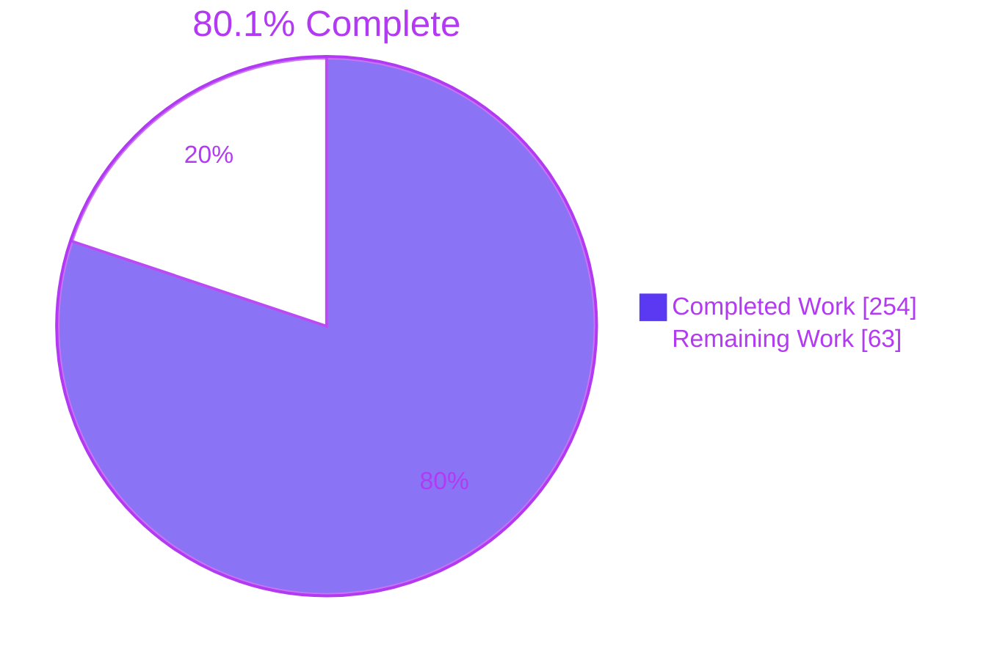
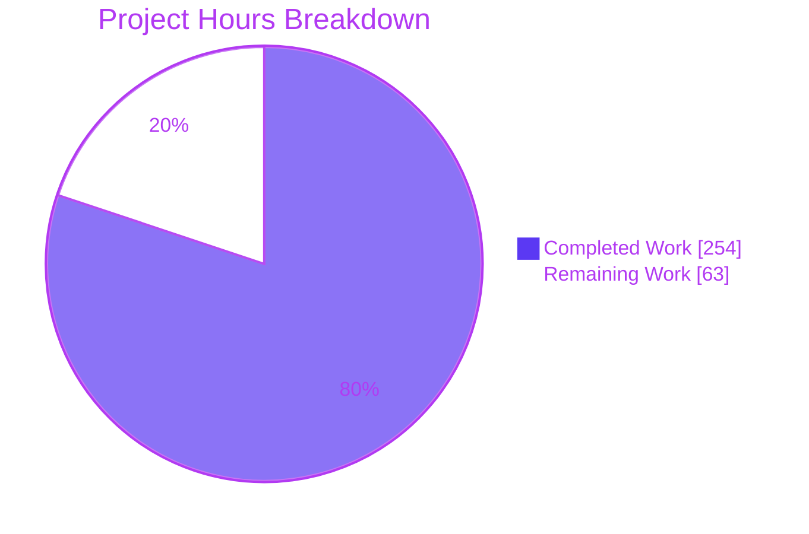
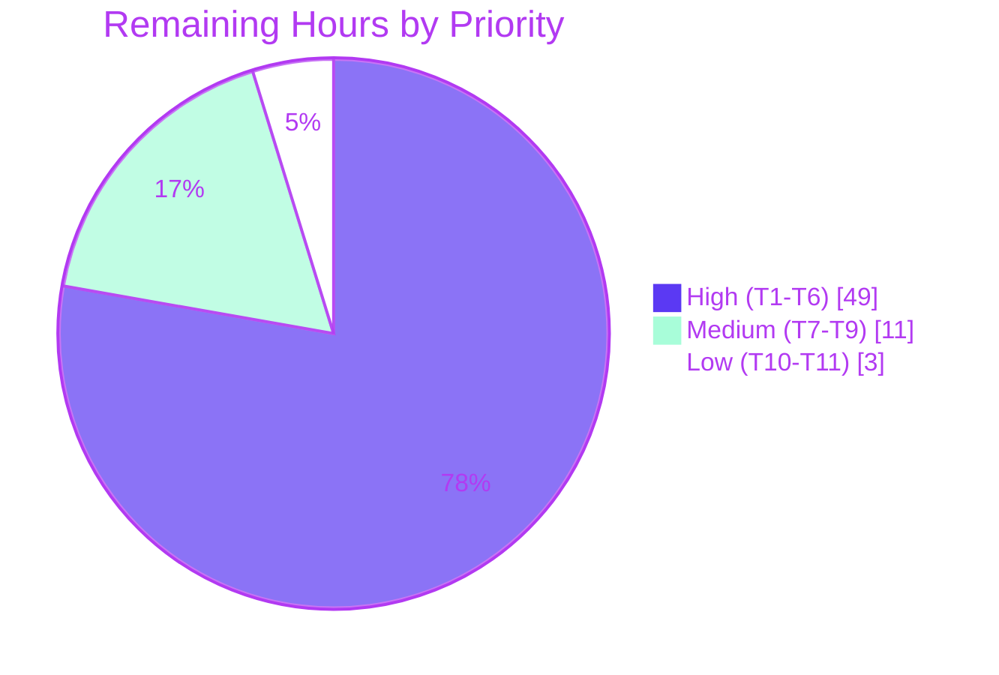

# 1. Executive Summary

## 1.1 Project Overview

This project amends the standard-library-only Rust crate `rust/ifcap-po-inquiry`. The crate ports the read-only VistA IFCAP purchase-order display (OPTION `PRCH DISPLAY PO`, routine `EN3^PRCHRPT`). The work makes the crate ready for case-by-case parity testing against the original on `worldvista/vehu`:

- A new `src/golden.rs` is the only reader of capture files.
- The loopback bridge gains replay, COMPARE with a boolean `match`, and `GET /api/status`.
- The screen gains a status line.
- A rewritten harness regenerates `REPORT.md`.
- Four operator documents cover recording and sign-off.

Users are VistA modernisation engineers and case reviewers.

## 1.2 Completion Status



| Metric | Value |
|---|---|
| Total Hours | 317 |
| Completed Hours (AI + Manual) | 254 (254 AI + 0 manual) |
| Remaining Hours | 63 |
| Percent Complete | 80.1% |

254 completed hours out of 317 total hours = **80.1% complete**. The remaining 63 hours are acceptance and sign-off work: captures, the four branches waiting on O-01, browser checks, live mode, and review of design decisions.

## 1.3 Key Accomplishments

- ✅ `src/golden.rs` is the only capture reader (audits S3, S4).
- ✅ Unimplemented branches end at the last prompt, and the guarded O-03 no-match loop is in place.
- ✅ RUST, MUMPS replay, COMPARE and `/api/status` give the AAP's exact texts on a running bridge.
- ✅ The screen shows the status line, `BRIDGE UNREACHABLE`, and a boolean `MATCH`/`MISMATCH`.
- ✅ The equivalence harness regenerates `REPORT.md` byte-identically.
- ✅ 179/179 tests pass; clippy, rustfmt, rustdoc and audits S1–S9 are clean.
- ✅ `SPEC.md` is reconciled: 108-row inventory, coverage 43/4/61, conflicts K1–K13.
- ✅ Four operator documents give the full procedure.

## 1.4 Critical Unresolved Issues

**4 of 16 AAP acceptance criteria remain open: B1, A6, B3 and B4.** The AAP assigns all four to the team. A1–A5, A7–A12 and B2 are met. No Section 5.2 divergence blocks release.

| Issue | Impact | Owner | ETA |
|---|---|---|---|
| B1 (1 of 4): five PASS. No capture exists, and `cases.zwr` is absent. O-07 (start command) and O-01 (HOME device) are unanswered, so PO-10.b4, PO-12.b1, PO-26.b1 and PO-30.b1 are not implemented | Parity is unproven, and `SPEC.md` records "Not accepted: no case has a capture." GC-01, GC-02 and GC-05 will FAIL until the O-01 branches exist | Team, then a developer | 49 h (T1–T6) |
| A6 (1 of 4): the 14-item checklist has not been done by hand in Firefox, nor its READY-state items in any browser | Cross-browser identity is unverified | Team | 6 h shared (T7) |
| B3 (1 of 4): no case has been run in the three modes | MATCH per passing case is unverified | Team | 6 h shared (T7) |
| B4 (1 of 4): screen identity and reactions have not been checked in Firefox | Firefox behaviour is unknown | Team | 6 h shared (T7) |

## 1.5 Access Issues

| System/Resource | Type of Access | Issue Description | Resolution Status | Owner |
|---|---|---|---|---|
| `worldvista/vehu:202609` container | Docker host with the VEHU image and a running container | Neither is available to the build host, so captures (B1) and live mode cannot be produced there | Open: team-owned | Team |
| Firefox (current release) | Browser install | Not installed on the validation host, so A6 and B4 cannot be checked there | Open | Team |
| VEHU capture start command (O-07) | Operational knowledge | The documented command needs an argument with spaces, which `meta.txt` `docker_exec_args` cannot express | Open: question for the team | Team |

## 1.6 Recommended Next Steps

1. [High] Settle O-07, record GC-01 to GC-05 (golden README Part B), and build `cases.zwr`.
2. [High] Answer O-01 from the GC-01 transcript, then implement the four O-01 branches.
3. [High] Run `cargo test --offline --locked` and correct each FAIL, with at most three attempts per case, until there are five PASS.
4. [Medium] Do the checklist and three modes in Chrome and Firefox, and run GC-01 live once.
5. [Medium] Sign off the five Section 5.2 decisions marked for review.

# 2. Project Hours Breakdown

## 2.1 Completed Work Detail

| Component | Hours | Description |
|---|---|---|
| Inquiry core (`src/inquiry.rs`, `src/mumps.rs`) | 30 | `InquiryError` keeps only `CorruptStore`, and `Halt` has the variants `InputExhausted`, `Unexercised` and `Corrupt`. A session ends at the last prompt through `into_transcript_at_prompt`. The O-03 guard (a)–(d) uses a prefix-seek index check, and the no-match sequence `<BEL> ??\n\nP.O./REQ.NO.: ` loops. `returned` is always `None`. Covered by 51 unit tests (AAP 0.3.2, 0.6.6) |
| Store contract (`src/store.rs`) | 12 | One `StoreError::Parse` variant. `load_fixtures` returns `io::Result<Store>`, merges at map level and has no mutator. Fixture files are opened read-only. 25 unit tests (AAP 0.3.2, A9) |
| Golden capture reader (`src/golden.rs`) | 40 | Capture conventions; `normalisation.txt` rules; `meta.txt` parsing and `docker_exec_args`; `validate_context`; the six readiness checks, `Readiness`, `CaseLoad`, `status`, `find_capture`, `live_start` and `default_dir`; bounded reads. 29 unit tests (AAP 0.3.2, A4) |
| Bridge server (`src/bridge.rs`) | 52 | `serve(listener, MumpsMode)`, replay rereading the folder per request, COMPARE through private `decide_match`, and `GET /api/status`. Exact static paths, the 400/404/502 texts, the live adapter through `golden`, unchanged limits, and the loopback request and response hardening. 53 unit tests (AAP 0.3.5.1) |
| Bridge binary and crate surface (`src/bin/bridge.rs`, `src/lib.rs`) | 8 | `GOLDEN_DIR` and `VEHU_CONTAINER` mode selection, the three startup lines, the stderr messages with their exit codes, the module and re-export surface, and `#![forbid(unsafe_code)]` at `src/lib.rs:9` (AAP 0.3.1, 0.3.5.1) |
| Comparison screen (`frontend/app.js`, `frontend/index.html`) | 12 | The `#bridge-status` line and `BRIDGE UNREACHABLE`, the boolean `MATCH`/`MISMATCH` verdict, and the input-handling behaviours. `style.css` is unchanged (AAP 0.3.5.2) |
| Bridge integration tests (`tests/bridge.rs`) | 20 | 19 tests that drive `serve` on `127.0.0.1:0` over temporary golden folders, plus an end-to-end pass over READY captures (AAP 0.7.3, A5) |
| Equivalence harness and report (`tests/equivalence.rs`, `REPORT.md`) | 16 | Five verdicts through `golden::load_case`. `REPORT.md` parts 1–3 are written with the nine included `SPEC.md` sections, and a second test checks the headings (AAP 0.7.2, A2, A8) |
| Specification reconciliation (`SPEC.md`) | 32 | A 108-row inventory with Tag and FileMan field columns, coverage 43/4/61, and the new and renamed sections. The record also holds the 14-item checklist, conflicts K1–K13, the read-only results, the capture hashes, the run evidence and the acceptance record (AAP 0.3.6, 0.6.3, A1) |
| Operator documents (`RUNNING.md`, `runPlaybook.md`, `testingMethods.md`, `tests/golden/ifcap/README.md`) | 24 | Seven-step run guide with a failure-message table, a 12-phase playbook (116 lines), and a 52-line, 600-word testing method. The rewritten capture conventions and procedure state their commands identically in every document (AAP 0.3.6, A10, A12) |
| Repository hygiene and verification evidence | 8 | 1,002 `test-results/` files and `MANIFEST.txt` removed. Records of A7 source-unchanged, S1–S9, the capture listing and the A12 runtime check. Cargo manifests are unchanged (AAP 0.2.2, 0.2.3, 0.7.4) |
| **Total** | **254** | |

## 2.2 Remaining Work Detail

| Category | Hours | Priority |
|---|---|---|
| T1 Record captures GC-01..GC-05 on VEHU (seven files per case, `meta.txt` context) [AAP B1] | 12 | High |
| T2 Settle the O-07 start command or the `docker_exec_args` convention (K3) [AAP 0.6.6] | 3 | High |
| T3 Answer O-01 (`IOF`, `IOSL`, `W @IOF` bytes) and set `STUB_CONTEXT` [AAP 0.6.6] | 3 | High |
| T4 Build `tests/fixtures/ifcap/cases.zwr` by README Part B step 6 [AAP 0.7.1] | 3 | High |
| T5 Implement PO-10.b4, PO-12.b1, PO-26.b1, PO-30.b1 with unit tests and `SPEC.md` updates [AAP 0.6.6] | 16 | High |
| T6 Equivalence correction cycle to five PASS; regenerate `REPORT.md` [AAP 0.7.2, B1, B2] | 12 | High |
| T7 By-hand screen checks in current Chrome and Firefox [AAP A6, B3, B4] | 6 | Medium |
| T8 Live mode: run GC-01 against VEHU and compare with replay [AAP 0.7.3] | 3 | Medium |
| T9 Review and sign off the delivery-time design decisions of Section 5.2 [Path-to-production] | 2 | Medium |
| T10 Decide how live runs handle processes `docker` leaves behind [Path-to-production] | 2 | Low |
| T11 Write the acceptance record (playbook phase 12) [AAP 0.7.4] | 1 | Low |
| **Total** | **63** | |

Confidence: T1–T4 and T7–T11 are medium confidence. T5 and T6 are low confidence. T5 may hit the cursor-addressing stop condition of AAP 0.6.1, and T6 depends on what the captures show.

## 2.3 Hours Calculation

- Completed hours = 30 + 12 + 40 + 52 + 8 + 12 + 20 + 16 + 32 + 24 + 8 = **254**
- Remaining hours = 12 + 3 + 3 + 3 + 16 + 12 + 6 + 3 + 2 + 2 + 1 = **63**
- Total project hours = 254 + 63 = **317**
- Completion = 254 / 317 × 100 = **80.1%**

# 3. Test Results

All results below come from `cargo test --offline --locked` and the gate commands, run from `rust/ifcap-po-inquiry` at commit `8a8ab239c` on Rust 1.99.1. The run exited 0 with **179 passed, 0 failed, 0 ignored**. `Cargo.lock`, `SPEC.md` and `REPORT.md` were byte-identical after the run. No coverage tool is installed, and the AAP requires none.

| Area / Category | Framework | Tests | Passed | Failed | Coverage | What This Proves |
|---|---|---|---|---|---|---|
| Inquiry core: `src/inquiry.rs` (36), `src/mumps.rs` (15) | Rust libtest (unit) | 51 | 51 | 0 | Not measured | Unimplemented branches end at the last prompt. The O-03 guard admits and refuses as specified. M collation, `$PIECE`, `$JUSTIFY` and the prompt cut follow the source reading |
| Store: `src/store.rs` | Rust libtest (unit) | 25 | 25 | 0 | Not measured | ZWR loading reports the malformed line number, loads `cases.zwr` last, admits only regular files, and never mutates |
| Golden reader: `src/golden.rs` | Rust libtest (unit) | 29 | 29 | 0 | Not measured | Normalisation, `meta.txt` and context checks, each of the six readiness checks, and bounded reads classify captures correctly |
| Bridge internals: `src/bridge.rs` | Rust libtest (unit) | 53 | 53 | 0 | Not measured | JSON escapes, surrogates and depth 64; the status JSON; the four `decide_match` cases; Host, Origin and Content-Type gates; the CSP hashes; accept backoff; the live-runner slot, timeout and output limits |
| Bridge HTTP contract: `tests/bridge.rs` | Rust libtest (integration) | 19 | 19 | 0 | Not measured | Over a real socket: `rust` gives 200; `mumps` gives 200 or 502; COMPARE `match` is true or false (differing, INCOMPLETE, `DUZ` 1, rule-covered); 400/404 texts; status READY, INCOMPLETE and empty; exact static paths; cross-origin refusal |
| Equivalence harness: `tests/equivalence.rs` | Rust libtest (integration) | 2 | 2 | 0 | Not measured | The five verdicts are computed and written to `REPORT.md` (GC-01..GC-05 NOT COMPARED), and every included `SPEC.md` section exists |
| Static gates: clippy `--all-targets`, `cargo fmt --check`, `cargo doc -D warnings`, audits S1–S9 | cargo, grep | 12 checks | 12 | 0 | N/A | No `unsafe`, `unwrap`, `expect` or `panic!` in `src/`. Capture-file names appear only in `src/golden.rs`. No file writes outside `#[cfg(test)]`, and no write control in `frontend/` |

**Not Covered.** Nothing below is exercised by any test. A human should check each item before release.

- **Parity with the original.** No capture exists, so every equivalence verdict is NOT COMPARED, and `end_to_end_real_captures` passes without comparing anything. Once captures exist, record them and confirm five PASS (T1–T6).
- **The four branches waiting on O-01** (PO-10.b4, PO-12.b1, PO-26.b1, PO-30.b1). They are not implemented, so nothing tests them.
- **Live mode against a real VEHU container.** This covers `docker exec -i`, the `EXIT <code>` and `TIMEOUT` answers from a real Docker, the `STANDARD STREAMS NOT CREATED` mapping, and processes `docker` leaves running after the 10 s kill. Run GC-01 live once (T8).
- **The O-03 guard's index check (c) over HTTP.** It needs `cases.zwr`, so only unit and differential tests cover it. Re-check it through the bridge after T4.
- **Accept-loop recovery from `ENFILE`, `ENOBUFS` and `ENOMEM`.** Unit tests cover it, but it has never been triggered on a live socket.
- **The `O_NONBLOCK` constants for Apple and BSD targets** (`src/store.rs`, `src/golden.rs`). They have never been compiled or run on those platforms.
- **`golden::tests::unsearchable_golden_folder_is_unreadable_not_absent`.** It prints `NOT RUN` when tests run as root. Run the suite once as an unprivileged user.
- **The screen in Firefox,** the status line and K13 idle-screen check with READY captures in any browser, and checklist item 14 with the bridge actually stopped (T7).

# 4. Runtime Validation & UI Verification

The debug bridge was started from a clean checkout with no captures, in replay mode, and driven with curl. The screen was driven in headless Chrome.

- ✅ **Startup.** `cargo run --offline --locked --bin bridge` prints `http://127.0.0.1:8080/`, `MUMPS MODE: REPLAY` and `RECORDED 0 OF 5 READY 0 OF 5`. With `GOLDEN_DIR` set to a missing folder, it adds `bridge: golden directory missing: <path>` on stderr and keeps serving.
- ✅ **Single instance.** A second bridge exits 1 with `bridge: port 8080 on 127.0.0.1 is already in use`.
- ✅ **Static files and headers.** `/` and `/index.html` return 200 (2249 B), `/app.js` 200 (15877 B) and `/style.css` 200 (8520 B). `/nope` returns 404. Every answer carries `nosniff`, `no-store`, `X-Frame-Options: DENY`, the `default-src 'none'` CSP and `Referrer-Policy: no-referrer`.
- ✅ **Status endpoint.** `GET /api/status` returns 200 `{"mumps_mode":"replay","recorded":[],"ready":[],"incomplete":{}}`. HEAD and POST return 404.
- ✅ **RUST session.** `{"inputs":[]}`, `[""]` and `["^"]` each return 200, with the transcript ending at `Select STATION NUMBER ('^' TO EXIT): 500// ` and `returned` null.
- ✅ **MUMPS replay and COMPARE with zero captures.** MUMPS returns 502 `NOT RECORDED`, and COMPARE returns 502 `MUMPS: NOT RECORDED`.
- ✅ **Request validation.** Malformed JSON, a non-object body, a foreign `Host`, a foreign `Origin` and `text/plain` each return their `BAD REQUEST: …` 400. An unknown backend or a wrong method returns its 404 text. A curl POST without `Origin` is accepted.
- ✅ **Screen in Chrome.** It shows the title `PURCHASE ORDER DISPLAY`, `#bridge-status` reading `MUMPS BACKEND: REPLAY RECORDED 0 OF 5 READY 0 OF 5`, the MUMPS/RUST/COMPARE selector, INPUT, SEND, EXIT and the 80×24 transcript. COMPARE over a synthetic READY capture showed `MATCH`. The layout shift on status load is 0.
- ⚠ **Screen coverage is partial.** Firefox, real captures in all three modes (B3), and the READY form of the K13 idle-screen check were never exercised.
- ⚠ **Live mode was never run** against a VEHU container. It is delivered unverified, as the AAP states, pending O-07. Replay is the delivered MUMPS backend.

# 5. Compliance & Quality Review

## 5.1 Compliance Matrix

| Deliverable (AAP criterion) | Benchmark | Status | Evidence |
|---|---|---|---|
| Branch inventory and coverage (A1) | 108 rows, each with routine, tag, line, FileMan field and one coverage label | ✅ Pass | `SPEC.md` "Branch inventory": 108 rows, coverage 43 / 4 / 61 |
| Equivalence harness and verdict rule (A2, B2) | `cargo test` exits 0, and a case without a capture shows NOT COMPARED | ✅ Pass | `tests/equivalence.rs` passes 2 of 2. `REPORT.md` part 2 shows five NOT COMPARED |
| Rust safety and capture isolation (A3, A4) | S1 has only `src/lib.rs:9`, S2 hits are reviewed, S3 returns nothing, and S4 hits only `src/golden.rs` | ✅ Pass | S1: 1 hit. S2: 1 hit, a comment at `src/inquiry.rs:745`. S3: exit 1. S4: 82 hits, all in `src/golden.rs` |
| Bridge contract (A5) | `cargo test --test bridge` exits 0 | ✅ Pass | `tests/bridge.rs` passes 19 of 19 |
| Front-end checklist by hand (A6) | All 14 items in current Chrome and Firefox | ⚠ Partial (50%) | Chrome is exercised. Firefox and the READY-state items are open (T7) |
| Source and captures unchanged (A7, A11) | `git diff --quiet` exits 0, and the capture listing is the same before and after | ✅ Pass | Both exit 0. The listing is the single `ABSENT tests/fixtures/ifcap/cases.zwr` line |
| Generated report (A8) | Three parts plus the nine included `SPEC.md` sections | ✅ Pass | `REPORT.md` (661 lines), regenerated byte-identical |
| Read-only enforcement (A9) | S5–S9 are recorded in `SPEC.md` | ✅ Pass | S5 and S9 return nothing. S6 finds one production `Command::new`. S7 hits only under `#[cfg(test)]`. S8 finds no control |
| Document limits and runtime check (A10, A12) | `testingMethods.md` at most 60 lines and 600 words; `runPlaybook.md` at most 150 lines, in 12 phases; a bridge runtime check | ✅ Pass | `testingMethods.md` has 52 lines and 600 words. `runPlaybook.md` has 116 lines and 12 phases. The bridge started, its status answered, and a second instance exited 1 |
| Build and lint quality | No warnings, and fmt, clippy and rustdoc clean | ✅ Pass | `cargo build` 0 warnings. `clippy --all-targets` 0. `fmt --check` 0. `cargo doc -D warnings` 0 |
| Parity acceptance (B1) | Five PASS in `REPORT.md` part 2 | ❌ Not met (0 / 5) | No captures exist (T1–T6) |
| Screen with captures in two browsers (B3, B4) | Each case in three modes, and identity in Chrome and Firefox | ❌ Not started | Team-owned (T7) |

## 5.2 AAP & Rule Divergences and Gaps

The AAP sets no user rules (AAP 0.8). Each row below departs from the AAP's own wording. None blocks release.

| What the AAP/Rule Required | What Was Delivered Instead | Why It Diverged | Impact | Remediation |
|---|---|---|---|---|
| 1. The capture-availability record uses `ls -la tests/golden/ifcap/ tests/fixtures/ifcap/` (0.7.1) | `ls -la --time-style=+ …`, recorded with its literal output (`SPEC.md:1587`) | Git sets modification times at checkout, so plain `ls -la` output never matches in another checkout. 0.7.4 requires recorded output to match a fresh run | None. Names, modes and sizes are still recorded | None needed |
| 2. Capture files are read with `std::fs::read` (0.3.3) | `open_read_only` plus `Read::take`, with budgets of 1 MiB for input and transcript, 64 KiB for returned, meta and normalisation, and 64 MiB per export (`src/golden.rs:550-563`) | An unbounded read lets one oversized capture exhaust memory | A capture over budget is reported as unreadable | Confirm the budgets fit real captures (T9) |
| 3. An unreadable capture gives 502 `NOT RECORDED (unreadable: <path>)` (0.3.5.1) | `NOT RECORDED (unreadable: <path>: <cause>)` | It gives operators the operating-system reason | The body text is longer than specified | None needed. `RUNNING.md` documents it |
| 4. Request parsing stays unchanged, and the only 400s are for body shape (0.3.5.1) | 400 `HOST NOT ALLOWED`, `ORIGIN NOT ALLOWED` and `CONTENT-TYPE APPLICATION/JSON REQUIRED`, checked before any session runs (`src/bridge.rs:584-843`) | An unauthenticated loopback server is open to DNS rebinding and to cross-site POSTs that can start `docker` | Only loopback-addressed, same-origin JSON clients are served. curl without `Origin` still works | Sign off (T9) |
| 5. "The hardening headers stay" (0.3.5.1) | A CSP of `default-src 'none'` with three `style-src-attr` hashes, plus `Referrer-Policy: no-referrer` (`src/bridge.rs:1122-1133`) | Security hardening. Hashes are stricter than `'unsafe-inline'` | Any new inline style must update the hashes, which `inline_styles_of_index_html_are_the_hashed_ones` enforces | None needed |
| 6. `index.html` gains one `<div id="bridge-status">` (0.3.5.2) | A grid wrapper whose hidden copy reserves the line's height, using inline styles (`frontend/index.html:15-17`) | It prevents layout shift when the status text arrives, while `style.css` stays unchanged as required | Layout shift is 0 | None needed |
| 7. Four startup messages (0.3.5.1 table) | Also `bridge: golden directory unreadable: <path>: <error>` and `bridge: serving failed: <error>`, and `cannot load fixtures` names its stage (`src/bin/bridge.rs:22-30, 91`) | It tells a missing golden folder from an unreadable one, and reports failures after the fixtures load | Diagnostics are more precise | None needed. `RUNNING.md` lists them |
| 8. A live run has a 10 s timeout with kill (0.3.5.1) | Only the `docker` child is killed (`src/bridge.rs:2531`). Processes `docker` started can outlive the run, and a run ends `TIMEOUT` while one of them holds the pipes | Killing a process group needs an unstable std API on 1.99.1, or `unsafe`/FFI, which `#![forbid(unsafe_code)]` rules out | Affects live mode only, which is unverified | Decide on a wrapper, or accept (T10) |
| 9. A non-empty `VEHU_CONTAINER` selects live mode (0.3.5.1) | A non-UTF-8 value is converted lossily and still selects live mode (`src/bin/bridge.rs:61`) | The AAP sets no rule for non-UTF-8 values, so the value is not rejected | Negligible | None needed |
| 10. `is_recorded` is true when the capture's input and transcript exist (0.3.2) | A case folder whose metadata cannot be read also counts as recorded (`src/golden.rs:1226-1232`). An unreadable golden folder therefore shows `RECORDED 5 OF 5 READY 0 OF 5` | Such a case ends FAIL (`CaseLoad::Unreadable`), so the count follows the verdict | The startup count can surprise an operator | Sign off (T9) |
| 11. Limits unchanged (0.3.5.1) | Accepting a connection backs off from 10 ms to 1 s on `EMFILE`, `ENFILE`, `ENOBUFS` and `ENOMEM` (`src/bridge.rs:90`) | Without it, descriptor or memory exhaustion ends the accept loop | The bridge keeps serving under pressure | None needed |
| 12. Limits unchanged (0.3.5.1) | A session-body input budget, with `FREE_INPUTS` 1024 and `MAX_HELD_INPUTS = MAX_BODY / 2` and admission that is not FIFO (`src/bridge.rs:102-113`) | Without it, 64 concurrent 1 MiB bodies can reach about 960 MB of peak memory | Peak memory is about 119 MB | None needed |
| 13. The AAP is silent on file types | Capture and fixture files are opened `O_NONBLOCK`, and their type is checked on the open descriptor. A non-regular `*.zwr` fails startup (`load_fixtures_rejects_non_regular_zwr_entry`) | It closes a check-then-open race, and a FIFO cannot hang startup | Startup fails fast on a bad fixture entry | None needed |
| 14. Minimal change and no extra abstractions (0.9.3); S3 forbids `golden` in `store.rs` | `admit`, `open_read_only` and `O_NONBLOCK` are duplicated in `src/store.rs:416-449` and `src/golden.rs:851-883` | The module boundaries forbid sharing through `golden`, and the AAP plans no shared module | Two copies must be kept in step | Optionally consolidate (T9) |
| 15. S6 expects `Command::new(program)` in `run_command` (0.7.4) | It is in `execute` (`src/bridge.rs:2245`), which `run_command` calls | `execute` owns the child's pipes and its kill | None. `SPEC.md` records the actual location | None needed |
| 16. SEND, and EXIT appending `^`, are "kept as they are" (0.3.5.2) | Focus returns to INPUT after SEND and EXIT, EXIT also clears INPUT, and a double-click sends one answer (`frontend/app.js:359-384`) | Usability hardening | The screen behaves more predictably | Check by hand (T7) |
| 17. `#match-status` is empty before a compare and after an error (0.3.5.2) | It is also empty while a compare is in flight | A stale verdict never shows beside a new request | None | None needed |
| 18. Checklist item 14 checks `BRIDGE UNREACHABLE` "with the bridge stopped" (0.3.5.2) | The check blocks `/api/status` in the browser's developer tools (`SPEC.md:1417`) | A page reloaded with the bridge stopped cannot load `app.js` at all | The same message, reached another way | Run as written (T7) |
| 19. Conflict register K1–K12 (0.9.4) | K13 is added: the resend on every selector change versus idle-screen identity, checked in two forms (`SPEC.md:1357, 1382`) | With zero captures, MUMPS and RUST idle screens cannot be identical after a resend | The checklist has a two-form item | Do the READY form by hand (T7) |
| 20. A1: `grep -c '^\| PO-' SPEC.md` counts the inventory rows (0.7.4) | The command returns 160: 108 inventory rows, 41 Mapping-table rows and 11 Data-reads rows (`SPEC.md:1800`) | Earlier tables share the `\| PO-` row prefix | Reviewers must count only the "Branch inventory" section | None needed |

**Divergences needing a human decision**

**2: Bounded capture reads.** `src/golden.rs:550-563` caps every file the harness and the bridge read. `input.txt` and `transcript.txt` are capped at 1 MiB. `returned.txt`, `meta.txt` and `normalisation.txt` are capped at 64 KiB. Each `db-before.zwr` and `db-after.zwr` export is capped at 64 MiB and read in 64 KiB pieces. This keeps peak memory near 20 MB, but a real export over 64 MiB would make its case FAIL as unreadable. When you record T1, check the size of each VEHU export. If any is larger, raise `EXPORT_LIMIT` and rerun `cargo test`.

**4: Loopback request gates.** The AAP kept request parsing unchanged. The bridge refuses any request whose `Host` is not `127.0.0.1`, `localhost` or `[::1]`. It also refuses a session POST that carries a foreign `Origin` or a non-JSON `Content-Type`. This closes DNS-rebinding and cross-site routes to `docker exec` in live mode. `foreign_host_and_cross_origin_post_400` (`tests/bridge.rs:1401`) and `session_post_needs_own_origin_and_json` (`src/bridge.rs:5089`) pin the behaviour, and `RUNNING.md` documents the texts. Decide whether to accept it, or name any client that needs another `Host`.

**8: Live timeout kill scope.** On timeout, `src/bridge.rs` kills only the `docker` process it started. A process inside the container, or the child of a wrapper installed as `docker`, keeps running. Such a process can also hold the output pipe open until the 10 s `TIMEOUT`. Stable Rust 1.99.1 cannot kill a process group without `unsafe`, which the crate forbids. Decide whether the O-07 start command should wrap the session in a container-side `timeout`, or accept this behaviour for a team-only tool.

**10: Status counting of uninspectable folders.** `golden::is_recorded` counts a case folder it cannot inspect as recorded, because `load_case` reports that folder `Unreadable`, which is FAIL. If the whole golden folder is unreadable, startup prints `RECORDED 5 OF 5 READY 0 OF 5` and `cargo test` fails. This keeps the status consistent with the verdict, but it can mislead an operator. Confirm these semantics, or ask for a separate UNREADABLE count in `/api/status`.

**14: Duplicated file-admission helpers.** `admit`, `open_read_only` and the platform `O_NONBLOCK` constant exist in both `src/store.rs:416-449` and `src/golden.rs:851-883`. AAP audit S3 forbids `store.rs` from naming `golden`, and the AAP plans no shared module. Each module tests its own copy with `admit_keeps_only_what_is_a_regular_file_once_opened` (`src/store.rs:1078`, `src/golden.rs:2557`). Decide whether to accept a small private shared module, which amends the AAP layout, or keep the two copies in step by review.

# 6. Risk Assessment

| Risk | Category | Severity | Probability | Mitigation | Status |
|---|---|---|---|---|---|
| Parity with the original is unproven until captures exist. Unit and contract tests check only the source reading | Technical | High | High: certain until B1 | Record GC-01..GC-05 and run the correction cycle (T1, T4, T6) | Open |
| O-01's answer may show cursor addressing, which triggers the AAP 0.6.1 stop condition. GC-01, GC-02 and GC-05 FAIL until PO-10.b4, PO-12.b1, PO-26.b1 and PO-30.b1 exist | Technical | High | Medium | Answer O-01 from the GC-01 transcript before implementing (T3, T5) | Open |
| Live mode is unverified. The documented start command cannot be expressed (O-07), and processes `docker` starts survive the 10 s kill | Integration | Medium | High | Settle O-07, run GC-01 live once, and decide on a container-side timeout (T2, T8, T10) | Open. Replay is the delivered backend |
| Read budgets (64 MiB per export, 1 MiB per transcript) may reject a real VEHU capture as unreadable | Integration | Medium | Low | Check capture sizes when recording, and raise `EXPORT_LIMIT` if needed (T1, T9) | Open |
| Firefox rendering and behaviour have never been exercised, so screen identity across browsers is unknown | Integration | Medium | Medium | Run the 14-item checklist in current Firefox (T7) | Open |
| The bridge is unauthenticated. Any local process can call it, and in live mode a session runs `docker exec` | Security | Medium | Low | Binds only `127.0.0.1:8080`. `Host` allowlist, same-`Origin` and JSON-only session POSTs, a strict CSP, and no shell or request-supplied M code | Mitigated |
| After large request bodies glibc keeps about 92–108 MB of resident memory, and startup briefly holds about 16 descriptors | Operational | Low | Medium | Bounded by the input budget. Run the bridge with `ulimit -n` ≥ 64. Restart it if memory matters | Accepted |
| Recovery from `ENFILE`, `ENOBUFS` and `ENOMEM`, the Apple/BSD `O_NONBLOCK` values, and the `STANDARD STREAMS NOT CREATED` mapping are only unit-tested or not exercised | Operational | Low | Low | Build and run the suite on any non-Linux host before using it there | Open |

# 7. Visual Project Status



**Remaining hours by priority (63 h total)**



| Remaining category (Section 2.2) | Hours |
|---|---|
| Captures, `cases.zwr` and open items O-01/O-07 (T1–T4) | 21 |
| O-01 branches (T5) | 16 |
| Correction cycle to five PASS (T6) | 12 |
| Browser checks, live run, sign-off and acceptance record (T7–T11) | 14 |
| **Total** | **63** |

# 8. Summary & Recommendations

The crate `rust/ifcap-po-inquiry` now contains everything the AAP asked this delivery to build:

- `src/golden.rs` is the only capture reader.
- The inquiry core ends unimplemented branches at the last prompt and loops the O-03 no-match sequence.
- The bridge serves replay, COMPARE with a boolean `match`, and `GET /api/status`, and the screen shows the status line.
- The equivalence harness regenerates `REPORT.md`, and the specification and four operator documents are reconciled.

The project is **80.1% complete**: 254 of 317 hours. The remaining 63 hours are acceptance and sign-off work, most of which the AAP assigns to the team.

The verification evidence is strong for everything that can run without the original system. 179 of 179 tests pass, and build, clippy, rustfmt and rustdoc report no warnings. The S1–S9 audits and the A7 source-unchanged check match the AAP. A running bridge answered every documented status, error text and refusal exactly. Parity is the gap. No capture exists, so all five cases are NOT COMPARED, and `SPEC.md` records "Not accepted: no case has a capture." Live mode, Firefox and the four O-01 branches have never been exercised.

The critical path to production:

1. Settle O-07 and record GC-01 to GC-05 on VEHU.
2. Build `cases.zwr`.
3. Answer O-01 from the GC-01 transcript, and implement PO-10.b4, PO-12.b1, PO-26.b1 and PO-30.b1.
4. Run the correction cycle until `REPORT.md` part 2 shows five PASS.
5. Finish the by-hand Chrome and Firefox checks and one live GC-01 run, then write the acceptance record.

Steps 1–4 hold 49 of the 63 remaining hours and carry the most estimation risk. If O-01 shows cursor addressing, the AAP's stop condition applies.

| Success metric | Target | Current |
|---|---|---|
| `REPORT.md` part 2 verdicts | 5 PASS | 0 PASS, 5 NOT COMPARED |
| Crate tests | All pass | 179 / 179 |
| Branches exercised and implemented | 47 (43 + 4 pending O-01) | 43 |
| Acceptance criteria met | 16 / 16 | 12 / 16 |

**Production readiness:** the crate is ready for capture-based acceptance, but it is not yet accepted. Replay mode is read-only and bound to loopback, so it is safe to run locally today. Before anyone relies on the port's output, the team should review the 20 divergences in Section 5.2. None blocks release, but five need a decision.

# 9. Development Guide

## 9.1 System Prerequisites

- **OS:** Linux x86_64. The suite was verified on Ubuntu 25.10. The crate also targets other Unix systems, but they are untested (Section 6).
- **Rust 1.99.1** with `rustfmt` and `clippy`. `rust-toolchain.toml` pins `channel = "1.99.1"`, and `Cargo.toml` sets `rust-version = "1.99.1"` and edition 2024.
- **A C linker (`cc`)**, for example gcc. Rust uses it to link the binary and the tests.
- **No crates.io access.** `[dependencies]` is empty, so the crate builds offline against the committed `Cargo.lock`.
- **Docker**, only for recording captures and for live mode. **Current Chrome or Firefox**, only for the screen.
- **Hardware:** any developer machine. A full build and test run takes about 15 s.

## 9.2 Environment Setup

Every command runs from the crate directory:

```bash
cd rust/ifcap-po-inquiry
export RUSTUP_AUTO_INSTALL=0   # a missing pinned toolchain fails instead of downloading
rustc --version                # expect: rustc 1.99.1 (...)
cargo --version                # expect: cargo 1.99.1 (...)
```

If the toolchain is missing, install it once with `rustup toolchain install 1.99.1 --component rustfmt clippy`. There is no virtual environment or package install step, and no `.env` file.

## 9.3 Build and Test

```bash
cargo build --offline --locked                       # exit 0, no warnings
cargo test --offline --locked                        # 179 passed: lib 158, tests/bridge 19, tests/equivalence 2
cargo test --offline --locked --lib                  # 158 unit tests
cargo test --offline --locked --test bridge -- --test-threads=1
cargo test --offline --locked --test equivalence -- --nocapture --test-threads=1
cargo clippy --offline --locked --all-targets        # exit 0, no warnings
cargo fmt --check                                    # exit 0
RUSTDOCFLAGS='-D warnings' cargo doc --offline --locked --no-deps --document-private-items
```

The equivalence run with `--nocapture` prints one line per case, `GC-01 NOT COMPARED` through `GC-05 NOT COMPARED`. Every `cargo test` rewrites `REPORT.md`, so commit `REPORT.md` only as produced by the last `cargo test` after the final `SPEC.md` edit. Never run `cargo update`, because `Cargo.lock` must stay unchanged.

## 9.4 Run the Bridge and Screen

```bash
cargo run --offline --locked --bin bridge
```

Expected standard output:

```text
http://127.0.0.1:8080/
MUMPS MODE: REPLAY
RECORDED 0 OF 5 READY 0 OF 5
```

- The bridge always binds `127.0.0.1:8080`, and there is no port option. On a shared host where port 8080 is taken, build first, then run the bridge and the client together in one private network namespace:

  ```bash
  cargo build --offline --locked
  sudo unshare -n sh -c 'ip link set lo up; ./target/debug/bridge & sleep 1; curl -s http://127.0.0.1:8080/api/status; kill $!'
  ```

- Open `http://127.0.0.1:8080/` in Chrome or Firefox. `file://` is not supported. The screen shows `PURCHASE ORDER DISPLAY`, the status line, the MUMPS/RUST/COMPARE selector, INPUT, SEND, EXIT and the 80×24 transcript.
- To serve another golden folder, run `GOLDEN_DIR=<folder> cargo run --offline --locked --bin bridge`.
- To run live mode, which is unverified (O-07), run `VEHU_CONTAINER=<container> cargo run --offline --locked --bin bridge`.
- Stop the bridge with Ctrl-C.

## 9.5 Verification and Example Usage

Run these while the bridge is serving:

```bash
curl -s http://127.0.0.1:8080/api/status
# {"mumps_mode":"replay","recorded":[],"ready":[],"incomplete":{}}

curl -s -X POST -H 'Content-Type: application/json' -d '{"inputs":[""]}' http://127.0.0.1:8080/api/rust/session
# {"transcript":"\n\n\nSelect STATION NUMBER ('^' TO EXIT): 500// ","returned":null}

curl -s -X POST -H 'Content-Type: application/json' -d '{"inputs":["^"]}' http://127.0.0.1:8080/api/mumps/session
# {"error":"NOT RECORDED"}     (HTTP 502 until captures exist)

curl -s -X POST -H 'Content-Type: application/json' -d '{"inputs":["^"]}' http://127.0.0.1:8080/api/compare/session
# {"error":"MUMPS: NOT RECORDED"}   (HTTP 502)

cargo run --offline --locked --bin bridge; echo "exit=$?"   # a second instance
# bridge: port 8080 on 127.0.0.1 is already in use
# exit=1
```

To load captures, follow `tests/golden/ifcap/README.md` Part B. Copy `GC-01`…`GC-05`, each with its seven files, into `tests/golden/ifcap/`, build `tests/fixtures/ifcap/cases.zwr` by step 6, run `cargo test --offline --locked`, then restart the bridge.

## 9.6 Troubleshooting

| Symptom | Cause | Resolution |
|---|---|---|
| `error: toolchain '1.99.1…' is not installed` | Pinned toolchain missing, with `RUSTUP_AUTO_INSTALL=0` set | `rustup toolchain install 1.99.1 --component rustfmt clippy` |
| `linker 'cc' not found` | No C toolchain | Install gcc (`apt-get install -y gcc`) |
| `bridge: port 8080 on 127.0.0.1 is already in use` (exit 1) | Another bridge, or another process, holds the port | Stop it, or run in a private network namespace (9.4) |
| `bridge: golden directory missing: <path>` | `GOLDEN_DIR` is wrong, or the folder is absent | Correct the path. The bridge keeps serving with `RECORDED 0 OF 5` |
| `bridge: cannot load fixtures: <path>: …` (exit 1) | An unreadable or non-regular file, or a malformed ZWR line, under `tests/fixtures/ifcap/` | Restore the fixture with `git checkout -- tests/fixtures/ifcap`, or rebuild `cases.zwr` |
| Status line shows `BRIDGE UNREACHABLE` | Page not served by a running bridge | Start the bridge, open `http://127.0.0.1:8080/` and reload |
| Status line counts are stale | It is fetched once, on page load | Reload the page after adding captures or restarting the bridge |
| `CONTEXT MISMATCH DUZ: expected .5, actual 1` | The case's `meta.txt` context differs from `STUB_CONTEXT` | Re-record with the documented context. Never edit a capture |
| `400 BAD REQUEST: HOST NOT ALLOWED` / `ORIGIN NOT ALLOWED` | Request addressed to a non-loopback host, or sent from another origin | Use `127.0.0.1`, `localhost` or `[::1]`, and send session POSTs from the bridge's own page or without `Origin` |
| `cargo test` exits non-zero after adding captures | A recorded case is FAIL. `REPORT.md` part 2 names the cause | Fix the cited branch in `src/inquiry.rs`, with at most three attempts per case (AAP 0.7.2) |

# 10. Appendices

## A. Command Reference

| Purpose | Command (from `rust/ifcap-po-inquiry`) |
|---|---|
| Build | `cargo build --offline --locked` |
| All tests and `REPORT.md` regeneration | `cargo test --offline --locked` |
| Verdict lines | `cargo test --offline --locked --test equivalence -- --nocapture --test-threads=1` |
| Lint and format | `cargo clippy --offline --locked --all-targets` and `cargo fmt --check` |
| Docs gate | `RUSTDOCFLAGS='-D warnings' cargo doc --offline --locked --no-deps --document-private-items` |
| Run the bridge | `cargo run --offline --locked --bin bridge` |
| Bridge in a private namespace | `sudo unshare -n sh -c 'ip link set lo up; ./target/debug/bridge & sleep 1; curl -s http://127.0.0.1:8080/api/status; kill $!'` |
| Source unchanged (A7, repository root) | `git diff --quiet HEAD -- Packages Packages.csv README.rst LICENSE NOTICE ATTESTATION` |
| Capture listing (A11) | `find tests/golden/ifcap -type f ! -name README.md -exec sha256sum {} +` and `[ -f tests/fixtures/ifcap/cases.zwr ] && sha256sum tests/fixtures/ifcap/cases.zwr \|\| echo "ABSENT tests/fixtures/ifcap/cases.zwr"` |
| Audits S1–S9 | As listed in AAP 0.7.4. Results are recorded in `SPEC.md` "Read-only enforcement results" |

## B. Port Reference

| Port | Bound by | Notes |
|---|---|---|
| `127.0.0.1:8080` | `src/bin/bridge.rs` | Fixed constant. Loopback only. No TLS or authentication, by design |
| `127.0.0.1:0` (ephemeral) | `tests/bridge.rs`, `src/bridge.rs` tests | Each test picks a free port. No allocation needed |

## C. Key File Locations

| Path | Purpose |
|---|---|
| `src/inquiry.rs` | `inquire`, `STUB_CONTEXT`, session halts, O-03 guard |
| `src/mumps.rs` | Private M primitives: collation, `$PIECE`, `$JUSTIFY`, prompt cut |
| `src/store.rs` | Immutable ZWR `Store`, `load_fixtures`, `StoreError::Parse` |
| `src/golden.rs` | The only capture reader: conventions, readiness, normalisation, `find_capture` |
| `src/bridge.rs` | `serve`, `MumpsMode`, endpoints, `decide_match`, live adapter, hardening |
| `src/bin/bridge.rs` | Startup, environment variables, stderr messages |
| `frontend/index.html`, `app.js`, `style.css` | Comparison screen |
| `tests/bridge.rs`, `tests/equivalence.rs` | HTTP contract tests, verdict harness and `REPORT.md` writer |
| `tests/fixtures/ifcap/*.zwr` | 11 read-only fixtures. `cases.zwr` is added by the team |
| `tests/golden/ifcap/README.md` | Capture conventions and the recording procedure (Part B) |
| `SPEC.md`, `REPORT.md` | Specification and the generated parity report |
| `RUNNING.md`, `runPlaybook.md`, `testingMethods.md` | Run guide, 12-phase playbook, one-page testing method |

## D. Technology Versions

| Technology | Version |
|---|---|
| Rust (`rustc`, `cargo`) | 1.99.1, edition 2024 |
| rustfmt / clippy | 1.10.0 / 0.1.99 |
| Crate dependencies | None (standard library only) |
| Linker | gcc 15.2 (`cc`) |
| Original system | `worldvista/vehu:202609` (YottaDB, VistA IFCAP) |
| Browsers | Current Chrome (verified), current Firefox (not verified) |

## E. Environment Variable Reference

| Variable | Used by | Default | Effect |
|---|---|---|---|
| `GOLDEN_DIR` | `src/bin/bridge.rs` | `golden::default_dir()` = `tests/golden/ifcap` | Golden folder the bridge reads. Tests always use the default |
| `VEHU_CONTAINER` | `src/bin/bridge.rs` | unset | A non-empty value selects live mode against that container |
| `RUSTUP_AUTO_INSTALL` | rustup | unset | Set it to `0` so a missing toolchain fails instead of downloading |
| `RUSTDOCFLAGS` | cargo doc | unset | `-D warnings` for the docs gate |

## F. Developer Tools Guide

- **Reading verdicts:** after `cargo test`, `REPORT.md` part 2 gives each case's verdict and cause, and part 3 gives readiness with any failed checks.
- **Inspecting the bridge:** `curl -s http://127.0.0.1:8080/api/status` shows the mode and the recorded, READY and INCOMPLETE cases.
- **Front-end checks:** `SPEC.md` "Front-end checklist" (14 items). Use the browser's developer tools to block `/api/status` for item 14.
- **Audits:** run S1–S9 from the crate and compare with `SPEC.md` "Read-only enforcement results".

## G. Glossary

| Term | Meaning |
|---|---|
| Capture | One recorded run of a case on VEHU: seven files in `tests/golden/ifcap/GC-0N/` |
| READY / INCOMPLETE | All six readiness checks pass / at least one fails |
| PASS / FAIL / NOT COMPARED | Case verdicts (AAP 0.7.2). NOT COMPARED means the capture's input or transcript is absent |
| Replay / Live | MUMPS backend from captures / from `docker exec` against a running container |
| O-01 … O-08 | Open items in `SPEC.md`. O-01 (HOME device) and O-07 (start command) are unanswered |
| K1 … K13 | Conflict register entries in `SPEC.md` |
| `STUB_CONTEXT` | The four context keys and values the port assumes, checked against `meta.txt` |
