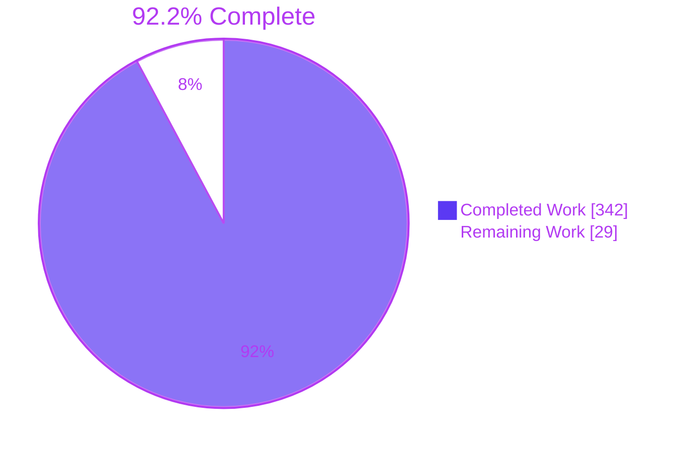
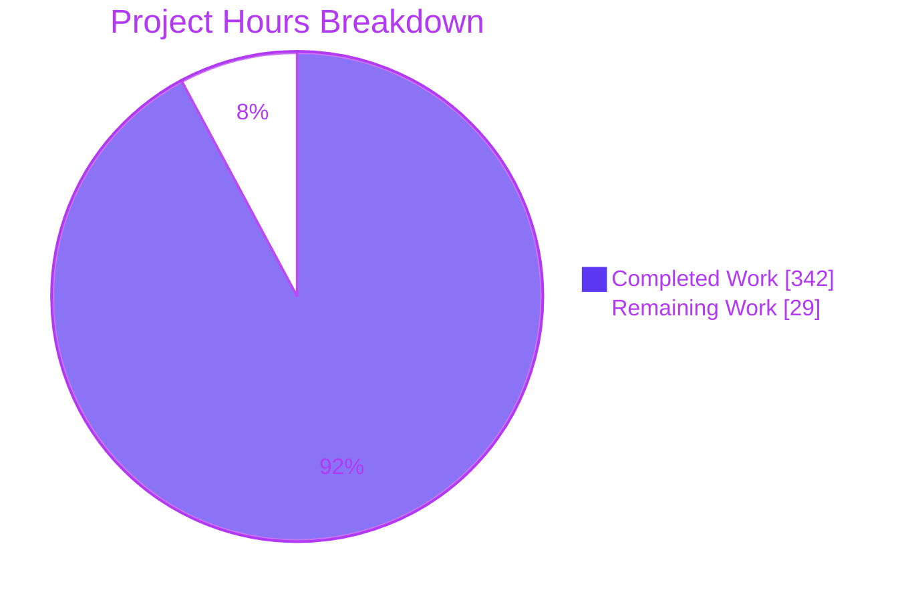
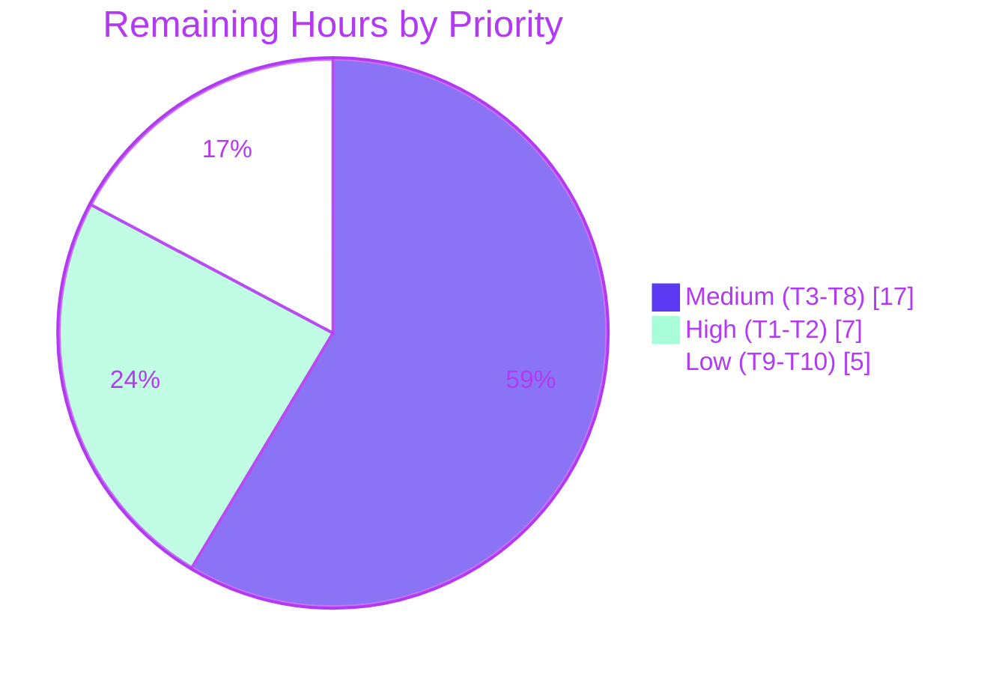

# 1. Executive Summary

## 1.1 Project Overview

This project amends `rust/ifcap-po-inquiry`, a standard-library-only Rust port of the read-only VistA IFCAP purchase-order display (`PRCH DISPLAY PO`, `EN3^PRCHRPT`), tested case by case against the team's five captures of the original on `worldvista/vehu`. All five now PASS. `src/golden.rs` alone reads captures, a loopback bridge serves replay, COMPARE and status to a comparison screen, and a harness writes each verdict to `REPORT.md`. One Rust session's output is capped at 1 MiB. Users are VistA modernisation engineers and case reviewers.

## 1.2 Completion Status



| Metric | Value |
|---|---|
| Total Hours | 371 |
| Completed Hours (AI + Manual) | 342 (324 AI + 18 manual) |
| Remaining Hours | 29 |
| Percent Complete | 92.2% |

342 completed hours out of 371 total hours = **92.2% complete**. Manual hours are the team's captures, `cases.zwr`, HOME-device answer, `200.zwr` and macOS run.

## 1.3 Key Accomplishments

- ✅ All five cases PASS in `REPORT.md` part 2.
- ✅ 191 of 191 tests pass; build, clippy, rustfmt, rustdoc, S1–S9 and A7 are clean.
- ✅ RUST, MUMPS replay and COMPARE agree byte for byte on all five cases.
- ✅ A Rust session's transcript is capped at 1,048,576 bytes, cut at its last prompt (K15).
- ✅ Under the cap, Rust output matches the previous build on 88 sequences.
- ✅ Only `src/golden.rs` reads captures; frozen files are byte-identical to `64482eef8`.
- ✅ `SPEC.md` holds the 108-row inventory, coverage 47/0/61, K1–K15 and the open items.
- ✅ Operator documents give the five-PASS and no-captures outcomes side by side.

## 1.4 Critical Unresolved Issues

**0 of the second change directive's 14 items are open. 3 of the 16 AAP acceptance criteria are open (A6, B3, B4)**, all team-owned by-hand browser checks. `SPEC.md` lists **7 open items** (O-04, not blocking; O-07, O-10, O-12, O-13, O-14, O-15), and acceptance is not yet recorded. No Section 5.2 divergence blocks release.

| Issue | Impact | Owner | ETA |
|---|---|---|---|
| A6, B3, B4: the 14-item checklist and the three modes per case, by hand in current Chrome and Firefox | Screen identity across browsers is unverified. The screen files are unchanged, and the API side of B3 matches for all five cases | Team | 6 h (T1) |
| Acceptance at `runPlaybook.md` phase 12: `SPEC.md` "Acceptance record" (`SPEC.md:2904`) reads `Not accepted.`, with `Date:`, `image_digest:` and `snapshot_id:` blank | The port is verified but not yet accepted | Team | 1 h (T2) |
| O-15: repeating an absent order value costs up to 52,425 lookups, about 44–58 s per request on a debug build, before the output cap ends it (`SPEC.md:1335`) | A local client can hold one CPU for about a minute per request. Output and memory stay bounded | Developer, under a scope that opens `src/bridge.rs` | 4 h (T5) |
| O-12: on macOS, `bridge::tests::drain_discards_exactly_its_byte_budget` fails and parallel `tests/bridge.rs` runs fail (`SPEC.md:1332`) | macOS developers see a red suite. It is not a parity difference, since the five cases PASS there too | Team | 3 h (T4) |
| O-07: the live start command cannot be expressed in `meta.txt` `docker_exec_args` | Live mode is unverified | Team | 6 h (T6, T7) |
| O-10: the process-exit newline rests on the captures, not on a documented YottaDB rule (K14) | All five PASS with it, but the rule is unconfirmed | Team | 1 h (T8) |
| O-13, O-14: frozen `testingMethods.md:48` and golden README lines still describe the HOME device as unresolved or the folder as empty | Readers meet statements the code no longer bears out | Developer, under a later scope | 3 h (T9) |

## 1.5 Access Issues

| System/Resource | Type of Access | Issue Description | Resolution Status | Owner |
|---|---|---|---|---|
| `worldvista/vehu` image (`sha256:e0710df4…0622`) and a running container | Docker host with the image and the team's snapshot | Neither exists on the build host. Replay with the committed captures works, but live mode and re-recording cannot run there | Open: team-owned | Team |
| Firefox (current release) | Browser install | Not installed on the validation host, so A6 and B4 cannot be checked there | Open | Team |
| macOS host with Rust 1.99.1 | Test platform | The build host is Linux, so O-12 cannot be reproduced or confirmed there | Open: team-owned | Team |
| VEHU capture start command (O-07) | Operational knowledge | The command that produced the captures (`su - vehu -c "…"`) needs an argument with spaces, which `meta.txt` `docker_exec_args` cannot express | Open: question for the team | Team |
| `src/bridge.rs`, `testingMethods.md` and the golden README's existing lines | Change authority | These files are frozen for this change set. Closing O-15, O-13 and O-14 needs a scope that opens them | Open: needs a scope decision | Team |

## 1.6 Recommended Next Steps

1. [High] Run the checklist and the three modes by hand in Chrome and Firefox (T1).
2. [High] Record acceptance at `runPlaybook.md` phase 12 and regenerate `REPORT.md` (T2).
3. [Medium] Sign off the Section 5.2 decisions, including the harness change and O-12 wording (T3).
4. [Medium] Confirm O-12 on macOS, and bound absent-value work under a scope that opens `src/bridge.rs` (T4, T5).
5. [Medium] Settle O-07, run GC-01 live, and confirm O-10 (T6–T8).

# 2. Project Hours Breakdown

## 2.1 Completed Work Detail

The team issued two change directives on top of the AAP: the first (D1–D19) and the second (D1–D14). Each row names the source it traces to.

| Component | Hours | Description |
|---|---|---|
| Inquiry core (`src/inquiry.rs`, `src/mumps.rs`) | 30 | `InquiryError` keeps only `CorruptStore`, and `Halt` carries `InputExhausted`, `Unexercised` and `Corrupt` (the fourth variant is listed below). An unimplemented branch ends the session at the last prompt through `into_transcript_at_prompt`. The O-03 guard (a)–(d) uses a prefix-seek index check, and the no-match sequence `<BEL> ??\n\nP.O./REQ.NO.: ` loops. `returned` is always `None` (AAP 0.3.2, 0.6.6) |
| Store contract (`src/store.rs`) | 12 | One `StoreError::Parse` variant. `load_fixtures` returns `io::Result<Store>`, merges at map level and has no mutator. Fixture files are opened read-only. 25 unit tests (AAP 0.3.2, A9) |
| Golden capture reader (`src/golden.rs`) | 40 | Capture conventions; `normalisation.txt` rules; `meta.txt` parsing and `docker_exec_args`; `validate_context`; the six readiness checks, `Readiness`, `CaseLoad`, `status`, `find_capture`, `live_start` and `default_dir`; bounded reads. 29 unit tests (AAP 0.3.2, A4) |
| Bridge server (`src/bridge.rs`) | 52 | `serve(listener, MumpsMode)`, replay rereading the folder per request, COMPARE through private `decide_match`, and `GET /api/status`. Exact static paths, the 400/404/502 texts, the live adapter through `golden`, unchanged limits, and the loopback request and response hardening. 53 unit tests (AAP 0.3.5.1) |
| Bridge binary and crate surface (`src/bin/bridge.rs`, `src/lib.rs`) | 8 | `GOLDEN_DIR` and `VEHU_CONTAINER` mode selection, the three startup lines, the stderr messages with their exit codes, the module and re-export surface, and `#![forbid(unsafe_code)]` at `src/lib.rs:9` (AAP 0.3.1, 0.3.5.1) |
| Comparison screen (`frontend/app.js`, `frontend/index.html`) | 12 | The `#bridge-status` line and `BRIDGE UNREACHABLE`, the boolean `MATCH`/`MISMATCH` verdict, and the input-handling behaviours. `style.css` is unchanged (AAP 0.3.5.2) |
| Bridge integration tests (`tests/bridge.rs`) | 20 | 19 tests that drive `serve` on `127.0.0.1:0` over temporary golden folders, plus an end-to-end pass over READY captures (AAP 0.7.3, A5) |
| Equivalence harness and report (`tests/equivalence.rs`, `REPORT.md`) | 16 | Five verdicts through `golden::load_case`. `REPORT.md` parts 1–3 are written with the nine included `SPEC.md` sections, and a second test checks the headings (AAP 0.7.2, A2, A8) |
| Specification reconciliation (`SPEC.md`) | 32 | A 108-row inventory with Tag and FileMan field columns, the coverage counts, and the new and renamed sections. The record also holds the 14-item checklist, conflicts K1–K13, the read-only results, the capture hashes, the run evidence and the acceptance record (AAP 0.3.6, 0.6.3, A1) |
| Operator documents (`RUNNING.md`, `runPlaybook.md`, `testingMethods.md`, `tests/golden/ifcap/README.md`) | 24 | Seven-step run guide with a failure-message table, a 12-phase playbook (116 lines), and a 52-line, 600-word testing method. The rewritten capture conventions and procedure state their commands identically in every document (AAP 0.3.6, A10, A12) |
| Repository hygiene and verification evidence | 8 | 1,002 `test-results/` files and `MANIFEST.txt` removed. Records of A7 source-unchanged, S1–S9, the capture listing and the A12 runtime check. Cargo manifests are unchanged (AAP 0.2.2, 0.2.3, 0.7.4) |
| HOME device branches and process-exit newline (`src/inquiry.rs`, `src/mumps.rs`) | 14 | `STUB_CONTEXT` sets `IOF` `#` and `IOSL` `60`, which closes O-01 (`src/inquiry.rs:117-122`). `pct_zis` writes the 26 device-open bytes, cited to `3.2+TERMINAL TYPE.zwr:818` (PO-12.b1). `Session::form_feed` and the `$X`/`$Y` model cover PO-10.b4 and PO-26.b1 (`src/mumps.rs:737`). The `$Y+5>IOSL` test is false for these orders (PO-30.b1). Normal completion appends `\n` when `$X>0` (first directive D7–D11) |
| Exact-value tests and resolved contexts | 6 | Six unit tests: four in `src/inquiry.rs` and two in `src/mumps.rs`. Three found-order tests are rewritten to the implemented output, and normally ended expectations end with `\n`. Every `IOSL` test literal is `60` in `src/golden.rs`, `src/bridge.rs` and `tests/bridge.rs`, and the golden expectations name the resolved constants (first directive D12, D13) |
| Parity evidence and the buyer-name source | 6 | The capture listing and baseline run before the first edit. A `cases.zwr` preflight found all 51 extracted lines per case present. The buyer name on transcript line 25 was traced to `DIS^PRCHDP1` [PRCHDP1.m:59] and the node `^VA(200,.5,0)` (first directive D3, D4, D14) |
| Specification and operator documents for the captured state | 10 | `SPEC.md`: coverage 47/0/61; O-01 closed; O-05 closed with the image digest and snapshot id; O-09 to O-11; K14; "Places the original looks wrong"; the `state/` row; and the run evidence. The named sentences of `RUNNING.md` and `runPlaybook.md` give both capture outcomes (first directive D6, D16, D17) |
| Baseline, hash freeze and preservation evidence | 2 | `SPEC.md:2561` records the baseline before the first edit: 185 passed and five PASS at `64482eef8`, the A7 before-check and the `200.zwr` hash. The 18 directive hashes are recorded after the last edit (second directive D3, D4, D13) |
| Buyer fixture documentation and O-09 closure | 4 | O-09 is closed (`SPEC.md:1329`), with the node recorded as verbatim in all five `db-before.zwr`. `200.zwr` is named beside `cases.zwr` in every fixture list. One paragraph and its `grep -F '^VA(200,.5,0)='` command are appended to README Part B step 6, line 371 (second directive D5, D6) |
| Run-guide and specification reconciliation | 5 | `SPEC.md`, `RUNNING.md` and `runPlaybook.md` state five PASS, exit 0, `RECORDED 5 OF 5 READY 5 OF 5` and `match` true, with the no-captures outcome beside each. The macOS command is at `RUNNING.md:34`. Earlier evidence is kept and labelled with its commit (second directive D10, D11) |
| Session output limit (`src/mumps.rs`, `src/inquiry.rs`) | 8 | `SESSION_OUTPUT_LIMIT` = 1,048,576 (`src/mumps.rs:544`, CWE-400). A sticky admission check covers `write`, `nl`, `tab`, `form_feed` and `bell` (`src/mumps.rs:642`). `Halt::OutputLimit` ends the session at the last prompt with branch ID `None`. The latch is checked by `run`, the read wrapper and `process_exit` (`src/inquiry.rs:181, 263, 279`), and `RUNNING.md:124` states the limit (second directive D7, D9) |
| Output-limit tests and bridge test harness | 7 | Six tests: two in `src/mumps.rs`, three in `src/inquiry.rs`, and `rust_session_stops_at_the_output_limit` in `tests/bridge.rs`. The harness waits for the first `GET /api/status` (`READY_TIMEOUT` 120 s, `tests/bridge.rs:48`). The two fixture-dependent tests print `NOT RUN` without `cases.zwr` (second directive D8, D12) |
| Conflict and open-item records | 5 | K15 (`SPEC.md:1373`); O-11 closed with measured wall times; O-12 with the team's macOS record; O-13 and O-14 for frozen false sentences; O-15 with the no-match measurements (second directive D9, D11, D13) |
| Completion evidence and acceptance record | 3 | Every completion command rerun at `7c7959357`, with 191 passed. `SPEC.md` "Acceptance record" begins `Not accepted.`, names that commit and leaves its three fields blank. `REPORT.md` is regenerated only by `cargo test` (second directive D10, D12) |
| Team captures and answers (manual) | 16 | GC-01 to GC-05, seven files each, with `meta.txt` context `{"DUZ":".5","IOF":"#","IOSL":"60","STATION":"500"}`; `tests/fixtures/ifcap/cases.zwr`; and the `state/` export (commit `0b123807c`) |
| Team buyer fixture and macOS run (manual) | 2 | `tests/fixtures/ifcap/200.zwr` with `^VA(200,.5,0)` (commit `a78321486`), and the macOS test run recorded in O-12 |
| **Total** | **342** | 324 AI + 18 manual |

## 2.2 Remaining Work Detail

| Category | Hours | Priority |
|---|---|---|
| T1 By-hand 14-item checklist and the three modes for each case in current Chrome and Firefox, including the rows 16, 18 and 19 behaviours of Section 5.2 [AAP A6, B3, B4] | 6 | High |
| T2 Record acceptance at `runPlaybook.md` phase 12: fill `Date:`, `image_digest:` and `snapshot_id:`, rerun `cargo test --offline --locked`, and commit the regenerated `REPORT.md` [AAP 0.7.4; second directive D10] | 1 | High |
| T3 Review and sign off the Section 5.2 decisions marked for sign-off: rows 4, 10 and 14, the test-harness change, the O-12 Linux wording and the `NOT RUN` path [Path-to-production] | 3 | Medium |
| T4 Rerun the suite on macOS at HEAD to confirm O-12 after the harness change, and diagnose `drain_discards_exactly_its_byte_budget` [AAP A5; second directive D11] | 3 | Medium |
| T5 Bound per-request work for repeated absent values (O-15), for example a session deadline or input cap in `src/bridge.rs`, with tests and the five transcripts unchanged [Path-to-production, CWE-400] | 4 | Medium |
| T6 Settle the O-07 start command or the `docker_exec_args` convention (K3) [AAP 0.6.6] | 3 | Medium |
| T7 Live mode: run GC-01 against VEHU and compare with replay [AAP 0.7.3] | 3 | Medium |
| T8 Confirm the process-exit newline of `yottadb -run %XCMD` (O-10, K14) [first directive D11] | 1 | Medium |
| T9 Documentation follow-ups: O-13 (`testingMethods.md:48`), O-14 (README lines), the stale comments at `src/golden.rs:124, 505-508` and `tests/bridge.rs:184`, the `REPORT.md` regeneration sentences at `RUNNING.md:80` and `runPlaybook.md:116`, and K14's naming of the output-limit end [AAP 0.3.6] | 3 | Low |
| T10 Decide how live runs handle processes `docker` leaves behind [Path-to-production] | 2 | Low |
| **Total** | **29** | |

Confidence: T1, T2, T3, T8 and T9 are high confidence. T4 is medium, because the macOS cause is unknown. T5 is medium, because the bound must leave every recorded transcript unchanged and needs a scope that opens `src/bridge.rs`. T6, T7 and T10 are medium to low, and depend on team access to VEHU.

## 2.3 Hours Calculation

- Completed hours = 30 + 12 + 40 + 52 + 8 + 12 + 20 + 16 + 32 + 24 + 8 + 14 + 6 + 6 + 10 + 2 + 4 + 5 + 8 + 7 + 5 + 3 + 16 + 2 = **342** (324 AI + 18 manual)
- Remaining hours = 6 + 1 + 3 + 3 + 4 + 3 + 3 + 1 + 3 + 2 = **29**
- Total project hours = 342 + 29 = **371**
- Completion = 342 / 371 × 100 = **92.2%**

# 3. Test Results

All results below come from `cargo test --offline --locked --no-fail-fast` and the gate commands, run from `rust/ifcap-po-inquiry` at commit `bde1c66eb` on Rust 1.99.1, with the five captures, `cases.zwr` and `200.zwr` in place. The run exited 0 in 21.6 s with **191 tests: 191 passed, 0 failed, 0 ignored**. The serial form `cargo test --offline --locked -- --test-threads=1` also gave 191 of 191, in 69.8 s. `REPORT.md` kept sha256 `624f0094…8478` and the tree stayed clean. No coverage tool is installed, and the AAP requires none.

| Area / Category | Framework | Tests | Passed | Failed | Coverage | What This Proves |
|---|---|---|---|---|---|---|
| Inquiry core: `src/inquiry.rs` (43), `src/mumps.rs` (19) | Rust libtest (unit) | 62 | 62 | 0 | Not measured | Device-open, form-feed, paging and exit-newline bytes are exact. The output cap refuses the crossing write, counts every byte of `tab` and `form_feed`, ends at the last prompt, and outranks a later `Corrupt` or `Unexercised` |
| Store: `src/store.rs` | Rust libtest (unit) | 25 | 25 | 0 | Not measured | ZWR loading reports the malformed line number, loads `cases.zwr` last, admits only regular files, and never mutates |
| Golden reader: `src/golden.rs` | Rust libtest (unit) | 29 | 29 | 0 | Not measured | Normalisation, `meta.txt`, the six readiness checks and bounded reads classify captures correctly against `IOF` `#` and `IOSL` `60` |
| Bridge internals: `src/bridge.rs` | Rust libtest (unit) | 53 | 53 | 0 | Not measured | JSON escapes, surrogates and depth 64; the status JSON; the four `decide_match` cases; the Host, Origin and Content-Type gates; the CSP hashes; accept backoff; the live-runner limits |
| Bridge HTTP contract: `tests/bridge.rs` | Rust libtest (integration) | 20 | 20 | 0 | Not measured | Over a real socket every status and error text is exact. `end_to_end_real_captures` prints `MATCH` for GC-01 to GC-05. A 900,019-byte body returns 200 with a 1,048,026-byte transcript in 1.4 s |
| Equivalence harness: `tests/equivalence.rs` | Rust libtest (integration) | 2 | 2 | 0 | Not measured | `equivalence_report` prints `GC-01 PASS` to `GC-05 PASS` and rewrites `REPORT.md` byte-identical. Every included `SPEC.md` section exists |
| Static gates: clippy `--all-targets`, `cargo fmt --check`, `cargo doc -D warnings`, audits S1–S9, A7 | cargo, grep, git | 13 checks | 13 | 0 | N/A | No warnings. No `unsafe`, `unwrap`, `expect` or `panic!` in `src/`. Capture names appear only in `src/golden.rs`, file writes only under `#[cfg(test)]`, and `Packages/` is unchanged |

**Not Covered.** Nothing below is exercised by any passing test. A human should check each item before release.

- **The screen in any browser by hand, and in Firefox at all** (T1). No automated test drives `frontend/`.
- **macOS.** The suite has not been run on macOS at HEAD, so O-12 is unconfirmed (T4).
- **Work cost of repeated absent values (O-15).** No test bounds the CPU time of one request. The cost was only measured (T5).
- **Live mode against a real VEHU container.** This covers `docker exec -i`, the `EXIT <code>` and `TIMEOUT` answers, the `STANDARD STREAMS NOT CREATED` mapping, and processes `docker` leaves running after the 10 s kill (T7).
- **PO-30.b2, the paging pause.** No case reaches it. Only a direct unit call confirms that it ends the session as `Unexercised`.
- **Accept-loop recovery from `ENFILE`, `ENOBUFS` and `ENOMEM`.** Unit tests cover it, but it has never been triggered on a live socket.
- **The `O_NONBLOCK` constants for Apple and BSD targets** (`src/store.rs`, `src/golden.rs`). They have never been compiled or run on those platforms.
- **`golden::tests::unsearchable_golden_folder_is_unreadable_not_absent`.** It prints `NOT RUN` when tests run as root. Run the suite once as an unprivileged user.

# 4. Runtime Validation & UI Verification

The debug bridge was started in replay mode over the five committed captures, in a private network namespace, and driven with curl.

- ✅ **Startup and single instance.** The bridge prints `http://127.0.0.1:8080/`, `MUMPS MODE: REPLAY` and `RECORDED 5 OF 5 READY 5 OF 5`. A second instance exits 1 with `bridge: port 8080 on 127.0.0.1 is already in use`, and the first keeps serving.
- ✅ **Status endpoint.** `GET /api/status` returns 200 with all five cases in `recorded` and `ready`, and `incomplete` is `{}`.
- ✅ **Five cases in three modes.** For each case's `input.txt`, MUMPS replay and RUST return transcripts byte-identical to `transcript.txt` (1664, 1852, 101, 101 and 1745 B). COMPARE answers 200 with `match` true for all five, and `returned` is null. GC-01, GC-02 and GC-05 show `POSTMASTER` on line 25, read from `200.zwr`.
- ✅ **Unchanged output under the cap.** On 88 sequences, up to and including a 1,048,576-byte session, RUST output is byte-identical to a build of `64482eef8`.
- ✅ **Session output cap.** 1,000 repetitions of `GC1001` return 200 in 1.25 s with a 1,048,026-byte transcript that ends `P.O./REQ.NO.: ` and has no final `\n`. Eight concurrent maximum-size bodies all return the same transcript, and `/api/status` answers within 0.1 s meanwhile.
- ⚠ **Repeated absent values.** 60,000 `INVALID!` inputs return 200 with 1,048,560 bytes, but take about 58 s on the debug build (O-15).
- ✅ **Request validation and errors.** Malformed JSON gives 400 `BAD REQUEST: MALFORMED JSON`, a foreign `Host` gives 400 `BAD REQUEST: HOST NOT ALLOWED`, an unrecorded sequence gives 502 `NOT RECORDED` or `MUMPS: NOT RECORDED`, and `/nope` gives 404.
- ✅ **No-captures outcome.** In a copy without captures or `cases.zwr`, `cargo test` exits 0 with five NOT COMPARED, the bridge reports `RECORDED 0 OF 5 READY 0 OF 5`, and RUST ends after the station prompt.
- ⚠ **Screen.** `frontend/` is byte-identical to `64482eef8` and was not driven against the five-PASS state. It was last exercised in headless Chrome at commit `4aae4dba6`. Firefox and by-hand checks have never been run (T1).
- ⚠ **Live mode and macOS were never exercised.** Live mode awaits O-07. Replay is the delivered MUMPS backend.

# 5. Compliance & Quality Review

## 5.1 Compliance Matrix

| Deliverable (AAP criterion) | Benchmark | Status | Evidence |
|---|---|---|---|
| Branch inventory and coverage (A1) | 108 rows, each with routine, tag, line, FileMan field and one coverage label | ✅ Pass | `grep -c '^\| PO-' SPEC.md` returns 108. Coverage is 47 / 0 / 61, and the output cap adds no row |
| Equivalence harness and verdict rule (A2, B2) | `cargo test` exits 0 with five PASS, and a case without a capture shows NOT COMPARED | ✅ Pass | 191 of 191, exit 0. A copy without captures exits 0 with five NOT COMPARED |
| Rust safety, capture isolation and lint (A3, A4) | S1 has only `src/lib.rs:9`, S2 hits are reviewed, S3 is empty, S4 hits only `src/golden.rs`; no warnings | ✅ Pass | S1: 1 hit. S2: 1 hit, a comment at `src/inquiry.rs:846`. S3: exit 1. S4: 82 hits in `src/golden.rs`. Build, clippy, fmt and `cargo doc -D warnings`: 0 warnings |
| Bridge contract (A5) | `cargo test --test bridge` exits 0 | ✅ Pass (Linux) | 20 / 20, parallel and serial. macOS is open as O-12 |
| Front-end checklist by hand (A6) | All 14 items in current Chrome and Firefox | ⚠ Partial (50%) | Headless Chrome was exercised at `4aae4dba6`. By-hand runs and Firefox are open (T1) |
| Source and captures unchanged (A7, A11) | `git diff --quiet` exits 0, and the capture listing is the same before and after | ✅ Pass | Both hold. The 18 recorded hashes match, including `200.zwr` `836c6a9b…c9da` and `cases.zwr` `9dd56f96…32a0` |
| Generated report (A8) | Three parts plus the nine included `SPEC.md` sections | ✅ Pass | `REPORT.md` (1474 lines) is regenerated byte-identical, and `spec_has_report_sections` passes |
| Read-only enforcement (A9) | S5–S9 recorded in `SPEC.md` | ✅ Pass | S5 and S9 are empty. S6 finds one production `Command::new`. S7's 25 hits are all under `#[cfg(test)]`. S8 finds no control |
| Document limits and runtime check (A10, A12) | `testingMethods.md` at most 60 lines and 600 words; `runPlaybook.md` at most 150 lines in 12 phases; a bridge runtime check | ✅ Pass | 52 lines and 600 words. 116 lines and 12 phases. Startup `RECORDED 5 OF 5 READY 5 OF 5`, and a second instance exits 1 |
| Parity acceptance (B1) | Five PASS in `REPORT.md` part 2 | ✅ Pass (5 / 5) | GC-01 to GC-05 `Verdict: PASS`. Acceptance is not yet recorded (T2) |
| Session output cap (second directive D7–D9) | Transcript at most 1,048,576 bytes, cut at the last prompt, under-limit bytes unchanged | ✅ Pass | Six tests pass. 88 under-limit sequences match `64482eef8`. Absent-value work stays open as O-15 |
| Screen with captures in two browsers (B3, B4) | Each case in three modes, and identity in Chrome and Firefox | ⚠ Partial | The API side matches for all five cases. The screen by hand and Firefox are team-owned (T1) |

## 5.2 AAP & Rule Divergences and Gaps

The AAP sets no user rules (AAP 0.8). The team issued two change directives, which outrank the AAP: the first (D1–D19) and the second (D1–D14), which also outranks the first where they differ. Rows 1–19 depart from the AAP's own wording in the delivered design. Rows 20–22 are open shortfalls and qualifications. Rows 23–35 are departures the first directive ordered or froze, and rows 36–50 are departures the second directive ordered; those marked **Sanctioned** cite the instruction. Rows 51–53 are decisions taken during delivery that neither directive names, and they need sign-off (T3). No row blocks release.

| What the AAP/Rule Required | What Was Delivered Instead | Why It Diverged | Impact | Remediation |
|---|---|---|---|---|
| 1. The capture-availability record uses `ls -la tests/golden/ifcap/ tests/fixtures/ifcap/` (0.7.1) | `ls -la --time-style=+ …`, recorded with its literal output (`SPEC.md:2152`) | Git sets modification times at checkout, so plain `ls -la` output never matches in another checkout. 0.7.4 requires recorded output to match a fresh run | None. Names, modes and sizes are still recorded | None needed |
| 2. Capture files are read with `std::fs::read` (0.3.3) | `open_read_only` plus `Read::take`, with budgets of 1 MiB for input and transcript, 64 KiB for returned, meta and normalisation, and 64 MiB per export (`src/golden.rs:550-563`) | An unbounded read lets one oversized capture exhaust memory | None for the real captures. Each `db-before.zwr` is 1,200,849 B, and all five cases are READY | None needed |
| 3. An unreadable capture gives 502 `NOT RECORDED (unreadable: <path>)` (0.3.5.1) | `NOT RECORDED (unreadable: <path>: <cause>)` | It gives operators the operating-system reason | The body text is longer than specified | None needed. `RUNNING.md` documents it |
| 4. Request parsing stays unchanged, and the only 400s are for body shape (0.3.5.1) | 400 `HOST NOT ALLOWED`, `ORIGIN NOT ALLOWED` and `CONTENT-TYPE APPLICATION/JSON REQUIRED`, checked before any session runs (`src/bridge.rs:584-843`) | An unauthenticated loopback server is open to DNS rebinding and to cross-site POSTs that can start `docker` | Only loopback-addressed, same-origin JSON clients are served. curl without `Origin` still works | Sign off (T3) |
| 5. "The hardening headers stay" (0.3.5.1) | A CSP of `default-src 'none'` with three `style-src-attr` hashes, plus `Referrer-Policy: no-referrer` (`src/bridge.rs:1122-1133`) | Security hardening. Hashes are stricter than `'unsafe-inline'` | Any new inline style must update the hashes, which `inline_styles_of_index_html_are_the_hashed_ones` enforces | None needed |
| 6. `index.html` gains one `<div id="bridge-status">` (0.3.5.2) | A grid wrapper whose hidden copy reserves the line's height, using inline styles (`frontend/index.html:15-17`) | It prevents layout shift when the status text arrives, while `style.css` stays unchanged as required | Layout shift is 0 | None needed |
| 7. Four startup messages (0.3.5.1 table) | Also `bridge: golden directory unreadable: <path>: <error>` and `bridge: serving failed: <error>`, and `cannot load fixtures` names its stage (`src/bin/bridge.rs:22-30, 91`) | It tells a missing golden folder from an unreadable one, and reports failures after the fixtures load | Diagnostics are more precise | None needed. `RUNNING.md` lists them |
| 8. A live run has a 10 s timeout with kill (0.3.5.1) | Only the `docker` child is killed (`src/bridge.rs:2531`). Processes `docker` started can outlive the run, and a run ends `TIMEOUT` while one of them holds the pipes | Killing a process group needs an unstable std API on 1.99.1, or `unsafe`/FFI, which `#![forbid(unsafe_code)]` rules out | Affects live mode only, which is unverified | Decide on a wrapper, or accept (T10) |
| 9. A non-empty `VEHU_CONTAINER` selects live mode (0.3.5.1) | A non-UTF-8 value is converted lossily and still selects live mode (`src/bin/bridge.rs:61`) | The AAP sets no rule for non-UTF-8 values, so the value is not rejected | Negligible | None needed |
| 10. `is_recorded` is true when the capture's input and transcript exist (0.3.2) | A case folder whose metadata cannot be read also counts as recorded (`src/golden.rs:1226-1232`). An unreadable golden folder therefore shows `RECORDED 5 OF 5 READY 0 OF 5` | Such a case ends FAIL (`CaseLoad::Unreadable`), so the count follows the verdict | The startup count can surprise an operator | Sign off (T3) |
| 11. Limits unchanged (0.3.5.1) | Accepting a connection backs off from 10 ms to 1 s on `EMFILE`, `ENFILE`, `ENOBUFS` and `ENOMEM` (`src/bridge.rs:90`) | Without it, descriptor or memory exhaustion ends the accept loop | The bridge keeps serving under pressure | None needed |
| 12. Limits unchanged (0.3.5.1) | A session-body input budget, with `FREE_INPUTS` 1024 and `MAX_HELD_INPUTS = MAX_BODY / 2` and admission that is not FIFO (`src/bridge.rs:102-113`) | Without it, 64 concurrent 1 MiB bodies can reach about 960 MB of peak memory | Peak memory is about 119 MB | None needed |
| 13. The AAP is silent on file types | Capture and fixture files are opened `O_NONBLOCK`, and their type is checked on the open descriptor. A non-regular `*.zwr` fails startup (`load_fixtures_rejects_non_regular_zwr_entry`) | It closes a check-then-open race, and a FIFO cannot hang startup | Startup fails fast on a bad fixture entry | None needed |
| 14. Minimal change and no extra abstractions (0.9.3); S3 forbids `golden` in `store.rs` | `admit`, `open_read_only` and `O_NONBLOCK` are duplicated in `src/store.rs:416-449` and `src/golden.rs:851-883` | The module boundaries forbid sharing through `golden`, and the AAP plans no shared module | Two copies must be kept in step | Optionally consolidate (T3) |
| 15. S6 expects `Command::new(program)` in `run_command` (0.7.4) | It is in `execute` (`src/bridge.rs:2245`), which `run_command` calls | `execute` owns the child's pipes and its kill | None. `SPEC.md` records the actual location | None needed |
| 16. SEND, and EXIT appending `^`, are "kept as they are" (0.3.5.2) | Focus returns to INPUT after SEND and EXIT, EXIT also clears INPUT, and a double-click sends one answer (`frontend/app.js:359-384`) | Usability hardening | The screen behaves more predictably | Check by hand (T1) |
| 17. `#match-status` is empty before a compare and after an error (0.3.5.2) | It is also empty while a compare is in flight | A stale verdict never shows beside a new request | None | None needed |
| 18. Checklist item 14 checks `BRIDGE UNREACHABLE` "with the bridge stopped" (0.3.5.2) | The check blocks `/api/status` in the browser's developer tools (`SPEC.md:1443`) | A page reloaded with the bridge stopped cannot load `app.js` at all | The same message, reached another way | Run as written (T1) |
| 19. Conflict register K1–K12 (0.9.4) | K13 is added: the resend on every selector change versus idle-screen identity, checked in two forms (`SPEC.md:1371, 1408`) | MUMPS and RUST idle screens cannot be identical after a resend of an unrecorded sequence | The checklist has a two-form item | Do the READY form by hand (T1) |
| 20. Production-ready code bounds the work one request can cause (AAP 0.9.3; the CWE-400 aim of second directive D7) | Output is capped, so a repeated found order stops after 662 displays in about 1.4 s. A repeated absent value writes only 20 bytes per lookup, so one request can run up to 52,425 lookups, about 44–58 s on a debug build, before the cut at 1,048,560 bytes. Recorded as open item O-15 (`SPEC.md:1335`) | D7 fixes the mechanism as an output bound and forbids any change to under-limit bytes. A faster lookup is an optimisation AAP 0.9.3 forbids, and a deadline or input cap needs `src/bridge.rs`, which D2 and D13 freeze | A local client can hold one CPU for about a minute per request, and about 10 such sessions fit the input budget at once. Memory and output stay bounded | T5 |
| 21. Cite the YottaDB documentation for the process-exit newline (first directive D11) | No such rule exists to cite. The newline is implemented from the captures, and O-10 (`SPEC.md:1330`) asks the team to confirm it | YottaDB documents only that CLOSE completes a partial record, and that it ignores CLOSE of `$PRINCIPAL`. It states no rule for HALT or process exit. D11 prescribes this fallback | Low. The rule rests on five captures, and all five PASS with it | T8 |
| 22. The halt prompt as first directive line 17 renders it, `       ENTER '^' TO HALT:` (7 spaces) | `SPEC.md:656, 1464` quote it with 8 leading spaces | `?8` at [PRCHDP2.m:10] and the captures both give column 8, and the directive requires agreement with the source | None on code or verdicts | None needed |
| 23. Zero captures. The capture listing is the single `ABSENT` line, and five cases are NOT COMPARED (0.2.1, 0.2.3, 0.7.1, A2, A11) | Five READY captures. The listing is recorded in `SPEC.md` "Capture hashes" (`SPEC.md:1563`), and a baseline run precedes the first edit (`SPEC.md:1784`) | **Sanctioned:** first directive D3 | None | None needed |
| 24. Remove items outside the layout (0.3.3, 0.2.2) | `tests/golden/ifcap/state/` is kept with its four files, and no code reads it (`SPEC.md:1476`). `save_state_report.txt` is absent, because the crate `.gitignore` excludes `*_report.txt` | **Sanctioned:** first directive D6 | None | None needed |
| 25. `STUB_CONTEXT` holds `IOF` and `IOSL` as `None`, and O-01 stays open (0.3.4, 0.6.6) | `("IOF", Some("#"))` and `("IOSL", Some("60"))` (`src/inquiry.rs:117-122`). Any other value fails `CONTEXT MISMATCH <key>`, and the CONSOLE `IOF` context is rejected. `validate_context` is unchanged | **Sanctioned:** first directive D7, from the team's answer | A capture recorded on another device now FAILs, by design | None needed |
| 26. No rule equivalent for `D ^%ZIS` (0.6.4) | `pct_zis` writes exactly the 26 device-open bytes (`src/inquiry.rs:1664, 1697`), citing `3.2+TERMINAL TYPE.zwr:818`, the line that holds `^%ZIS(2,168,2)`, where the directive suggested 816-817. The row keeps its "requires runtime shim" flag | **Sanctioned:** first directive D8 | Output is fixed to terminal type 168, `PK-VTMT` | None needed |
| 27. YottaDB gives `WRITE #` as `<FF><LF>` (0.3.7) | `Session::form_feed` writes LF if `$X>0`, then FF, and sets `$X` and `$Y` to 0 (`src/mumps.rs:737`). The conflict is recorded in "Places the original looks wrong" (`SPEC.md:1464`) | **Sanctioned:** first directive D9. The captures judge | None. The bytes equal the captures | None needed |
| 28. The `$Y+5>IOSL` paging test is not implemented (0.6.3, 0.6.4) | With `IOSL` 60 the test is false for these orders and writes nothing. The true arm ends `Halt::Unexercised("PO-30.b2")` (`src/inquiry.rs:2528-2535`) | **Sanctioned:** first directive D10 | None | None needed |
| 29. Implemented output does not change (0.1.1) | Normal completion appends `\n` when `$X>0` (`process_exit`, `src/inquiry.rs:275-283`). Conflict K14 records the tension (`SPEC.md:1372`) | **Sanctioned:** first directive D11 | Every normally ended transcript gains one byte, as the captures show | Confirm with T8 |
| 30. Unit tests stop a found order at the device gate, and contexts carry `"IOSL":"24"` (0.7.3) | Three tests are rewritten to the implemented output. Every `IOSL` test literal is `"60"`, and the golden expectations name the resolved constants | **Sanctioned:** first directive D12, D13 | None | None needed |
| 31. At most three correction attempts per case (0.7.2) | Five were allowed under the first directive, noted at `SPEC.md:1904`. None were used | **Sanctioned:** first directive D14 | None | None needed |
| 32. Coverage 43/4/61 and O-05 open (0.6.3, 0.6.6) | Coverage 47/0/61. O-05 is closed with `image_digest` and `snapshot_id`. RUNTIME-VERIFIED labels behaviour of all five PASS cases (`SPEC.md:7`) | **Sanctioned:** first directive D16; second directive D7 keeps 47/0/61, because the cap is not a branch of the original | None | None needed |
| 33. A clean checkout gives five NOT COMPARED and `RECORDED 0 OF 5` as the sole outcome (A12) | Each named sentence gives both outcomes, and no command changes | **Sanctioned:** first directive D17 | None | None needed |
| 34. Every document and doc comment agrees with the code (0.3.6, 0.9.3) | Frozen or unnamed passages still describe the HOME device as unresolved or the golden folder as empty: `src/golden.rs:124, 505-508`, `tests/bridge.rs:184`, `testingMethods.md:48` (O-13, `SPEC.md:1333`), and README lines 5, 117, 119, 120, 172, 186, 260 and 278 (O-14, `SPEC.md:1334`) | **Sanctioned:** first directive D2, D17 and D18, and second directive D2, D6 and D13, freeze these files and lines | Readers meet statements the code no longer bears out | T9 |
| 35. Every document agrees with the code (0.3.6) | `RUNNING.md:80` and `runPlaybook.md:116` credit plain `cargo test` with rewriting `REPORT.md`. That holds only while every earlier target passes, because cargo stops at the first failing target | The second directive's reconciliation (D10) named the five-PASS sentences, and these lines are true in the delivered state. No further reason is recorded | Low. If a bridge test fails, `REPORT.md` is not rewritten | T9 |
| 36. `Halt` becomes `InputExhausted`, `Unexercised(&'static str)` and `Corrupt(String)` (0.3.2, 0.4.1) | A fourth variant, `OutputLimit`, with the same derives, visibility and location (`src/inquiry.rs:229-248`) | **Sanctioned:** second directive D7, which adds exactly one variant | An over-limit session ends like exhausted input | None needed |
| 37. Behaviour must not change, and rules come from source only (0.9.1, 0.9.3, 0.1.2, 0.3.5.1) | `SESSION_OUTPUT_LIMIT` = 1,048,576 (`src/mumps.rs:544`). A session that would pass it ends after its last prompt with no `\n`, recorded as K15 (`SPEC.md:1373`). The original has no limit | **Sanctioned:** second directive D7 and D9 | Sessions over 1 MiB differ from the original by design. Sessions under it are byte-identical | None needed |
| 38. `read()` sets `prompt_end` on every call (0.3.2) | The read wrapper checks the latch before `Session::read` (`src/inquiry.rs:263`), so the read that reports the limit leaves `prompt_end` at the last prompt before the crossing | **Sanctioned:** second directive D7, which requires the cut never to be longer than the limit | The cut always ends at a prompt within the limit | None needed |
| 39. A `src/mumps.rs` unit test makes the next read return `Err(Halt::OutputLimit)` (second directive D8, test 1) | The `src/mumps.rs` tests assert the `Session` limit signal and a cut within the limit. The `Err(Halt::OutputLimit)` assertion is in `inquiry::tests::output_limit_ends_session_at_last_prompt` | **Sanctioned:** D8 read with D7. `Halt` is private to `src/inquiry.rs`, and D7 forbids any other change to it | Both halves of the assertion are tested | None needed |
| 40. The bridge test checks a transcript of at most `SESSION_OUTPUT_LIMIT` bytes (second directive D8, test 3) | `tests/bridge.rs` declares a local constant of 1,048,576, with a comment naming `src/mumps.rs` | **Sanctioned:** D8 read with D2. The constant is crate-private, and `src/lib.rs` is frozen, so an integration test cannot import it | Two constants must stay equal | None needed |
| 41. 158 existing tests, and the test list of 0.7.3 (0.6.7, 0.3.6, 0.7.3) | 191 tests: the 185 of the baseline plus six output-limit tests | **Sanctioned:** second directive D8 and D12. `testingMethods.md` keeps its older count, because it is frozen | None | None needed |
| 42. The 11 supporting fixtures stay unchanged (0.2.1, 0.3.1, 0.4.1, K7) | `tests/fixtures/ifcap/` holds 13 files: the 11 exports, `200.zwr` (`836c6a9b…c9da`, one node `^VA(200,.5,0)`) and `cases.zwr` | **Sanctioned:** second directive D1 and D5, after the team committed `200.zwr` | The buyer name `POSTMASTER` now appears on line 25 | None needed |
| 43. README step 6 says `cases.zwr` is the union of the extracted nodes (0.3.6) | One appended paragraph at `tests/golden/ifcap/README.md:371` explains that `200.zwr` holds the buyer node, with the command `grep -F '^VA(200,.5,0)=' tests/golden/ifcap/GC-01/db-before.zwr`. No existing line changed | **Sanctioned:** second directive D6 | The command prints `200.zwr` line 3 exactly | None needed |
| 44. Operator documents state the zero-captures outcomes: `RECORDED 0 OF 5`, five NOT COMPARED (0.3.6, 0.7.1, A2, A11, A12) | `SPEC.md`, `RUNNING.md` and `runPlaybook.md` state five PASS, exit 0, `RECORDED 5 OF 5 READY 5 OF 5` and `match` true, with the no-captures outcome beside each | **Sanctioned:** second directive D10 | The documents match what runs today | None needed |
| 45. The acceptance record starts `Not accepted: no case has a capture.` (0.3.6) | `SPEC.md:2904` reads `Not accepted.`, states 191 passed, five PASS, 5 of 5 READY and `match` true, names commit `7c7959357`, and leaves `Date:`, `image_digest:` and `snapshot_id:` blank | **Sanctioned:** second directive D10, which asks for the observed result and its commit with blank fields. The commit holding the record cannot name itself, so it names the commit of the final run, whose `src/` and `tests/` equal HEAD's | No acceptance is recorded | T2 |
| 46. Commands are stated identically in all four documents (0.5.2) | The macOS form `cargo test --offline --locked -- --test-threads=1` is in `RUNNING.md:34` only | **Sanctioned:** second directive D11. `RUNNING.md` is the single source of commands | None | None needed |
| 47. `tests/bridge.rs` exits 0 (A5) on every platform | On macOS, one `src/bridge.rs` unit test and parallel `tests/bridge.rs` runs fail. Recorded as O-12 (`SPEC.md:1332`), with no change to `src/bridge.rs` | **Sanctioned:** second directive D11. D12 still requires 0 failed on Linux, which is observed | macOS developers see a red suite. It is not a parity difference | T4 |
| 48. A FAIL with captures allows up to three correction attempts per case (0.7.2) | No correction cycle was run. The baseline was five PASS, so none was needed | **Sanctioned:** second directive D3 and D14 | None | None needed |
| 49. The 0.4.1 rows allow edits to `src/bridge.rs`, `src/golden.rs`, `src/store.rs`, `src/lib.rs`, `src/bin/bridge.rs`, `tests/equivalence.rs`, `frontend/` and `testingMethods.md` | All of them are byte-identical to `64482eef8`, with `Cargo.toml`, `Cargo.lock`, `rust-toolchain.toml` and `Packages/**` | **Sanctioned:** second directive D2 and D13 | O-13, O-14 and O-15 cannot close in this change set | T5, T9 |
| 50. Every present-tense statement agrees (0.3.6 reconciliation rule) | The O-07 and O-10 rows and K14 are byte-identical to `64482eef8`. K14 and O-10 name only `InputExhausted` and `Unexercised`, not the output-limit end | **Sanctioned:** second directive D1, which leaves O-07, O-10 and K14 as they are. K15 and O-11 carry the limit | K14 reads as incomplete | T9 |
| 51. "Change no code or test for [O-12]" (second directive D11) | `tests/bridge.rs` waits for the first `GET /api/status` with `READY_TIMEOUT` 120 s, and the output-limit request uses `LIMIT_SESSION_TIMEOUT` 120 s (`tests/bridge.rs:48, 53`). No assertion changed, and `src/bridge.rs` is untouched | On Linux the parallel suite failed 3 of 4 runs at `d09596d44` with `os error 11`, the O-12 symptom, because the 5 s client timeout began before `serve` had loaded the fixtures. D12 requires 0 failed on Linux | 20 of 20 pass under load. The change may also clear the macOS parallel failure | Sign off (T3); confirm on macOS (T4) |
| 52. O-12 states "The Linux build host cannot reproduce any of this" (second directive D11) | O-12 records the Linux reproduction, its mechanism and the harness change, and keeps the team's macOS record and "cause unknown … not a parity difference" verbatim | D10 requires every present-tense statement to agree with the observed run, and a Linux reproduction was observed | O-12 is accurate, but departs from the directive's wording | Sign off (T3) |
| 53. The output-limit tests assert the exact values D8 gives (second directive D8) | `repeated_found_order_ends_at_the_output_limit` and `rust_session_stops_at_the_output_limit` print `NOT RUN: … cases.zwr is absent …` and pass when `cases.zwr` is absent. With it, they assert the exact values | The no-captures outcome, exit 0 with five NOT COMPARED, must hold (D10), and both tests need order `GC1001`, which only `cases.zwr` holds | Without `cases.zwr` the cap is not exercised over HTTP | Sign off (T3) |

**Divergences needing a human decision**

**20: Residual work cost of absent values (O-15).** The output cap ends a repeated found order after 662 displays, but a value no index holds writes only the 20-byte no-match sequence, so the cap admits about 52,425 lookups. On the debug bridge one such request took 44–58 s of CPU, and a client disconnect does not stop it. Replay listens on loopback only, and memory stays under 55 MB. `SPEC.md:1335` records the measurements. Decide whether a later scope may open `src/bridge.rs` for a per-session deadline or input cap, with the five transcripts unchanged (T5).

**51: Test-harness change for Linux stability.** The second directive said to change no code or test for O-12, yet required 0 failed on Linux. At `d09596d44`, parallel `cargo test` failed 3 of 4 runs with `Resource temporarily unavailable (os error 11)`, because the 5 s client timeout started while `serve` was still loading about 29,874 fixture nodes. `tests/bridge.rs` now waits up to 120 s for the first `/api/status` answer (`tests/bridge.rs:48, 335`). Assertions and `src/bridge.rs` are unchanged. Confirm the change is acceptable, and whether it clears the macOS parallel failure (T3, T4).

**52: O-12 wording.** The directive dictated the sentence "The Linux build host cannot reproduce any of this." Linux did reproduce the parallel failure under load before the harness change, so `SPEC.md:1332` records that reproduction instead and keeps every macOS observation and the "cause unknown, not a parity difference" statement verbatim. The team's drain-test failure (`src/bridge.rs:5847`, 1,987,797 and 2,021,449 against 2,097,152 bytes) still has no Linux reproduction. Confirm the replacement wording (T3).

**53: Fixture-dependent tests without `cases.zwr`.** Two output-limit tests need order `GC1001`, which only `tests/fixtures/ifcap/cases.zwr` provides. Without that file they print `NOT RUN` and pass, so a checkout without captures still exits 0 with five NOT COMPARED, as `RUNNING.md:29` states. With the committed file they assert 1,048,026 bytes and the order-prompt ending. `inquiry::tests::refused_write_ends_session_before_a_later_halt` uses a synthetic store and always runs. Decide whether a fixture-independent HTTP test is wanted (T3).

**21 and 29: Process-exit newline (O-10, K14).** Every capture ends with one `\n` after the final `P.O./REQ.NO.: `, and the port writes it only when `run` returns normally with `$X>0` (`src/inquiry.rs:275-283`). Sessions that end at exhausted input, an unexercised branch or the output cap keep the prompt cut and get no newline. YottaDB documents no exit rule, so the behaviour rests on the five captures. Confirm, from a YottaDB maintainer or a test of `yottadb -run %XCMD` on a piped principal device, that the newline comes from process exit (T8).

**4: Loopback request gates.** The AAP kept request parsing unchanged. The bridge refuses any request whose `Host` is not `127.0.0.1`, `localhost` or `[::1]`. It also refuses a session POST that carries a foreign `Origin` or a non-JSON `Content-Type`. This closes DNS-rebinding and cross-site routes to `docker exec` in live mode. `foreign_host_and_cross_origin_post_400` (`tests/bridge.rs`) and `session_post_needs_own_origin_and_json` (`src/bridge.rs:5089`) pin the behaviour, and `RUNNING.md` documents the texts. Decide whether to accept it, or name any client that needs another `Host` (T3).

**8: Live timeout kill scope.** On timeout, `src/bridge.rs` kills only the `docker` process it started. A process inside the container, or the child of a wrapper installed as `docker`, keeps running. Such a process can also hold the output pipe open until the 10 s `TIMEOUT`. Stable Rust 1.99.1 cannot kill a process group without `unsafe`, which the crate forbids. Decide whether the O-07 start command should wrap the session in a container-side `timeout`, or accept this behaviour for a team-only tool (T10).

**10: Status counting of uninspectable folders.** `golden::is_recorded` counts a case folder it cannot inspect as recorded, because `load_case` reports that folder `Unreadable`, which is FAIL. If the whole golden folder is unreadable, startup prints `RECORDED 5 OF 5 READY 0 OF 5` and `cargo test` fails. This keeps the status consistent with the verdict, but it can mislead an operator. Confirm these semantics, or ask for a separate UNREADABLE count in `/api/status` (T3).

# 6. Risk Assessment

| Risk | Category | Severity | Probability | Mitigation | Status |
|---|---|---|---|---|---|
| Repeating an absent order value costs up to 52,425 lookups, about 44–58 s of CPU per request on a debug build. About 10 such sessions fit the input budget, and a client disconnect does not stop one (O-15, CWE-400) | Security | Medium | Medium | Loopback-only binding and the 1 MiB output cap bound memory and output. Add a per-session deadline or input cap under a scope that opens `src/bridge.rs` (T5) | Open |
| The suite fails on macOS (O-12), and `tests/bridge.rs` keeps a 5 s per-request client timeout that a heavily loaded host can still exceed | Technical | Low | High on macOS, low on Linux | Use `cargo test --offline --locked -- --test-threads=1` on macOS. The harness waits up to 120 s for readiness. Confirm on macOS at HEAD (T4) | Open |
| Live mode is unverified. The start command cannot be expressed (O-07), and processes `docker` starts survive the 10 s kill | Integration | Medium | High | Settle O-07, run GC-01 live once, and decide on a container-side timeout (T6, T7, T10) | Open. Replay is the delivered backend |
| The screen has not been driven against the five-PASS state, and Firefox rendering and behaviour have never been exercised | Integration | Medium | Medium | `frontend/` is byte-identical to `64482eef8`. Run the 14-item checklist and the three modes in Chrome and Firefox by hand (T1) | Open |
| The process-exit newline (K14) rests on the captures, not on a documented YottaDB rule | Technical | Low | Low | Confirm with the YottaDB behaviour of `yottadb -run %XCMD` (T8) | Open (O-10) |
| Frozen documents and comments still describe the HOME device as unresolved or the golden folder as empty (O-13, O-14) | Operational | Low | Medium | `SPEC.md` O-13 and O-14 list every false line. Correct them under a later scope (T9) | Open |
| The bridge is unauthenticated. Any local process can call it, and in live mode a session runs `docker exec` | Security | Medium | Low | Binds only `127.0.0.1:8080`. `Host` allowlist, same-`Origin` and JSON-only session POSTs, a strict CSP, and no shell or request-supplied M code | Mitigated |
| Transcripts carry raw device-control bytes (`ESC[5i`, `ESC[4i`, `ESC[?3h`, FF). Piped to a real terminal, they can switch printer or column modes | Operational | Low | Low | The screen renders them as text, and the JSON escapes them. Never `cat` a transcript to a terminal | Accepted |

# 7. Visual Project Status



**Remaining hours by priority (29 h total)**



| Remaining category (Section 2.2) | Hours |
|---|---|
| Browser checks and team acceptance (T1–T2) | 7 |
| Sign-off of Section 5.2 decisions (T3) | 3 |
| macOS confirmation and the absent-value work bound (T4–T5) | 7 |
| O-07, the live run and the O-10 confirmation (T6–T8) | 7 |
| Documentation follow-ups and `docker` leftovers (T9–T10) | 5 |
| **Total** | **29** |

# 8. Summary & Recommendations

The crate `rust/ifcap-po-inquiry` holds everything the AAP and both change directives asked this delivery to build, and it now reproduces all five of the team's captures:

- `src/golden.rs` is the only capture reader.
- The bridge serves replay, COMPARE with a boolean `match`, and `GET /api/status`, and the screen shows the status line.
- The inquiry core implements the HOME device as the team answered it, reads the buyer name from the team's `200.zwr`, and caps one session's transcript at 1,048,576 bytes, cut at its last prompt.
- The equivalence harness regenerates `REPORT.md`, and the specification and operator documents state the five-PASS outcome with the no-captures outcome beside it.

The project is **92.2% complete**: 342 of 371 hours. The remaining 29 hours are led by two high-priority, team-owned tasks: the by-hand browser checks and recording acceptance. The rest is sign-off, the macOS confirmation, the absent-value work bound, live mode and documentation follow-ups.

The verification evidence is strong. 191 of 191 tests pass, and build, clippy, rustfmt and rustdoc report no warnings. The S1–S9 audits, the A7 source-unchanged check and the 18 recorded hashes all hold, and every frozen file is byte-identical to `64482eef8`. A running bridge returned RUST and MUMPS transcripts byte-identical to all five captures, with COMPARE `match` true. Under the cap, Rust output matched the previous build on 88 sequences. Live mode, macOS and Firefox have never been exercised.

The critical path to production:

1. Run the browser checks by hand and record acceptance (T1, T2).
2. Sign off the Section 5.2 decisions, and confirm O-12 on macOS (T3, T4).
3. Bound the work of repeated absent values under a scope that opens `src/bridge.rs` (T5).
4. Settle O-07, run GC-01 live once, and confirm O-10 (T6–T8).

| Success metric | Target | Current |
|---|---|---|
| `REPORT.md` part 2 verdicts | 5 PASS | 5 PASS |
| Crate tests | All pass | 191 / 191 |
| Branches exercised and implemented | 47 | 47 (coverage 47/0/61) |
| AAP acceptance criteria met | 16 / 16 | 13 / 16 |
| Second-directive items met | 14 / 14 | 14 / 14 |

**Production readiness:** the port is verified but not yet accepted. Replay mode is read-only and bound to loopback, so it is safe to run locally today. Acceptance waits on the by-hand browser checks (T1) and the phase 12 record (T2). Before the bridge serves anyone but its operator, bound per-request work for absent values (T5).

# 9. Development Guide

## 9.1 System Prerequisites

- **OS:** Linux x86_64. The suite was verified on Ubuntu 25.10. On macOS one unit test and parallel `tests/bridge.rs` runs fail (O-12). Other Unix systems are untested (Section 3, Not Covered).
- **Rust 1.99.1** with `rustfmt` and `clippy`. `rust-toolchain.toml` pins `channel = "1.99.1"`, and `Cargo.toml` sets `rust-version = "1.99.1"` and edition 2024.
- **A C linker (`cc`)**, for example gcc. Rust uses it to link the binary and the tests.
- **No crates.io access.** `[dependencies]` is empty, so the crate builds offline against the committed `Cargo.lock`.
- **Docker**, only for recording captures and for live mode. **Current Chrome or Firefox**, only for the screen.
- **Hardware:** any developer machine. A full parallel test run takes about 22 s, and a serial run about 70 s.

## 9.2 Environment Setup

Every command runs from the crate directory:

```bash
cd rust/ifcap-po-inquiry
export RUSTUP_AUTO_INSTALL=0   # a missing pinned toolchain fails instead of downloading
rustc --version                # expect: rustc 1.99.1 (...)
cargo --version                # expect: cargo 1.99.1 (...)
```

If the toolchain is missing, install it once with `rustup toolchain install 1.99.1 --component rustfmt clippy`. There is no virtual environment or package install step, and no `.env` file.

## 9.3 Build and Test

```bash
cargo build --offline --locked                       # exit 0, no warnings
cargo test --offline --locked --no-fail-fast         # 191 passed, 0 failed; exit 0
cargo test --offline --locked --lib -- --nocapture   # 169 unit tests, exit 0
cargo test --offline --locked --test bridge -- --nocapture --test-threads=1      # 20 passed; GC-01..GC-05 MATCH
cargo test --offline --locked --test equivalence -- --nocapture --test-threads=1 # GC-01..GC-05 PASS; rewrites REPORT.md
cargo test --offline --locked -- --test-threads=1    # macOS form (O-12); 191 passed on Linux
cargo clippy --offline --locked --all-targets        # exit 0, no warnings
cargo fmt --check                                    # exit 0
RUSTDOCFLAGS='-D warnings' cargo doc --offline --locked --no-deps --document-private-items
```

- The equivalence run with `--nocapture` prints `GC-01 PASS` to `GC-05 PASS`. Without captures it prints `GC-0N NOT COMPARED` for each case and still exits 0.
- The bridge run prints `rust_session_stops_at_the_output_limit: 900019 body bytes, 1048026 transcript bytes, <time> s`. Without `cases.zwr` that test and `repeated_found_order_ends_at_the_output_limit` print `NOT RUN` and pass.
- `--lib` prints `NOT RUN: permission bits are not enforced for this user` when run as root. That test passes by design.
- `tests/equivalence.rs` rewrites `REPORT.md` on every run. On a clean checkout the rewrite is byte-identical. After a `SPEC.md` edit, commit `REPORT.md` only as produced by the last `cargo test` after the final edit. Otherwise restore it with `git checkout -- REPORT.md`.
- Plain `cargo test` stops at the first failing target. If a bridge test fails, the equivalence target never runs and `REPORT.md` is not rewritten, so use `--no-fail-fast`.
- Never run `cargo update`, because `Cargo.lock` must stay unchanged.

## 9.4 Run the Bridge and Screen

```bash
cargo run --offline --locked --bin bridge
```

Expected standard output, with the five committed captures:

```text
http://127.0.0.1:8080/
MUMPS MODE: REPLAY
RECORDED 5 OF 5 READY 5 OF 5
```

- The bridge always binds `127.0.0.1:8080`, and there is no port option. On a shared host where port 8080 is taken, build first, then run the bridge and the client together in one private network namespace:

  ```bash
  cargo build --offline --locked
  sudo unshare -n sh -c 'ip link set lo up; ./target/debug/bridge & sleep 1; curl -s http://127.0.0.1:8080/api/status; kill $!'
  ```

- Open `http://127.0.0.1:8080/` in Chrome or Firefox. `file://` is not supported. The screen shows `PURCHASE ORDER DISPLAY`, the status line `MUMPS BACKEND: REPLAY RECORDED 5 OF 5 READY 5 OF 5`, the MUMPS/RUST/COMPARE selector, INPUT, SEND, EXIT and the 80×24 transcript.
- To serve another golden folder, run `GOLDEN_DIR=<folder> cargo run --offline --locked --bin bridge`.
- To run live mode, which is unverified (O-07), run `VEHU_CONTAINER=<container> cargo run --offline --locked --bin bridge`.
- A RUST session's transcript is limited to 1 MiB (1,048,576 bytes). A session that would pass the limit ends after its last prompt, as when input runs out (`RUNNING.md:124`).
- Stop the bridge with Ctrl-C.

## 9.5 Verification and Example Usage

Run these from `rust/ifcap-po-inquiry` while the bridge is serving:

```bash
curl -s http://127.0.0.1:8080/api/status
# {"mumps_mode":"replay","recorded":["GC-01","GC-02","GC-03","GC-04","GC-05"],"ready":["GC-01","GC-02","GC-03","GC-04","GC-05"],"incomplete":{}}

curl -s -X POST -H 'Content-Type: application/json' -d '{"inputs":[""]}' http://127.0.0.1:8080/api/rust/session
# {"transcript":"\n\n\nSelect STATION NUMBER ('^' TO EXIT): 500//       CAMP MASTER\n\n\nP.O./REQ.NO.: ","returned":null}

for c in GC-01 GC-02 GC-03 GC-04 GC-05; do
  body=$(jq -Rsc 'split("\n")[:-1] | {inputs: .}' tests/golden/ifcap/$c/input.txt)
  curl -s -X POST -H 'Content-Type: application/json' -d "$body" http://127.0.0.1:8080/api/compare/session | jq -c "{case: \"$c\", match}"
done
# {"case":"GC-01","match":true} ... {"case":"GC-05","match":true}

curl -s -X POST -H 'Content-Type: application/json' -d '{"inputs":["","GC1001","","","^"]}' http://127.0.0.1:8080/api/rust/session \
  | jq -j .transcript | cmp - tests/golden/ifcap/GC-01/transcript.txt && echo IDENTICAL
# IDENTICAL   (line 25 ends "|   POSTMASTER")

python3 -c 'import json;print(json.dumps({"inputs":[""]+["GC1001","",""]*1000+["^"]}),end="")' \
  | curl -s -X POST -H 'Content-Type: application/json' --data-binary @- http://127.0.0.1:8080/api/rust/session \
  | jq -j .transcript | wc -c
# 1048026   (cut after the last "P.O./REQ.NO.: ", no final newline)

curl -s -X POST -H 'Content-Type: application/json' -d '{"inputs":[""]}' http://127.0.0.1:8080/api/mumps/session
# {"error":"NOT RECORDED"}     (HTTP 502: no capture has this input sequence)

cargo run --offline --locked --bin bridge; echo "exit=$?"   # a second instance
# bridge: port 8080 on 127.0.0.1 is already in use
# exit=1
```

Use `jq -j`, not `jq -r`, when comparing a transcript with a capture, because `jq -r` appends a newline. To re-record or add a case, follow `tests/golden/ifcap/README.md` Part B. Never edit a committed capture, `normalisation.txt`, `cases.zwr` or `200.zwr`. Then run `cargo test --offline --locked --no-fail-fast`, and restart the bridge.

## 9.6 Troubleshooting

| Symptom | Cause | Resolution |
|---|---|---|
| `error: toolchain '1.99.1…' is not installed` | Pinned toolchain missing, with `RUSTUP_AUTO_INSTALL=0` set | `rustup toolchain install 1.99.1 --component rustfmt clippy` |
| `linker 'cc' not found` | No C toolchain | Install gcc (`apt-get install -y gcc`) |
| `bridge: port 8080 on 127.0.0.1 is already in use` (exit 1) | Another bridge, or another process, holds the port | Stop it, or run in a private network namespace (9.4) |
| `bridge: golden directory missing: <path>` | `GOLDEN_DIR` is wrong, or the folder is absent | Correct the path. The bridge keeps serving with `RECORDED 0 OF 5` |
| `bridge: cannot load fixtures: <path>: …` (exit 1) | An unreadable or non-regular file, or a malformed ZWR line, under `tests/fixtures/ifcap/` | Restore the fixtures with `git checkout -- tests/fixtures/ifcap` |
| `drain_discards_exactly_its_byte_budget` fails, or `tests/bridge.rs` fails with `os error 35`, on macOS | Known macOS behaviour, cause unknown, not a parity difference (O-12) | Run `cargo test --offline --locked -- --test-threads=1`, and report results against O-12 |
| `read: Resource temporarily unavailable (os error 11)` in `tests/bridge.rs` on Linux | The host is so loaded that a request waits more than the 5 s client timeout | Rerun with `--test-threads=1`, or on a less loaded host |
| `cargo test` stops at `error: test failed, to rerun pass --test bridge`, and `REPORT.md` is unchanged | A bridge test failed before the equivalence target ran | Run `cargo test --offline --locked --no-fail-fast`, or the `--test equivalence` command |
| `NOT RUN: … cases.zwr is absent …` | `tests/fixtures/ifcap/cases.zwr` is missing | Expected without captures. Restore it with `git checkout -- tests/fixtures/ifcap/cases.zwr` to exercise the output cap |
| A RUST transcript stops at about 1 MiB, after `P.O./REQ.NO.: ` with no final newline | The session output limit (K15) | By design. Shorten the input sequence |
| A RUST request with many repeated unknown order values takes about a minute | Each no-match writes only 20 bytes, so the cap admits about 52,425 lookups (O-15) | Expected on a debug build. Use a release build, or shorten the sequence |
| `CONTEXT MISMATCH IOSL: expected 60, actual 24`, or `IOF: expected #` | The case was recorded on a device other than HOME device 0 with `IOSL` 60 | Re-record with the documented context. Never edit a capture |
| `CONTEXT MISMATCH DUZ: expected .5, actual 1` | The case's `meta.txt` context differs from `STUB_CONTEXT` | Re-record with the documented context |
| Status line shows `BRIDGE UNREACHABLE`, or its counts are stale | Page not served by a running bridge, or loaded before the bridge restarted | Start the bridge, open `http://127.0.0.1:8080/` and reload |
| The terminal changes mode after `cat` of a transcript | Captures hold raw device-control bytes (`ESC[?3h`, `ESC[5i`, FF) | View transcripts with `cat -v` or `od -c` |
| `400 BAD REQUEST: HOST NOT ALLOWED` / `ORIGIN NOT ALLOWED` | Request addressed to a non-loopback host, or sent from another origin | Use `127.0.0.1`, `localhost` or `[::1]`, and send session POSTs from the bridge's own page or without `Origin` |

# 10. Appendices

## A. Command Reference

| Purpose | Command (from `rust/ifcap-po-inquiry`) |
|---|---|
| Build | `cargo build --offline --locked` |
| All tests, running every target even when one fails | `cargo test --offline --locked --no-fail-fast` |
| All tests on macOS (O-12) | `cargo test --offline --locked -- --test-threads=1` |
| Verdict lines and `REPORT.md` regeneration | `cargo test --offline --locked --test equivalence -- --nocapture --test-threads=1` |
| End-to-end MATCH lines and the output-cap test | `cargo test --offline --locked --test bridge -- --nocapture --test-threads=1` |
| Lint and format | `cargo clippy --offline --locked --all-targets` and `cargo fmt --check` |
| Docs gate | `RUSTDOCFLAGS='-D warnings' cargo doc --offline --locked --no-deps --document-private-items` |
| Run the bridge | `cargo run --offline --locked --bin bridge` |
| Bridge in a private namespace | `sudo unshare -n sh -c 'ip link set lo up; ./target/debug/bridge & sleep 1; curl -s http://127.0.0.1:8080/api/status; kill $!'` |
| Source unchanged (A7, repository root) | `git diff --quiet HEAD -- Packages Packages.csv README.rst LICENSE NOTICE ATTESTATION` |
| Capture listing (A11) | `find tests/golden/ifcap -type f ! -name README.md -exec sha256sum {} +` and `[ -f tests/fixtures/ifcap/cases.zwr ] && sha256sum tests/fixtures/ifcap/cases.zwr \|\| echo "ABSENT tests/fixtures/ifcap/cases.zwr"` |
| Buyer node in a capture (README Part B step 6) | `grep -F '^VA(200,.5,0)=' tests/golden/ifcap/GC-01/db-before.zwr` |
| Audits S1–S9 | As listed in AAP 0.7.4. Results are recorded in `SPEC.md` "Read-only enforcement results" |

## B. Port Reference

| Port | Bound by | Notes |
|---|---|---|
| `127.0.0.1:8080` | `src/bin/bridge.rs` | Fixed constant. Loopback only. No TLS or authentication, by design |
| `127.0.0.1:0` (ephemeral) | `tests/bridge.rs`, `src/bridge.rs` tests | Each test picks a free port. No allocation needed |

## C. Key File Locations

| Path | Purpose |
|---|---|
| `src/inquiry.rs` | `inquire`, `STUB_CONTEXT`, the four session ends of `Halt` (including `OutputLimit`), O-03 guard, `pct_zis` and the device-open bytes |
| `src/mumps.rs` | Private M primitives: collation, `$PIECE`, `$JUSTIFY`, prompt cut, the `$X`/`$Y` model, `form_feed`, and `SESSION_OUTPUT_LIMIT` with its sticky admission check |
| `src/store.rs` | Immutable ZWR `Store`, `load_fixtures`, `StoreError::Parse` |
| `src/golden.rs` | The only capture reader: conventions, readiness, normalisation, `find_capture` |
| `src/bridge.rs` | `serve`, `MumpsMode`, endpoints, `decide_match`, live adapter, hardening |
| `src/bin/bridge.rs` | Startup, environment variables, stderr messages |
| `frontend/index.html`, `app.js`, `style.css` | Comparison screen |
| `tests/bridge.rs`, `tests/equivalence.rs` | HTTP contract tests, verdict harness and `REPORT.md` writer |
| `tests/fixtures/ifcap/*.zwr` | 13 read-only files: 11 export copies, the team's buyer fixture `200.zwr` (`836c6a9b…c9da`) and `cases.zwr` (`9dd56f96…32a0`), loaded last |
| `tests/golden/ifcap/GC-01` … `GC-05` | The five READY captures, seven files each |
| `tests/golden/ifcap/state/` | The team's state export, kept as committed and read by no code |
| `tests/golden/ifcap/README.md` | Capture conventions and the recording procedure (Part B) |
| `SPEC.md`, `REPORT.md` | Specification, conflicts, open items, run evidence and acceptance record; the generated parity report |
| `RUNNING.md`, `runPlaybook.md`, `testingMethods.md` | Run guide, 12-phase playbook, one-page testing method |

## D. Technology Versions

| Technology | Version |
|---|---|
| Rust (`rustc`, `cargo`) | 1.99.1, edition 2024 |
| rustfmt / clippy | 1.10.0 / 0.1.99 |
| Crate dependencies | None (standard library only) |
| Linker | gcc 15.2 (`cc`) |
| Original system | `worldvista/vehu@sha256:e0710df4ab487831ad84d0383637488da2baa37168ce8ac8e71e8cd039590622`, snapshot `sha256:a8089ad06fcca92d40659c2a1503cd6f4ef829f407df547d939275e6892bace4` (YottaDB, VistA IFCAP) |
| Browsers | Current Chrome (headless, exercised at `4aae4dba6`), current Firefox (not verified) |

## E. Environment Variable Reference

| Variable | Used by | Default | Effect |
|---|---|---|---|
| `GOLDEN_DIR` | `src/bin/bridge.rs` | `golden::default_dir()` = `tests/golden/ifcap` | Golden folder the bridge reads. Tests always use the default |
| `VEHU_CONTAINER` | `src/bin/bridge.rs` | unset | A non-empty value selects live mode against that container |
| `RUSTUP_AUTO_INSTALL` | rustup | unset | Set it to `0` so a missing toolchain fails instead of downloading |
| `RUSTDOCFLAGS` | cargo doc | unset | `-D warnings` for the docs gate |

## F. Developer Tools Guide

- **Reading verdicts:** after the equivalence run, `REPORT.md` part 2 gives each case's verdict with the first differing line, the expected and actual text, and the routine it is attributed to. Part 3 gives readiness with any failed checks.
- **Inspecting the bridge:** `curl -s http://127.0.0.1:8080/api/status` shows the mode and the recorded, READY and INCOMPLETE cases.
- **Inspecting transcripts:** `od -c tests/golden/ifcap/GC-01/transcript.txt` shows the device-open sequences and the form feed, which a terminal would otherwise act on.
- **Front-end checks:** `SPEC.md` "Front-end checklist" (14 items). Use the browser's developer tools to block `/api/status` for item 14.
- **Audits:** run S1–S9 from the crate and compare with `SPEC.md` "Read-only enforcement results".

## G. Glossary

| Term | Meaning |
|---|---|
| Capture | One recorded run of a case on VEHU: seven files in `tests/golden/ifcap/GC-0N/` |
| READY / INCOMPLETE | All six readiness checks pass / at least one fails |
| PASS / FAIL / NOT COMPARED | Case verdicts (AAP 0.7.2). NOT COMPARED means the capture's input or transcript is absent |
| Replay / Live | MUMPS backend from captures / from `docker exec` against a running container |
| HOME device | Device 0 with `IOF` `#` (form feed) and `IOSL` 60, the context every capture records |
| Buyer fixture | `tests/fixtures/ifcap/200.zwr`, holding `^VA(200,.5,0)`, the `POSTMASTER` name line 25 of GC-01, GC-02 and GC-05 shows |
| Session output limit | `SESSION_OUTPUT_LIMIT`, 1,048,576 bytes. A Rust session that would pass it ends after its last prompt with no final newline (K15) |
| O-01 … O-15 | Items in `SPEC.md` "Open items". O-07 (start command), O-10 (exit newline), O-12 (macOS), O-13 and O-14 (frozen false sentences) and O-15 (absent-value work) are open, O-04 is open but not blocking, and the rest are closed |
| K1 … K15 | Conflict register entries in `SPEC.md`. K14 is the process-exit newline against unchanged output, and K15 the output limit the original lacks |
| First and second change directives | The team's two instructions on top of the AAP, numbered D1–D19 and D1–D14. The second outranks the first where they differ |
| `STUB_CONTEXT` | The four context keys and values the port assumes, checked against `meta.txt` |
