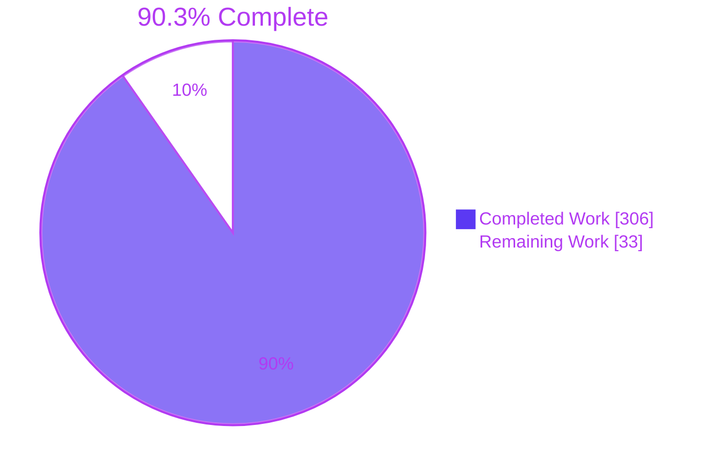
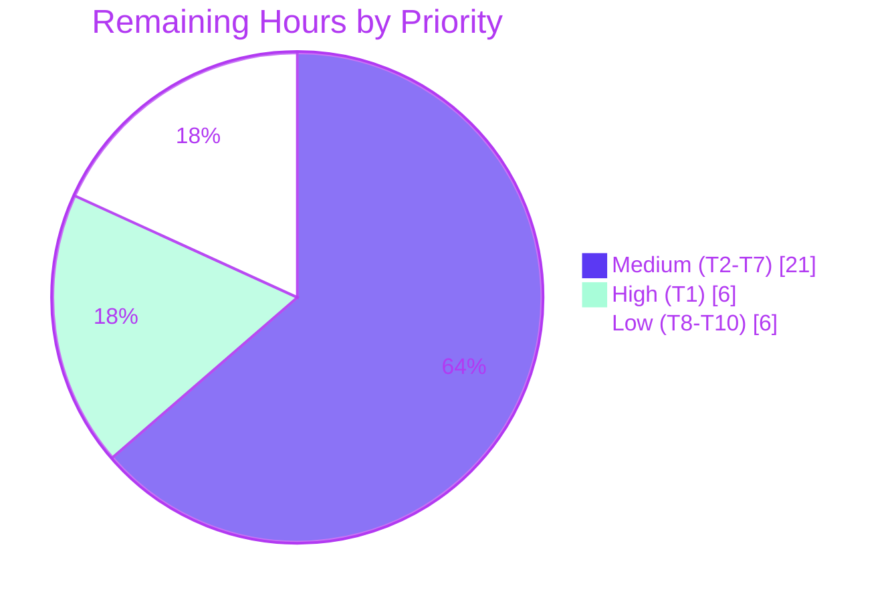

# 1. Executive Summary

## 1.1 Project Overview

This project amends `rust/ifcap-po-inquiry`, a standard-library-only Rust port of the read-only VistA IFCAP purchase-order display (`PRCH DISPLAY PO`, `EN3^PRCHRPT`). The port is tested case by case against captures of the original on `worldvista/vehu`. `src/golden.rs` alone reads the captures. A loopback bridge serves replay, COMPARE and status to a comparison screen, and a harness writes the verdict for each case to `REPORT.md`. The team's five captures let the port implement the HOME-device branches. Users are VistA modernisation engineers and case reviewers.

## 1.2 Completion Status



| Metric | Value |
|---|---|
| Total Hours | 339 |
| Completed Hours (AI + Manual) | 306 (290 AI + 16 manual) |
| Remaining Hours | 33 |
| Percent Complete | 90.3% |

306 completed hours out of 339 total hours = **90.3% complete**. The manual hours are the team's captures, `cases.zwr` and HOME-device answer. What remains is closing O-09, the O-11 bound, browser and live checks, and sign-off.

## 1.3 Key Accomplishments

- ✅ Only `src/golden.rs` reads captures (audits S3, S4).
- ✅ The HOME device is resolved. The device-open, form-feed, paging and exit-newline bytes match the captures.
- ✅ GC-03 and GC-04 PASS. GC-01, GC-02 and GC-05 differ only on line 25.
- ✅ Replay, COMPARE and `/api/status` answer exactly over five READY captures.
- ✅ The screen shows `RECORDED 5 OF 5 READY 5 OF 5` and `MATCH`/`MISMATCH`.
- ✅ 183 of 185 tests pass. clippy, rustfmt, rustdoc, S1–S9 and A7 are clean.
- ✅ `SPEC.md` holds a 108-row inventory, coverage 47/0/61, and conflicts K1–K14.
- ✅ The operator documents give the outcome for both capture states.

## 1.4 Critical Unresolved Issues

**6 of 16 AAP acceptance criteria are open: B1, A2 (as amended by D15), A5, A6, B3 and B4.**

- B1, A2 and A5 share one cause, O-09, and block release.
- A6, B3 and B4 are team-owned.

**2 of the 19 change directives are not fully met:** D1's goal and D15. Both fall short because of O-09. Open items O-11, O-07 and O-10 also carry release risk.

| Issue | Impact | Owner | ETA |
|---|---|---|---|
| B1 and the D1 goal: five PASS. GC-03 and GC-04 PASS. GC-01, GC-02 and GC-05 FAIL at transcript line 25, where the capture shows the buyer `POSTMASTER` at column 57 and the port writes nothing (O-09: no fixture holds `^VA(200,.5,0)`) | Parity for found orders is unproven, and `SPEC.md` "Acceptance record" records no acceptance. Every route to closure changes `tests/fixtures/ifcap/` or the golden README, which this change's file scope forbids, so the D19 escape valve applies (Section 5.2, row 20) | Team (revised-scope request), then a developer | 6 h (T1) |
| A2 as amended by D15: `cargo test --offline --locked` exits 0 | It exits 101. `equivalence_report` fails at `tests/equivalence.rs:773` on the three FAIL verdicts (row 21) | Developer, after T1 | Shared (T1) |
| A5: `cargo test --test bridge` exits 0 | 18 of 19 pass. `end_to_end_real_captures` fails at `tests/bridge.rs:1722` with `GC-01: COMPARE answered match false` (row 22) | Developer, after T1 | Shared (T1) |
| A6: the 14-item checklist by hand in current Chrome and Firefox | Cross-browser identity is unverified. Headless Chrome is exercised | Team | 6 h shared (T3) |
| B3: each case in the three modes, MATCH per passing case | Headless Chrome showed MATCH for GC-03 and GC-04 and MISMATCH for the three FAIL cases. No by-hand run exists | Team | 6 h shared (T3) |
| B4: screen identity and reactions in Firefox | Firefox behaviour is unknown | Team | 6 h shared (T3) |
| O-11: one session can repeat the display loop without bound (CWE-400, row 24) | `SPEC.md` O-11 extrapolates about 115 MB of output and 111 s of work for the largest admitted body. Replay is loopback-only, so the exposure is local | Developer | 6 h (T2) |
| O-07: the live start command cannot be expressed in `meta.txt` `docker_exec_args` | Live mode is unverified | Team | 6 h (T4, T5) |
| O-10: the process-exit newline rests on the captures, not on a documented YottaDB rule (row 25) | GC-03 and GC-04 PASS with it, but the rule is unconfirmed (conflict K14) | Team | 1 h (T7) |

## 1.5 Access Issues

| System/Resource | Type of Access | Issue Description | Resolution Status | Owner |
|---|---|---|---|---|
| `worldvista/vehu` image (`sha256:e0710df4…0622`) and a running container | Docker host with the image and the team's snapshot | Neither exists on the build host. Replay with the committed captures works, but live mode and re-recording cannot run there | Open: team-owned | Team |
| Firefox (current release) | Browser install | Not installed on the validation host, so A6 and B4 cannot be checked there | Open | Team |
| VEHU capture start command (O-07) | Operational knowledge | The command that produced the captures (`su - vehu -c "…"`) needs an argument with spaces, which `meta.txt` `docker_exec_args` cannot express | Open: question for the team | Team |
| `tests/fixtures/ifcap/` and `tests/golden/ifcap/README.md` (O-09) | Change authority | This change's file scope freezes both, and closing O-09 needs a change to one of them | Open: needs a revised-scope request (D19) | Team |

## 1.6 Recommended Next Steps

1. [High] As directive D19 provides, close this pull request and request a revised scope that supplies `^VA(200,.5,0)`. Then rerun to five PASS (T1).
2. [Medium] Bound per-session work (O-11) (T2).
3. [Medium] Run the checklist and the three modes by hand in Chrome and Firefox. Settle O-07, and run GC-01 live (T3–T5).
4. [Medium] Confirm O-10, and sign off the Section 5.2 decisions (T6, T7).
5. [Low] Refresh the frozen HOME-device wording and the sentences that give only the no-captures outcome (T8).

# 2. Project Hours Breakdown

## 2.1 Completed Work Detail

| Component | Hours | Description |
|---|---|---|
| Inquiry core (`src/inquiry.rs`, `src/mumps.rs`) | 30 | `InquiryError` keeps only `CorruptStore`, and `Halt` has the variants `InputExhausted`, `Unexercised` and `Corrupt`. An unimplemented branch ends the session at the last prompt through `into_transcript_at_prompt`. The O-03 guard (a)–(d) uses a prefix-seek index check, and the no-match sequence `<BEL> ??\n\nP.O./REQ.NO.: ` loops. `returned` is always `None` (AAP 0.3.2, 0.6.6) |
| Store contract (`src/store.rs`) | 12 | One `StoreError::Parse` variant. `load_fixtures` returns `io::Result<Store>`, merges at map level and has no mutator. Fixture files are opened read-only. 25 unit tests (AAP 0.3.2, A9) |
| Golden capture reader (`src/golden.rs`) | 40 | Capture conventions; `normalisation.txt` rules; `meta.txt` parsing and `docker_exec_args`; `validate_context`; the six readiness checks, `Readiness`, `CaseLoad`, `status`, `find_capture`, `live_start` and `default_dir`; bounded reads. 29 unit tests (AAP 0.3.2, A4) |
| Bridge server (`src/bridge.rs`) | 52 | `serve(listener, MumpsMode)`, replay rereading the folder per request, COMPARE through private `decide_match`, and `GET /api/status`. Exact static paths, the 400/404/502 texts, the live adapter through `golden`, unchanged limits, and the loopback request and response hardening. 53 unit tests (AAP 0.3.5.1) |
| Bridge binary and crate surface (`src/bin/bridge.rs`, `src/lib.rs`) | 8 | `GOLDEN_DIR` and `VEHU_CONTAINER` mode selection, the three startup lines, the stderr messages with their exit codes, the module and re-export surface, and `#![forbid(unsafe_code)]` at `src/lib.rs:9` (AAP 0.3.1, 0.3.5.1) |
| Comparison screen (`frontend/app.js`, `frontend/index.html`) | 12 | The `#bridge-status` line and `BRIDGE UNREACHABLE`, the boolean `MATCH`/`MISMATCH` verdict, and the input-handling behaviours. `style.css` is unchanged (AAP 0.3.5.2) |
| Bridge integration tests (`tests/bridge.rs`) | 20 | 19 tests that drive `serve` on `127.0.0.1:0` over temporary golden folders, plus an end-to-end pass over READY captures (AAP 0.7.3, A5) |
| Equivalence harness and report (`tests/equivalence.rs`, `REPORT.md`) | 16 | Five verdicts through `golden::load_case`. `REPORT.md` parts 1–3 are written with the nine included `SPEC.md` sections, and a second test checks the headings (AAP 0.7.2, A2, A8) |
| Specification reconciliation (`SPEC.md`) | 32 | A 108-row inventory with Tag and FileMan field columns, the coverage counts, and the new and renamed sections. The record also holds the 14-item checklist, conflicts K1–K13, the read-only results, the capture hashes, the run evidence and the acceptance record (AAP 0.3.6, 0.6.3, A1) |
| Operator documents (`RUNNING.md`, `runPlaybook.md`, `testingMethods.md`, `tests/golden/ifcap/README.md`) | 24 | Seven-step run guide with a failure-message table, a 12-phase playbook (116 lines), and a 52-line, 600-word testing method. The rewritten capture conventions and procedure state their commands identically in every document (AAP 0.3.6, A10, A12) |
| Repository hygiene and verification evidence | 8 | 1,002 `test-results/` files and `MANIFEST.txt` removed. Records of A7 source-unchanged, S1–S9, the capture listing and the A12 runtime check. Cargo manifests are unchanged (AAP 0.2.2, 0.2.3, 0.7.4) |
| HOME device branches and process-exit newline (`src/inquiry.rs`, `src/mumps.rs`) | 14 | `STUB_CONTEXT` sets `IOF` `#` and `IOSL` `60`, which closes O-01 (`src/inquiry.rs:117-122`). `pct_zis` writes the 26 device-open bytes, cited to `3.2+TERMINAL TYPE.zwr:818` (PO-12.b1). `Session::form_feed` and the `$X`/`$Y` model cover PO-10.b4 and PO-26.b1 (`src/mumps.rs:655-683`). The `$Y+5>IOSL` test is false for these orders (PO-30.b1). Normal completion appends `\n` when `$X>0` (directives D7–D11) |
| Exact-value tests and resolved contexts | 6 | Six new unit tests: four in `src/inquiry.rs` and two in `src/mumps.rs`. Three found-order tests are rewritten to the implemented output, and normally ended expectations end with `\n`. Every `IOSL` test literal moves from `24` to `60` in `src/golden.rs`, `src/bridge.rs` and `tests/bridge.rs`, and the golden expectations name the resolved constants (D12, D13) |
| Parity evidence and the O-09 diagnosis | 6 | The capture listing and baseline run recorded before the first edit. A `cases.zwr` preflight found all 51 extracted lines per case present. The five verdict runs, and the line-25 difference traced to `DIS^PRCHDP1` [PRCHDP1.m:59] and the missing buyer node (D3, D4, D14, D19) |
| Specification and operator documents for the captured state | 10 | `SPEC.md`: coverage 47/0/61; O-01 closed; O-05 closed with the image digest and snapshot id; O-09 to O-11; K14; "Places the original looks wrong"; the `state/` row; the Acceptance record; and the run evidence. The named sentences of `RUNNING.md` and `runPlaybook.md` give both outcomes. `REPORT.md` is regenerated (D6, D16, D17) |
| Team captures and answers (manual) | 16 | GC-01 to GC-05, seven files each, with `meta.txt` context `{"DUZ":".5","IOF":"#","IOSL":"60","STATION":"500"}`; `tests/fixtures/ifcap/cases.zwr`; and the `state/` export (commit `0b123807c`) |
| **Total** | **306** | 290 AI + 16 manual |

## 2.2 Remaining Work Detail

| Category | Hours | Priority |
|---|---|---|
| T1 Close O-09 under a revised scope. Let README Part B step 6 extract `^VA(200,<buyer>,0)` into `cases.zwr`, or add a supporting fixture with `^VA(200,.5,0)`. Rerun to five PASS, close O-09, and update the five-captures outcome in `RUNNING.md` and `runPlaybook.md`. Regenerate `REPORT.md` last [AAP B1, A2, A5; D1, D15] | 6 | High |
| T2 Bound per-session work or output (O-11) without changing the five transcripts, with tests [Path-to-production] | 6 | Medium |
| T3 By-hand 14-item checklist and three modes for each case in current Chrome and Firefox [AAP A6, B3, B4] | 6 | Medium |
| T4 Settle the O-07 start command or the `docker_exec_args` convention (K3) [AAP 0.6.6] | 3 | Medium |
| T5 Live mode: run GC-01 against VEHU and compare with replay [AAP 0.7.3] | 3 | Medium |
| T6 Review and sign off the Section 5.2 decisions marked for review [Path-to-production] | 2 | Medium |
| T7 Confirm the process-exit newline of `yottadb -run %XCMD` (O-10, K14) [D11] | 1 | Medium |
| T8 Documentation follow-ups: the HOME-device wording in frozen files, and the sentences that give only the no-captures outcome [AAP 0.3.6; D16] | 3 | Low |
| T9 Decide how live runs handle processes `docker` leaves behind [Path-to-production] | 2 | Low |
| T10 Write the acceptance record (playbook phase 12) after five PASS [AAP 0.7.4] | 1 | Low |
| **Total** | **33** | |

Confidence: T1 is high confidence. Adding only `^VA(200,.5,0)` as a fixture to a copy of the crate makes all 185 tests pass. T2 is medium confidence, because the bound must leave every recorded transcript unchanged. T3–T10 are medium confidence, and depend on team access to VEHU and Firefox.

## 2.3 Hours Calculation

- Completed hours = 30 + 12 + 40 + 52 + 8 + 12 + 20 + 16 + 32 + 24 + 8 + 14 + 6 + 6 + 10 + 16 = **306** (290 AI + 16 manual)
- Remaining hours = 6 + 6 + 6 + 3 + 3 + 2 + 1 + 3 + 2 + 1 = **33**
- Total project hours = 306 + 33 = **339**
- Completion = 306 / 339 × 100 = **90.3%**

# 3. Test Results

All results below come from `cargo test --offline --locked --no-fail-fast` and the gate commands, run from `rust/ifcap-po-inquiry` at commit `4aae4dba6` on Rust 1.99.1, with the five team captures and `cases.zwr` in place. The run exited 101 with **185 tests: 183 passed, 2 failed, 0 ignored**. Both failures have the single cause O-09 (Section 1.4). `Cargo.lock`, `SPEC.md` and `REPORT.md` were byte-identical after the run. No coverage tool is installed, and the AAP requires none.

| Area / Category | Framework | Tests | Passed | Failed | Coverage | What This Proves |
|---|---|---|---|---|---|---|
| Inquiry core: `src/inquiry.rs` (40), `src/mumps.rs` (17) | Rust libtest (unit) | 57 | 57 | 0 | Not measured | The 26 device-open bytes, the form feed, the `$Y+5>IOSL` test and the exit newline give exact bytes. Unimplemented branches still end at the last prompt, and the O-03 guard admits and refuses as specified |
| Store: `src/store.rs` | Rust libtest (unit) | 25 | 25 | 0 | Not measured | ZWR loading reports the malformed line number, loads `cases.zwr` last, admits only regular files, and never mutates |
| Golden reader: `src/golden.rs` | Rust libtest (unit) | 29 | 29 | 0 | Not measured | Normalisation, `meta.txt`, the six readiness checks and bounded reads classify captures correctly. Contexts are checked against `IOF` `#` and `IOSL` `60`, and `DUZ` `1` fails on `DUZ` alone |
| Bridge internals: `src/bridge.rs` | Rust libtest (unit) | 53 | 53 | 0 | Not measured | JSON escapes, surrogates and depth 64; the status JSON; the four `decide_match` cases; Host, Origin and Content-Type gates; the CSP hashes; accept backoff; the live-runner slot, timeout and output limits |
| Bridge HTTP contract: `tests/bridge.rs` | Rust libtest (integration) | 19 | 18 | 1 | Not measured | Over a real socket, every status, error text and refusal is exact. `end_to_end_real_captures` fails: COMPARE answers `match` false for GC-01 (O-09) |
| Equivalence harness: `tests/equivalence.rs` | Rust libtest (integration) | 2 | 1 | 1 | Not measured | Every included `SPEC.md` section exists. `equivalence_report` writes GC-03 and GC-04 PASS, and GC-01, GC-02 and GC-05 FAIL at transcript line 25, attributed to `DIS^PRCHDP1` |
| Static gates: clippy `--all-targets`, `cargo fmt --check`, `cargo doc -D warnings`, audits S1–S9, A7 | cargo, grep, git | 13 checks | 13 | 0 | N/A | No `unsafe`, `unwrap`, `expect` or `panic!` in `src/`. Capture-file names appear only in `src/golden.rs`. No file writes outside `#[cfg(test)]`, no write control in `frontend/`, and `Packages/` is unchanged |

**Not Covered.** Nothing below is exercised by any passing test. A human should check each item before release.

- **Parity for found orders.** GC-01, GC-02 and GC-05 cannot PASS until a fixture holds the buyer node `^VA(200,.5,0)`. Lines 1–24 and 26 onward of each are equal to the capture (T1).
- **PO-30.b2, the paging pause.** No case reaches it. Only a direct unit call confirms that it ends the session as `Unexercised`.
- **Unbounded display-loop repetition (O-11).** No test bounds the work or output of one session (T2).
- **Live mode against a real VEHU container.** This covers `docker exec -i`, the `EXIT <code>` and `TIMEOUT` answers from a real Docker, the `STANDARD STREAMS NOT CREATED` mapping, and processes `docker` leaves running after the 10 s kill. Run GC-01 live once (T5).
- **Accept-loop recovery from `ENFILE`, `ENOBUFS` and `ENOMEM`.** Unit tests cover it, but it has never been triggered on a live socket.
- **The `O_NONBLOCK` constants for Apple and BSD targets** (`src/store.rs`, `src/golden.rs`). They have never been compiled or run on those platforms.
- **`golden::tests::unsearchable_golden_folder_is_unreadable_not_absent`.** It prints `NOT RUN` when tests run as root. Run the suite once as an unprivileged user.
- **The screen in Firefox**, and by-hand runs in any browser of the checklist and the three modes with READY captures (T3).

# 4. Runtime Validation & UI Verification

The debug bridge was started in replay mode over the five committed captures, inside a private network namespace, and driven with curl. The screen was driven in headless Chrome.

- ✅ **Startup.** The bridge prints `http://127.0.0.1:8080/`, `MUMPS MODE: REPLAY` and `RECORDED 5 OF 5 READY 5 OF 5`. With `GOLDEN_DIR` set to a missing folder, it adds `bridge: golden directory missing: <path>` on stderr and keeps serving.
- ✅ **Single instance.** A second bridge exits 1 with `bridge: port 8080 on 127.0.0.1 is already in use`.
- ✅ **Static files, headers and request validation.** `/`, `/index.html`, `/app.js` and `/style.css` return 200, and `/nope` returns 404. Every answer carries `nosniff`, `no-store`, `X-Frame-Options: DENY`, the `default-src 'none'` CSP and `Referrer-Policy: no-referrer`. Malformed JSON returns 400 `BAD REQUEST: MALFORMED JSON`, and foreign `Host`, foreign `Origin` and `text/plain` requests are refused.
- ✅ **Status endpoint.** `GET /api/status` returns 200 with all five cases in `recorded` and `ready`, and `incomplete` is `{}`.
- ✅ **MUMPS replay.** All five recorded input sequences return the raw capture byte for byte, control sequences included. An unrecorded sequence returns 502 `NOT RECORDED`.
- ✅ **RUST session and the O-03 no-match loop.** The RUST transcripts of GC-03 and GC-04 equal their 101-byte captures, ending `P.O./REQ.NO.: \n`. The `<BEL> ??` loop is driven over HTTP with `cases.zwr` loaded.
- ⚠ **COMPARE.** It answers 200 with `match` true for GC-03 and GC-04, and false for GC-01, GC-02 and GC-05. Their RUST transcripts (1654, 1842 and 1735 B) differ from the captures (1664, 1852 and 1745 B) only on line 25, the missing `POSTMASTER` (O-09).
- ✅ **HOME device output.** In the found-order transcripts, line 8 ends with the six device-open sequences and `\n`, and the column header begins `\n\f\n\n` and 55 spaces before `UNIT`, as in the captures.
- ⚠ **Screen in headless Chrome.** The status line reads `MUMPS BACKEND: REPLAY RECORDED 5 OF 5 READY 5 OF 5`. COMPARE shows `MATCH` for GC-03 and GC-04, and `MISMATCH` for the other three. ESC and FF bytes render as text, with the grid intact and no markup injection. Firefox and by-hand checks were never exercised.
- ⚠ **Live mode was never run** against a VEHU container. It is delivered unverified, pending O-07. Replay is the delivered MUMPS backend.

# 5. Compliance & Quality Review

## 5.1 Compliance Matrix

| Deliverable (AAP criterion) | Benchmark | Status | Evidence |
|---|---|---|---|
| Branch inventory and coverage (A1) | 108 rows, each with routine, tag, line, FileMan field and one coverage label | ✅ Pass | `grep -c '^\| PO-' SPEC.md` returns 108. Coverage is 47 / 0 / 61 |
| Equivalence harness and verdict rule (A2 as amended by D15, B2) | `cargo test` exits 0 with five PASS, and a case without a capture shows NOT COMPARED | ❌ Not met (exit 101) | `equivalence_report` fails on three FAIL verdicts (O-09). The NOT COMPARED rule holds (`tests/equivalence.rs:7-8`, `status_empty_folder`) |
| Rust safety and capture isolation (A3, A4) | S1 has only `src/lib.rs:9`, S2 hits are reviewed, S3 returns nothing, and S4 hits only `src/golden.rs` | ✅ Pass | S1: 1 hit. S2: 1 hit, a comment at `src/inquiry.rs:786`. S3: exit 1. S4: 82 hits, all in `src/golden.rs` |
| Bridge contract (A5) | `cargo test --test bridge` exits 0 | ⚠ Partial (18 / 19) | `end_to_end_real_captures` fails: `GC-01: COMPARE answered match false` |
| Front-end checklist by hand (A6) | All 14 items in current Chrome and Firefox | ⚠ Partial (50%) | Headless Chrome is exercised with five READY captures. By-hand runs and Firefox are open (T3) |
| Source and captures unchanged (A7, A11 as amended by D3) | `git diff --quiet` exits 0, and the capture listing is the same before and after | ✅ Pass | Both exit 0. The listing holds 39 files plus `cases.zwr` `9dd56f96…32a0`, equal to `SPEC.md` "Capture hashes" |
| Generated report (A8) | Three parts plus the nine included `SPEC.md` sections | ✅ Pass | `REPORT.md` (1062 lines) is regenerated byte-identical, and `spec_has_report_sections` passes |
| Read-only enforcement (A9) | S5–S9 are recorded in `SPEC.md` | ✅ Pass | S5 and S9 return nothing. S6 finds one production `Command::new`. S7 hits only under `#[cfg(test)]`. S8 finds no control |
| Document limits and runtime check (A10, A12 as amended by D17) | `testingMethods.md` at most 60 lines and 600 words; `runPlaybook.md` at most 150 lines, in 12 phases, with both outcomes; a bridge runtime check | ✅ Pass | 52 lines and 600 words. 116 lines and 12 phases. The bridge started with `RECORDED 5 OF 5 READY 5 OF 5`, its status answered, and a second instance exited 1 |
| Build and lint quality (D15) | No warnings, and fmt, clippy and rustdoc clean | ✅ Pass | `cargo build` 0 warnings. `clippy --all-targets` 0. `fmt --check` 0. `cargo doc -D warnings` 0 |
| Parity acceptance (B1) | Five PASS in `REPORT.md` part 2 | ⚠ Partial (2 / 5) | GC-03 and GC-04 PASS. GC-01, GC-02 and GC-05 FAIL at line 25 (O-09, T1) |
| Screen with captures in two browsers (B3, B4) | Each case in three modes, and identity in Chrome and Firefox | ⚠ Partial | Headless Chrome shows MATCH for both passing cases. Firefox and by-hand runs are team-owned (T3) |

## 5.2 AAP & Rule Divergences and Gaps

The AAP sets no user rules (AAP 0.8). Rows 1–19 depart from the AAP's own wording in the delivered design. Rows 20–26 are places where this change fell short of, or qualified, what the AAP and the change directive D1–D19 required. Rows 27–39 are departures the directive itself ordered, marked **Sanctioned**, because the directive outranks the AAP. Rows 20, 21 and 22 block release. They appear in Section 1.4 with rows 24 and 25.

| What the AAP/Rule Required | What Was Delivered Instead | Why It Diverged | Impact | Remediation |
|---|---|---|---|---|
| 1. The capture-availability record uses `ls -la tests/golden/ifcap/ tests/fixtures/ifcap/` (0.7.1) | `ls -la --time-style=+ …`, recorded with its literal output (`SPEC.md:2032`) | Git sets modification times at checkout, so plain `ls -la` output never matches in another checkout. 0.7.4 requires recorded output to match a fresh run | None. Names, modes and sizes are still recorded | None needed |
| 2. Capture files are read with `std::fs::read` (0.3.3) | `open_read_only` plus `Read::take`, with budgets of 1 MiB for input and transcript, 64 KiB for returned, meta and normalisation, and 64 MiB per export (`src/golden.rs:550-563`) | An unbounded read lets one oversized capture exhaust memory | None for the real captures. Each `db-before.zwr` is 1,200,849 B, and all five cases are READY | None needed |
| 3. An unreadable capture gives 502 `NOT RECORDED (unreadable: <path>)` (0.3.5.1) | `NOT RECORDED (unreadable: <path>: <cause>)` | It gives operators the operating-system reason | The body text is longer than specified | None needed. `RUNNING.md` documents it |
| 4. Request parsing stays unchanged, and the only 400s are for body shape (0.3.5.1) | 400 `HOST NOT ALLOWED`, `ORIGIN NOT ALLOWED` and `CONTENT-TYPE APPLICATION/JSON REQUIRED`, checked before any session runs (`src/bridge.rs:584-843`) | An unauthenticated loopback server is open to DNS rebinding and to cross-site POSTs that can start `docker` | Only loopback-addressed, same-origin JSON clients are served. curl without `Origin` still works | Sign off (T6) |
| 5. "The hardening headers stay" (0.3.5.1) | A CSP of `default-src 'none'` with three `style-src-attr` hashes, plus `Referrer-Policy: no-referrer` (`src/bridge.rs:1122-1133`) | Security hardening. Hashes are stricter than `'unsafe-inline'` | Any new inline style must update the hashes, which `inline_styles_of_index_html_are_the_hashed_ones` enforces | None needed |
| 6. `index.html` gains one `<div id="bridge-status">` (0.3.5.2) | A grid wrapper whose hidden copy reserves the line's height, using inline styles (`frontend/index.html:15-17`) | It prevents layout shift when the status text arrives, while `style.css` stays unchanged as required | Layout shift is 0 | None needed |
| 7. Four startup messages (0.3.5.1 table) | Also `bridge: golden directory unreadable: <path>: <error>` and `bridge: serving failed: <error>`, and `cannot load fixtures` names its stage (`src/bin/bridge.rs:22-30, 91`) | It tells a missing golden folder from an unreadable one, and reports failures after the fixtures load | Diagnostics are more precise | None needed. `RUNNING.md` lists them |
| 8. A live run has a 10 s timeout with kill (0.3.5.1) | Only the `docker` child is killed (`src/bridge.rs:2531`). Processes `docker` started can outlive the run, and a run ends `TIMEOUT` while one of them holds the pipes | Killing a process group needs an unstable std API on 1.99.1, or `unsafe`/FFI, which `#![forbid(unsafe_code)]` rules out | Affects live mode only, which is unverified | Decide on a wrapper, or accept (T9) |
| 9. A non-empty `VEHU_CONTAINER` selects live mode (0.3.5.1) | A non-UTF-8 value is converted lossily and still selects live mode (`src/bin/bridge.rs:61`) | The AAP sets no rule for non-UTF-8 values, so the value is not rejected | Negligible | None needed |
| 10. `is_recorded` is true when the capture's input and transcript exist (0.3.2) | A case folder whose metadata cannot be read also counts as recorded (`src/golden.rs:1226-1232`). An unreadable golden folder therefore shows `RECORDED 5 OF 5 READY 0 OF 5` | Such a case ends FAIL (`CaseLoad::Unreadable`), so the count follows the verdict | The startup count can surprise an operator | Sign off (T6) |
| 11. Limits unchanged (0.3.5.1) | Accepting a connection backs off from 10 ms to 1 s on `EMFILE`, `ENFILE`, `ENOBUFS` and `ENOMEM` (`src/bridge.rs:90`) | Without it, descriptor or memory exhaustion ends the accept loop | The bridge keeps serving under pressure | None needed |
| 12. Limits unchanged (0.3.5.1) | A session-body input budget, with `FREE_INPUTS` 1024 and `MAX_HELD_INPUTS = MAX_BODY / 2` and admission that is not FIFO (`src/bridge.rs:102-113`) | Without it, 64 concurrent 1 MiB bodies can reach about 960 MB of peak memory | Peak memory is about 119 MB | None needed |
| 13. The AAP is silent on file types | Capture and fixture files are opened `O_NONBLOCK`, and their type is checked on the open descriptor. A non-regular `*.zwr` fails startup (`load_fixtures_rejects_non_regular_zwr_entry`) | It closes a check-then-open race, and a FIFO cannot hang startup | Startup fails fast on a bad fixture entry | None needed |
| 14. Minimal change and no extra abstractions (0.9.3); S3 forbids `golden` in `store.rs` | `admit`, `open_read_only` and `O_NONBLOCK` are duplicated in `src/store.rs:416-449` and `src/golden.rs:851-883` | The module boundaries forbid sharing through `golden`, and the AAP plans no shared module | Two copies must be kept in step | Optionally consolidate (T6) |
| 15. S6 expects `Command::new(program)` in `run_command` (0.7.4) | It is in `execute` (`src/bridge.rs:2245`), which `run_command` calls | `execute` owns the child's pipes and its kill | None. `SPEC.md` records the actual location | None needed |
| 16. SEND, and EXIT appending `^`, are "kept as they are" (0.3.5.2) | Focus returns to INPUT after SEND and EXIT, EXIT also clears INPUT, and a double-click sends one answer (`frontend/app.js:359-384`) | Usability hardening | The screen behaves more predictably | Check by hand (T3) |
| 17. `#match-status` is empty before a compare and after an error (0.3.5.2) | It is also empty while a compare is in flight | A stale verdict never shows beside a new request | None | None needed |
| 18. Checklist item 14 checks `BRIDGE UNREACHABLE` "with the bridge stopped" (0.3.5.2) | The check blocks `/api/status` in the browser's developer tools (`SPEC.md:1431`) | A page reloaded with the bridge stopped cannot load `app.js` at all | The same message, reached another way | Run as written (T3) |
| 19. Conflict register K1–K12 (0.9.4) | K13 is added: the resend on every selector change versus idle-screen identity, checked in two forms (`SPEC.md:1364, 1396`) | MUMPS and RUST idle screens cannot be identical after a resend of an unrecorded sequence | The checklist has a two-form item | Do the READY form by hand (T3) |
| 20. `REPORT.md` part 2 reads PASS for all five cases (D1 goal, D15; AAP B1) | GC-03 and GC-04 PASS. GC-01, GC-02 and GC-05 FAIL at transcript line 25, where the capture has `\|   POSTMASTER` and the port writes `\|   ` (`REPORT.md:739, 748, 771`) | The buyer node `^VA(200,.5,0)`, read at [PRCHDP1.m:59], is in no file under `tests/fixtures/ifcap/` (O-09, `SPEC.md:1326`). Supplying it needs a fixture or `cases.zwr` edit (D5), a README step 6 change (D17), a `src/store.rs` or PO-18 change (D18), or a hard-coded name (AAP 0.9.2). So the D19 escape valve applies. No correction attempt was made, because no source line supports one (D14) | Blocks release. Parity for found orders is unproven | T1 |
| 21. `cargo test --offline --locked` exits 0 with no failures (D15; AAP A2) | It exits 101. `equivalence_report` fails at `tests/equivalence.rs:773` | The same cause as row 20 (O-09) | Blocks release. Any gate on the exit status fails | T1 |
| 22. `end_to_end_real_captures` answers `match` true for every READY case, and `--test bridge` exits 0 (D15; AAP A5) | 18 of 19 pass. The test fails at `tests/bridge.rs:1722` with `GC-01: COMPARE answered match false` | The same cause as row 20 (O-09) | Blocks release | T1 |
| 23. Beside each named sentence, add the outcome with five captures: `GC-01 PASS` to `GC-05 PASS`, exit 0, `RECORDED 5 OF 5 READY 5 OF 5` (D17) | The named sentences of `RUNNING.md` and `runPlaybook.md` state the outcome actually observed: GC-03 and GC-04 PASS, GC-01, GC-02 and GC-05 FAIL at line 25, and exit 101 | D16 requires every present-tense statement to agree with the code, so a case not at PASS is stated as observed | The documents are true today, and must change once T1 lands | Update in T1 |
| 24. Production-ready code bounds the work one request can cause (AAP 0.9.3) | One session can repeat a found order's display without bound. The transcript grows about 1.6 KB per repetition, and `SPEC.md` O-11 (`SPEC.md:1328`) extrapolates about 115 MB and 111 s for the largest admitted body (CWE-400). It is recorded as open, not fixed | A bound needs a change to the frozen non-test bridge code, or to the logic of implemented branches (D18), which is outside this change's file scope | A local client can hold a worker thread and memory. Replay listens on loopback only | T2 |
| 25. Cite the YottaDB documentation for the process-exit newline (D11) | No such rule exists to cite. The newline is implemented from the captures, and O-10 (`SPEC.md:1327`) asks the team to confirm it | YottaDB documents only that CLOSE completes a partial record, and that it ignores CLOSE of `$PRINCIPAL`. It states no rule for HALT or process exit. D11 prescribes this fallback | Low. The rule rests on five captures, and GC-03 and GC-04 PASS with it | T7 |
| 26. The halt prompt as directive line 17 renders it, `       ENTER '^' TO HALT:` (7 spaces) | `SPEC.md:656, 1452` quote it with 8 leading spaces | `?8` at [PRCHDP2.m:10] and the captures both give column 8, and D16 requires agreement with the source | None on code or verdicts | None needed |
| 27. Zero captures. The capture listing is the single `ABSENT` line, and five cases are NOT COMPARED (0.2.1, 0.2.3, 0.7.1, A2, A11) | Five READY captures. The listing of 39 files plus `cases.zwr` is recorded in `SPEC.md` "Capture hashes" (`SPEC.md:1551`), and a baseline run precedes the first edit (`SPEC.md:1666`) | **Sanctioned:** D3 | None | None needed |
| 28. Remove items outside the layout (0.3.3, 0.2.2) | `tests/golden/ifcap/state/` is kept with its four files, and no code reads it (`SPEC.md:1464`). `save_state_report.txt` is absent, because the crate `.gitignore` excludes `*_report.txt` | **Sanctioned:** D6 | None | None needed |
| 29. `STUB_CONTEXT` holds `IOF` and `IOSL` as `None`, and O-01 stays open (0.3.4, 0.6.6) | `("IOF", Some("#"))` and `("IOSL", Some("60"))` (`src/inquiry.rs:117-122`). Any other value fails `CONTEXT MISMATCH <key>`, and the CONSOLE `IOF` context is rejected. `validate_context` is unchanged | **Sanctioned:** D7, from the team's answer | A capture recorded on another device now FAILs, by design | None needed |
| 30. No rule equivalent for `D ^%ZIS` (0.6.4) | `pct_zis` writes exactly the 26 device-open bytes (`src/inquiry.rs:1613, 1637`), citing `3.2+TERMINAL TYPE.zwr:818`, the line that holds `^%ZIS(2,168,2)`, where the directive suggested 816-817. The row keeps its "requires runtime shim" flag | **Sanctioned:** D8 | Output is fixed to terminal type 168, `PK-VTMT` | None needed |
| 31. YottaDB gives `WRITE #` as `<FF><LF>` (0.3.7) | `Session::form_feed` writes LF if `$X>0`, then FF, and sets `$X` and `$Y` to 0 (`src/mumps.rs:677-683`). The conflict is recorded in "Places the original looks wrong" (`SPEC.md:1452`) | **Sanctioned:** D9. The captures judge | None. The bytes equal the captures | None needed |
| 32. The `$Y+5>IOSL` paging test is not implemented (0.6.3, 0.6.4) | With `IOSL` 60 the test is false for these orders and writes nothing. The true arm ends `Halt::Unexercised("PO-30.b2")` (`src/inquiry.rs:2470-2477`) | **Sanctioned:** D10 | None | None needed |
| 33. Implemented output does not change (0.1.1) | Normal completion appends `\n` when `$X>0` (`src/inquiry.rs:164-168`). Conflict K14 records the tension (`SPEC.md:1365`) | **Sanctioned:** D11 | Every normally ended transcript gains one byte, as the captures show | Confirm with T7 |
| 34. Unit tests stop a found order at the device gate, and contexts carry `"IOSL":"24"` (0.7.3) | Three tests are rewritten to the implemented output. Every `IOSL` test literal is `"60"`, and the golden expectations name the resolved constants | **Sanctioned:** D12, D13 | None | None needed |
| 35. At most three correction attempts per case (0.7.2) | Five are allowed for this change only, noted at `SPEC.md:1786`. None were used | **Sanctioned:** D14 | None | None needed |
| 36. Coverage 43/4/61, O-05 open, and an acceptance record reading `Not accepted: no case has a capture.` (0.6.3, 0.6.6, 0.3.6) | Coverage 47/0/61. O-05 is closed with `image_digest` and `snapshot_id`. The acceptance record (`SPEC.md:2383`) states the observed verdicts without acceptance, and RUNTIME-VERIFIED labels only GC-03 and GC-04 | **Sanctioned:** D16 | None | None needed |
| 37. A clean checkout gives five NOT COMPARED and `RECORDED 0 OF 5` as the sole outcome (A12) | Each named sentence gives both outcomes, and no command changes | **Sanctioned:** D17 | None | None needed |
| 38. Every document and doc comment agrees with the code (0.3.6, 0.9.3) | Frozen files still say `IOF` and `IOSL` are unresolved: `src/golden.rs:125, 506-508`, `tests/bridge.rs:172`, `RUNNING.md:67`, `runPlaybook.md:68`, `testingMethods.md:48`, and `tests/golden/ifcap/README.md:119-120, 172, 260, 325` | **Sanctioned:** D2, D17 and D18 freeze these files and lines | Readers meet statements the code no longer bears out | T8 |
| 39. Every document agrees with the code (0.3.6) | Sentences D17 did not name still give only the no-captures outcome, or credit plain `cargo test` with rewriting `REPORT.md`: `RUNNING.md:79` and `runPlaybook.md:44-46, 87, 116` | **Sanctioned:** D2 and D17 allow edits to the named lines only | While O-09 stands, plain `cargo test` stops at `tests/bridge.rs` and never rewrites `REPORT.md` | T8 |

**Divergences needing a human decision**

**20–22: Five PASS blocked by the missing buyer node.** Transcript line 25 of GC-01, GC-02 and GC-05 writes the buyer name from `^VA(200,Y,0)` at column 57 [PRCHDP1.m:59]. Each order's buyer is `.5`, and `^VA(200,.5,0)="POSTMASTER^…"` is in every `db-before.zwr` and in `Packages/Kernel/Globals/200+NEW PERSON.zwr:4`, but `tests/equivalence.rs` loads only `tests/fixtures/ifcap/`. Adding just that node as a fixture to a copy of the crate makes all 185 tests pass. Decide which route to authorise in the revised-scope request: extend README Part B step 6 and rebuild `cases.zwr`, or add a supporting fixture.

**24: Unbounded session work (O-11).** `en30_prchrpt` (`src/inquiry.rs:592-609`) loops back to the order prompt after each display, and `Session::write` appends without a budget (`src/mumps.rs:610-620`). The bridge admits a 1 MiB body, so one request can repeat a found order tens of thousands of times. Replay is loopback-only and read-only, so the exposure is local, but a worker thread and memory are held for the whole run. Decide whether to cap output bytes, session steps or wall time in the bridge, and require that the five transcripts stay unchanged.

**25 and 33: Process-exit newline (O-10, K14).** Every capture ends with one `\n` after the final `P.O./REQ.NO.: `, and the port now writes it only when `run` returns normally with `$X>0` (`src/inquiry.rs:164-168`). Sessions that end `InputExhausted` or `Unexercised` keep the prompt cut and get no newline. YottaDB documents no exit rule, so the behaviour rests on the five captures. Confirm, from a YottaDB maintainer or a test of `yottadb -run %XCMD` on a piped principal device, that the newline comes from process exit.

**4: Loopback request gates.** The AAP kept request parsing unchanged. The bridge refuses any request whose `Host` is not `127.0.0.1`, `localhost` or `[::1]`. It also refuses a session POST that carries a foreign `Origin` or a non-JSON `Content-Type`. This closes DNS-rebinding and cross-site routes to `docker exec` in live mode. `foreign_host_and_cross_origin_post_400` (`tests/bridge.rs:1401`) and `session_post_needs_own_origin_and_json` (`src/bridge.rs:5089`) pin the behaviour, and `RUNNING.md` documents the texts. Decide whether to accept it, or name any client that needs another `Host`.

**8: Live timeout kill scope.** On timeout, `src/bridge.rs` kills only the `docker` process it started. A process inside the container, or the child of a wrapper installed as `docker`, keeps running. Such a process can also hold the output pipe open until the 10 s `TIMEOUT`. Stable Rust 1.99.1 cannot kill a process group without `unsafe`, which the crate forbids. Decide whether the O-07 start command should wrap the session in a container-side `timeout`, or accept this behaviour for a team-only tool.

**10: Status counting of uninspectable folders.** `golden::is_recorded` counts a case folder it cannot inspect as recorded, because `load_case` reports that folder `Unreadable`, which is FAIL. If the whole golden folder is unreadable, startup prints `RECORDED 5 OF 5 READY 0 OF 5` and `cargo test` fails. This keeps the status consistent with the verdict, but it can mislead an operator. Confirm these semantics, or ask for a separate UNREADABLE count in `/api/status`.

**14: Duplicated file-admission helpers.** `admit`, `open_read_only` and the platform `O_NONBLOCK` constant exist in both `src/store.rs:416-449` and `src/golden.rs:851-883`. AAP audit S3 forbids `store.rs` from naming `golden`, and the AAP plans no shared module. Each module tests its own copy with `admit_keeps_only_what_is_a_regular_file_once_opened` (`src/store.rs:1078`, `src/golden.rs:2558`). Decide whether to accept a small private shared module, which amends the AAP layout, or keep the two copies in step by review.

**38–39: Wording in frozen and unnamed lines.** Fourteen passages across `src/golden.rs`, `tests/bridge.rs`, `RUNNING.md`, `runPlaybook.md`, `testingMethods.md` and the golden README still describe the HOME device as unresolved, or give only the no-captures outcome. The directive froze them, so they stand as written. Their most misleading claim concerns how `REPORT.md` is regenerated. While any case FAILs, use `cargo test --offline --locked --no-fail-fast` or the `--test equivalence` target. Authorise a documentation-only change that updates them after T1.

# 6. Risk Assessment

| Risk | Category | Severity | Probability | Mitigation | Status |
|---|---|---|---|---|---|
| Parity for found orders is unproven. GC-01, GC-02 and GC-05 FAIL until a fixture holds the buyer node, and a later difference could sit behind line 25 | Technical | High | High: certain until O-09 closes | Close O-09 under a revised scope and rerun to five PASS. A one-node fixture already gives 185 of 185 on a copy of the crate (T1) | Open |
| One session can repeat the display loop without bound (O-11, CWE-400). About 115 MB of output and 111 s of work for the largest admitted body | Security | Medium | Medium | Cap output bytes, steps or wall time per session without changing the five transcripts (T2) | Open |
| The process-exit newline (K14) rests on the captures, not on a documented YottaDB rule | Technical | Low | Low | Confirm with the YottaDB behaviour of `yottadb -run %XCMD` (T7) | Open (O-10) |
| Live mode is unverified. The start command cannot be expressed (O-07), and processes `docker` starts survive the 10 s kill | Integration | Medium | High | Settle O-07, run GC-01 live once, and decide on a container-side timeout (T4, T5, T9) | Open. Replay is the delivered backend |
| Firefox rendering and behaviour have never been exercised, so screen identity across browsers is unknown | Integration | Medium | Medium | Run the 14-item checklist and the three modes in current Firefox (T3) | Open |
| Transcripts now carry raw device-control bytes (`ESC[5i`, `ESC[4i`, `ESC[?3h`, FF). Piped to a real terminal, they can switch printer or column modes | Operational | Low | Low | The screen renders them as text, and the JSON escapes them. Never `cat` a transcript to a terminal | Accepted |
| The bridge is unauthenticated. Any local process can call it, and in live mode a session runs `docker exec` | Security | Medium | Low | Binds only `127.0.0.1:8080`. `Host` allowlist, same-`Origin` and JSON-only session POSTs, a strict CSP, and no shell or request-supplied M code | Mitigated |
| Frozen documents still describe the HOME device as unresolved, and credit plain `cargo test` with rewriting `REPORT.md` | Operational | Low | Medium | Use `--no-fail-fast` or `--test equivalence` while any case FAILs, and refresh the wording after T1 (T8) | Open |

# 7. Visual Project Status


**Remaining hours by priority (33 h total)**



| Remaining category (Section 2.2) | Hours |
|---|---|
| O-09 closure to five PASS (T1) | 6 |
| Session work bound, O-11 (T2) | 6 |
| Browser checks, O-07 and the live run (T3–T5) | 12 |
| Sign-off and the O-10 confirmation (T6–T7) | 3 |
| Documentation follow-ups, `docker` leftovers and the acceptance record (T8–T10) | 6 |
| **Total** | **33** |

# 8. Summary & Recommendations

The crate `rust/ifcap-po-inquiry` holds everything the AAP asked this delivery to build, and is now tested against the team's five real captures:

- `src/golden.rs` is the only capture reader.
- The bridge serves replay, COMPARE with a boolean `match`, and `GET /api/status`, and the screen shows the status line.
- The inquiry core implements the HOME device as the team answered it: the 26 device-open bytes, the form feed with its `$X`/`$Y` model, the paging test, and the process-exit newline.
- The equivalence harness regenerates `REPORT.md`, and the specification and four operator documents are reconciled to the captured state.

The project is **90.3% complete**: 306 of 339 hours. The remaining 33 hours start with one high-priority task, closing O-09. The rest is security hardening, team-owned browser and live checks, and sign-off.

The verification evidence is strong. 183 of 185 tests pass, and build, clippy, rustfmt and rustdoc report no warnings. The S1–S9 audits and the A7 source-unchanged check match the AAP. A running bridge with five READY captures answered every status, error text and refusal exactly, and MUMPS replay returned each capture byte for byte.

GC-03 and GC-04 PASS. GC-01, GC-02 and GC-05 equal their captures everywhere except line 25. There the buyer name `POSTMASTER` is missing, because no fixture holds `^VA(200,.5,0)`. Every fix lies outside this change's file scope, so the work stops at the D19 escape valve. Live mode and Firefox have never been exercised.

The critical path to production:

1. Open a revised-scope request that supplies the buyer node, and rerun to five PASS (T1).
2. Bound per-session work (T2).
3. Finish the by-hand Chrome and Firefox checks, settle O-07 and run GC-01 live once (T3–T5).
4. Confirm O-10, sign off Section 5.2, and write the acceptance record (T6, T7, T10).

| Success metric | Target | Current |
|---|---|---|
| `REPORT.md` part 2 verdicts | 5 PASS | 2 PASS, 3 FAIL (line 25, O-09) |
| Crate tests | All pass | 183 / 185 |
| Branches exercised and implemented | 47 | 47 (coverage 47/0/61) |
| Acceptance criteria met | 16 / 16 | 10 / 16 |
| Change directives fully met | 19 / 19 | 17 / 19 |

**Production readiness:** the port is not yet accepted. Replay mode is read-only and bound to loopback, so it is safe to run locally today. Release waits on T1, which also closes Section 5.2 rows 20–23. Before the bridge serves anyone but its operator, bound per-session work (T2). Then review the other decisions listed after the Section 5.2 table (T6, T7, T9).

# 9. Development Guide

## 9.1 System Prerequisites

- **OS:** Linux x86_64. The suite was verified on Ubuntu 25.10. The crate also targets other Unix systems, but they are untested (Section 3, Not Covered).
- **Rust 1.99.1** with `rustfmt` and `clippy`. `rust-toolchain.toml` pins `channel = "1.99.1"`, and `Cargo.toml` sets `rust-version = "1.99.1"` and edition 2024.
- **A C linker (`cc`)**, for example gcc. Rust uses it to link the binary and the tests.
- **No crates.io access.** `[dependencies]` is empty, so the crate builds offline against the committed `Cargo.lock`.
- **Docker**, only for recording captures and for live mode. **Current Chrome or Firefox**, only for the screen.
- **Hardware:** any developer machine. A full build and test run takes about 15 s.

## 9.2 Environment Setup

Every command runs from the crate directory:

```bash
cd rust/ifcap-po-inquiry
export RUSTUP_AUTO_INSTALL=0   # a missing pinned toolchain fails instead of downloading
rustc --version                # expect: rustc 1.99.1 (...)
cargo --version                # expect: cargo 1.99.1 (...)
```

If the toolchain is missing, install it once with `rustup toolchain install 1.99.1 --component rustfmt clippy`. There is no virtual environment or package install step, and no `.env` file.

## 9.3 Build and Test

```bash
cargo build --offline --locked                       # exit 0, no warnings
cargo test --offline --locked --no-fail-fast         # 185 run: 183 passed, 2 failed (O-09); exit 101
cargo test --offline --locked --lib                  # 164 unit tests, exit 0
cargo test --offline --locked --test bridge -- --test-threads=1                  # 18 passed, 1 failed
cargo test --offline --locked --test equivalence -- --nocapture --test-threads=1 # verdict lines; rewrites REPORT.md
cargo clippy --offline --locked --all-targets        # exit 0, no warnings
cargo fmt --check                                    # exit 0
RUSTDOCFLAGS='-D warnings' cargo doc --offline --locked --no-deps --document-private-items
```

- The equivalence run with `--nocapture` prints one line per case: `GC-01 FAIL`, `GC-02 FAIL`, `GC-03 PASS`, `GC-04 PASS` and `GC-05 FAIL`. Each FAIL names transcript line 25 and `DIS^PRCHDP1`.
- Plain `cargo test --offline --locked` stops when `tests/bridge.rs` fails, with `error: test failed, to rerun pass --test bridge`. The equivalence target then never runs, and `REPORT.md` is not rewritten. While any case FAILs, use `--no-fail-fast` or the `--test equivalence` command.
- Commit `REPORT.md` only as produced by the last equivalence run after the final `SPEC.md` edit. Otherwise restore it with `git checkout -- REPORT.md`.
- Never run `cargo update`, because `Cargo.lock` must stay unchanged.

## 9.4 Run the Bridge and Screen

```bash
cargo run --offline --locked --bin bridge
```

Expected standard output, with the five committed captures:

```text
http://127.0.0.1:8080/
MUMPS MODE: REPLAY
RECORDED 5 OF 5 READY 5 OF 5
```

- The bridge always binds `127.0.0.1:8080`, and there is no port option. On a shared host where port 8080 is taken, build first, then run the bridge and the client together in one private network namespace:

  ```bash
  cargo build --offline --locked
  sudo unshare -n sh -c 'ip link set lo up; ./target/debug/bridge & sleep 1; curl -s http://127.0.0.1:8080/api/status; kill $!'
  ```

- Open `http://127.0.0.1:8080/` in Chrome or Firefox. `file://` is not supported. The screen shows `PURCHASE ORDER DISPLAY`, the status line `MUMPS BACKEND: REPLAY RECORDED 5 OF 5 READY 5 OF 5`, the MUMPS/RUST/COMPARE selector, INPUT, SEND, EXIT and the 80×24 transcript.
- To serve another golden folder, run `GOLDEN_DIR=<folder> cargo run --offline --locked --bin bridge`.
- To run live mode, which is unverified (O-07), run `VEHU_CONTAINER=<container> cargo run --offline --locked --bin bridge`.
- Stop the bridge with Ctrl-C.

## 9.5 Verification and Example Usage

Run these while the bridge is serving:

```bash
curl -s http://127.0.0.1:8080/api/status
# {"mumps_mode":"replay","recorded":["GC-01","GC-02","GC-03","GC-04","GC-05"],"ready":["GC-01","GC-02","GC-03","GC-04","GC-05"],"incomplete":{}}

curl -s -X POST -H 'Content-Type: application/json' -d '{"inputs":[""]}' http://127.0.0.1:8080/api/rust/session
# {"transcript":"\n\n\nSelect STATION NUMBER ('^' TO EXIT): 500//       CAMP MASTER\n\n\nP.O./REQ.NO.: ","returned":null}

curl -s -X POST -H 'Content-Type: application/json' -d '{"inputs":["","GC3003","^"]}' http://127.0.0.1:8080/api/compare/session
# HTTP 200, "match":true. Both transcripts end "P.O./REQ.NO.: \u0007 ??\n\nP.O./REQ.NO.: \n"

curl -s -X POST -H 'Content-Type: application/json' -d '{"inputs":["","GC1001","","","^"]}' http://127.0.0.1:8080/api/compare/session
# HTTP 200, "match":false. Line 25 lacks POSTMASTER (O-09)

curl -s -X POST -H 'Content-Type: application/json' -d '{"inputs":[""]}' http://127.0.0.1:8080/api/mumps/session
# {"error":"NOT RECORDED"}     (HTTP 502: no capture has this input sequence)

cargo run --offline --locked --bin bridge; echo "exit=$?"   # a second instance
# bridge: port 8080 on 127.0.0.1 is already in use
# exit=1
```

To re-record or add a case, follow `tests/golden/ifcap/README.md` Part B. Never edit a committed capture, `normalisation.txt` or `cases.zwr`. Then run `cargo test --offline --locked --no-fail-fast`, and restart the bridge.

## 9.6 Troubleshooting

| Symptom | Cause | Resolution |
|---|---|---|
| `error: toolchain '1.99.1…' is not installed` | Pinned toolchain missing, with `RUSTUP_AUTO_INSTALL=0` set | `rustup toolchain install 1.99.1 --component rustfmt clippy` |
| `linker 'cc' not found` | No C toolchain | Install gcc (`apt-get install -y gcc`) |
| `bridge: port 8080 on 127.0.0.1 is already in use` (exit 1) | Another bridge, or another process, holds the port | Stop it, or run in a private network namespace (9.4) |
| `bridge: golden directory missing: <path>` | `GOLDEN_DIR` is wrong, or the folder is absent | Correct the path. The bridge keeps serving with `RECORDED 0 OF 5` |
| `bridge: cannot load fixtures: <path>: …` (exit 1) | An unreadable or non-regular file, or a malformed ZWR line, under `tests/fixtures/ifcap/` | Restore the fixture with `git checkout -- tests/fixtures/ifcap` |
| Status line shows `BRIDGE UNREACHABLE` | Page not served by a running bridge | Start the bridge, open `http://127.0.0.1:8080/` and reload |
| Status line counts are stale | It is fetched once, on page load | Reload the page after adding captures or restarting the bridge |
| `cargo test` stops at `error: test failed, to rerun pass --test bridge`, and `REPORT.md` is unchanged | `end_to_end_real_captures` fails before the equivalence target runs | Run `cargo test --offline --locked --no-fail-fast`, or the `--test equivalence` command |
| `GC-0N FAIL: transcript differs at line 25 … POSTMASTER` | The buyer node `^VA(200,.5,0)` is in no fixture (O-09) | Close O-09 under a revised scope (T1). Never edit a capture or add a normalisation rule |
| `CONTEXT MISMATCH IOSL: expected 60, actual 24`, or `IOF: expected #` | The case was recorded on a device other than HOME device 0 with `IOSL` 60 | Re-record with the documented context. Never edit a capture |
| `CONTEXT MISMATCH DUZ: expected .5, actual 1` | The case's `meta.txt` context differs from `STUB_CONTEXT` | Re-record with the documented context |
| The terminal changes mode after `cat` of a transcript | Captures hold raw device-control bytes (`ESC[?3h`, `ESC[5i`, FF) | View transcripts with `cat -v` or `od -c` |
| `400 BAD REQUEST: HOST NOT ALLOWED` / `ORIGIN NOT ALLOWED` | Request addressed to a non-loopback host, or sent from another origin | Use `127.0.0.1`, `localhost` or `[::1]`, and send session POSTs from the bridge's own page or without `Origin` |

# 10. Appendices

## A. Command Reference

| Purpose | Command (from `rust/ifcap-po-inquiry`) |
|---|---|
| Build | `cargo build --offline --locked` |
| All tests, running every target even when one fails | `cargo test --offline --locked --no-fail-fast` |
| Verdict lines and `REPORT.md` regeneration | `cargo test --offline --locked --test equivalence -- --nocapture --test-threads=1` |
| Lint and format | `cargo clippy --offline --locked --all-targets` and `cargo fmt --check` |
| Docs gate | `RUSTDOCFLAGS='-D warnings' cargo doc --offline --locked --no-deps --document-private-items` |
| Run the bridge | `cargo run --offline --locked --bin bridge` |
| Bridge in a private namespace | `sudo unshare -n sh -c 'ip link set lo up; ./target/debug/bridge & sleep 1; curl -s http://127.0.0.1:8080/api/status; kill $!'` |
| Source unchanged (A7, repository root) | `git diff --quiet HEAD -- Packages Packages.csv README.rst LICENSE NOTICE ATTESTATION` |
| Capture listing (A11) | `find tests/golden/ifcap -type f ! -name README.md -exec sha256sum {} +` and `[ -f tests/fixtures/ifcap/cases.zwr ] && sha256sum tests/fixtures/ifcap/cases.zwr \|\| echo "ABSENT tests/fixtures/ifcap/cases.zwr"` |
| Audits S1–S9 | As listed in AAP 0.7.4. Results are recorded in `SPEC.md` "Read-only enforcement results" |

## B. Port Reference

| Port | Bound by | Notes |
|---|---|---|
| `127.0.0.1:8080` | `src/bin/bridge.rs` | Fixed constant. Loopback only. No TLS or authentication, by design |
| `127.0.0.1:0` (ephemeral) | `tests/bridge.rs`, `src/bridge.rs` tests | Each test picks a free port. No allocation needed |

## C. Key File Locations

| Path | Purpose |
|---|---|
| `src/inquiry.rs` | `inquire`, `STUB_CONTEXT`, session halts, O-03 guard, `pct_zis` and the device-open bytes |
| `src/mumps.rs` | Private M primitives: collation, `$PIECE`, `$JUSTIFY`, prompt cut, the `$X`/`$Y` model and `form_feed` |
| `src/store.rs` | Immutable ZWR `Store`, `load_fixtures`, `StoreError::Parse` |
| `src/golden.rs` | The only capture reader: conventions, readiness, normalisation, `find_capture` |
| `src/bridge.rs` | `serve`, `MumpsMode`, endpoints, `decide_match`, live adapter, hardening |
| `src/bin/bridge.rs` | Startup, environment variables, stderr messages |
| `frontend/index.html`, `app.js`, `style.css` | Comparison screen |
| `tests/bridge.rs`, `tests/equivalence.rs` | HTTP contract tests, verdict harness and `REPORT.md` writer |
| `tests/fixtures/ifcap/*.zwr` | 11 read-only fixtures plus the team's `cases.zwr` (`9dd56f96…32a0`) |
| `tests/golden/ifcap/GC-01` … `GC-05` | The five READY captures, seven files each |
| `tests/golden/ifcap/state/` | The team's state export, kept as committed and read by no code |
| `tests/golden/ifcap/README.md` | Capture conventions and the recording procedure (Part B) |
| `SPEC.md`, `REPORT.md` | Specification, open items and run evidence; the generated parity report |
| `RUNNING.md`, `runPlaybook.md`, `testingMethods.md` | Run guide, 12-phase playbook, one-page testing method |

## D. Technology Versions

| Technology | Version |
|---|---|
| Rust (`rustc`, `cargo`) | 1.99.1, edition 2024 |
| rustfmt / clippy | 1.10.0 / 0.1.99 |
| Crate dependencies | None (standard library only) |
| Linker | gcc 15.2 (`cc`) |
| Original system | `worldvista/vehu@sha256:e0710df4ab487831ad84d0383637488da2baa37168ce8ac8e71e8cd039590622`, snapshot `sha256:a8089ad06fcca92d40659c2a1503cd6f4ef829f407df547d939275e6892bace4` (YottaDB, VistA IFCAP) |
| Browsers | Current Chrome (headless, verified), current Firefox (not verified) |

## E. Environment Variable Reference

| Variable | Used by | Default | Effect |
|---|---|---|---|
| `GOLDEN_DIR` | `src/bin/bridge.rs` | `golden::default_dir()` = `tests/golden/ifcap` | Golden folder the bridge reads. Tests always use the default |
| `VEHU_CONTAINER` | `src/bin/bridge.rs` | unset | A non-empty value selects live mode against that container |
| `RUSTUP_AUTO_INSTALL` | rustup | unset | Set it to `0` so a missing toolchain fails instead of downloading |
| `RUSTDOCFLAGS` | cargo doc | unset | `-D warnings` for the docs gate |

## F. Developer Tools Guide

- **Reading verdicts:** after the equivalence run, `REPORT.md` part 2 gives each case's verdict with the first differing line, the expected and actual text, and the routine it is attributed to. Part 3 gives readiness with any failed checks.
- **Inspecting the bridge:** `curl -s http://127.0.0.1:8080/api/status` shows the mode and the recorded, READY and INCOMPLETE cases.
- **Inspecting transcripts:** `od -c tests/golden/ifcap/GC-01/transcript.txt` shows the device-open sequences and the form feed, which a terminal would otherwise act on.
- **Front-end checks:** `SPEC.md` "Front-end checklist" (14 items). Use the browser's developer tools to block `/api/status` for item 14.
- **Audits:** run S1–S9 from the crate and compare with `SPEC.md` "Read-only enforcement results".

## G. Glossary

| Term | Meaning |
|---|---|
| Capture | One recorded run of a case on VEHU: seven files in `tests/golden/ifcap/GC-0N/` |
| READY / INCOMPLETE | All six readiness checks pass / at least one fails |
| PASS / FAIL / NOT COMPARED | Case verdicts (AAP 0.7.2). NOT COMPARED means the capture's input or transcript is absent |
| Replay / Live | MUMPS backend from captures / from `docker exec` against a running container |
| HOME device | Device 0 with `IOF` `#` (form feed) and `IOSL` 60, the context every capture records |
| O-01 … O-11 | Items in `SPEC.md` "Open items". O-01 (HOME device) and O-05 (image record) are closed. O-07 (start command), O-09 (buyer node), O-10 (exit newline) and O-11 (session work bound) are open, and O-04 is open but not blocking |
| K1 … K14 | Conflict register entries in `SPEC.md`. K14 is the process-exit newline against unchanged output |
| Escape valve (D19) | The directive's stop: when every fix lies outside the allowed scope, the work stops and a revised-scope request follows |
| `STUB_CONTEXT` | The four context keys and values the port assumes, checked against `meta.txt` |
