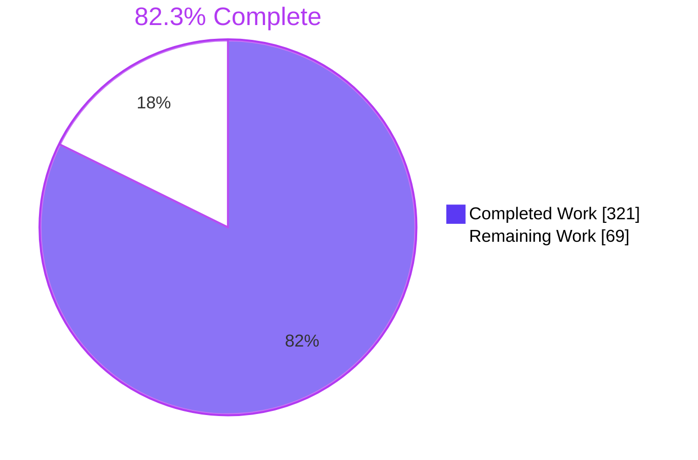
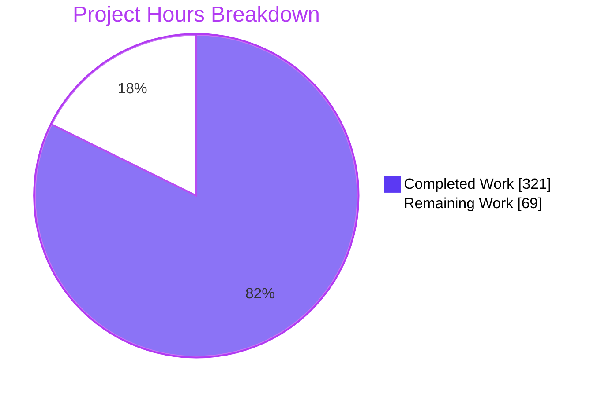
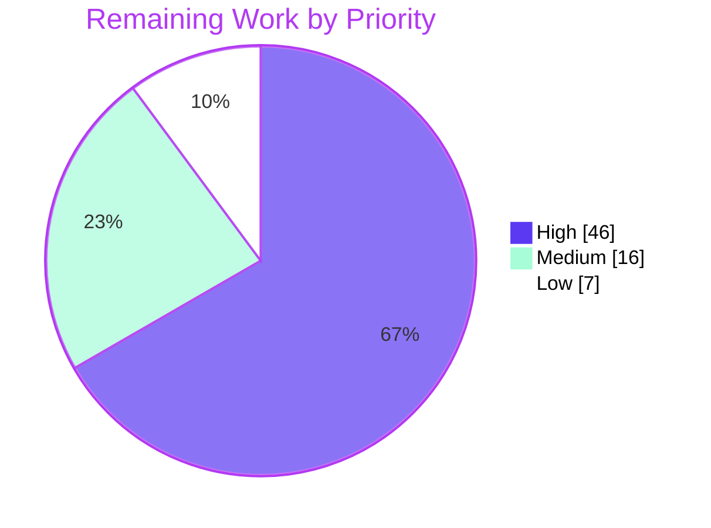

# 1. Executive Summary

## 1.1 Project Overview

The crate `rust/ifcap-po-inquiry` is a standard-library-only Rust port of the read-only VistA IFCAP purchase-order display, OPTION `PRCH DISPLAY PO` (`EN3^PRCHRPT`). It reproduces the original's prompts, messages, field order and formatting byte for byte over an immutable store of FileMan globals. It also ships the means to prove that equivalence: a source-contract specification (`SPEC.md`), a golden-capture harness, and a loopback HTTP bridge with a retro single-screen front-end that drives MUMPS, Rust or both side by side. It is for VA modernisation engineers who need evidence before the routine is retired. Nothing outside the crate changes.

## 1.2 Completion Status



| Metric | Hours |
|---|---|
| **Total Hours** | 390 |
| **Completed Hours (AI + Manual)** | 321 (AI 321, Manual 0) |
| **Remaining Hours** | 69 |
| **Percent Complete** | 82.3% |

321 hours completed out of 390 total hours = **82.3% complete**.

## 1.3 Key Accomplishments

- ✅ Rust port of all 41 source contracts (PO-01 to PO-41), with 108 branches classified against source
- ✅ Read-only ZWR store over 11 byte-identical fixtures (29,820 nodes), hashed in `MANIFEST.txt`
- ✅ Loopback bridge for replay, live and compare sessions on the fixed status set 200/400/404/422/500/502
- ✅ Single-screen front-end in MUMPS, RUST and COMPARE modes, verified in Chrome with no JavaScript exceptions
- ✅ Golden-capture harness that reports NOT COMPARED honestly and writes only between its `REPORT.md` markers
- ✅ 158 of 158 tests pass; clippy and rustfmt clean; no `unsafe`, `unwrap`, `expect`, `panic!` or indexing in `src/`
- ✅ Offline, locked build on pinned Rust 1.99.1 with no external crates
- ✅ No file outside the crate changed

## 1.4 Critical Unresolved Issues

15 items remain open: 8 release gates owned by the team and 7 engineering items inside the crate. Of the AAP's 12 completion and acceptance criteria, A1 to A8 are met and B1 to B4 are open. Of the 8 source open items in `SPEC.md`, 7 are still open and O-02 is closed.

| Issue | Impact | Owner | ETA |
|---|---|---|---|
| Golden captures GC-01 to GC-05, `cases.zwr` and its `MANIFEST.txt` line not yet supplied (1) | Every case reports NOT COMPARED. The repository fixtures hold no purchase orders, so RUST sessions stop at `UnsupportedBranch("PO-09.b15")` | Capture owner (Rainman Kemp) | 2026-11-13 17:00 ET |
| O-01 HOME device context (`IOF`, `IOSL`, form-feed bytes) unresolved (1) | PO-12.b1, PO-10.b4, PO-26.b1 and PO-30.b1 are BLOCKED. Once captures exist, every case FAILs on `CONTEXT MISMATCH IOF` until this closes | Team + Rust developer | After captures |
| O-03 nested transform behaviour unresolved, together with the R6 lookup-labelling approximation (Section 5.2) (1) | GC-03 and GC-04 stop at the BLOCKED PO-09.b14 | Team + Rust developer | After captures |
| Live mode never run against a VistA container (O-05, O-06, O-07) (1) | Live sessions, `docker_exec_args` and the live return value are unverified | Team | After O-01 |
| Acceptance checks B1 to B4 PENDING / NOT RUN (4) | No equivalence claim can be made; the manual screen runs and the Chrome + Firefox checklist are outstanding | Team | After captures |
| In-crate engineering items (7): bare-LF request heads get 400 `INCOMPLETE HEAD`; `src/store.rs` unit tests write temporary directories; `synthetic_502_context_mismatch` hard-codes `IOF` UNRESOLVED; 4 front-end cosmetics (grey page scrollbar, query string on a static path gives 404, focus rings clipped by 3.5 px at 800×600, transcript text touching the box's left border) | Low. No functional defect on an exercised path | Rust / front-end developer | 1 day |

## 1.5 Access Issues

| System/Resource | Type of Access | Issue Description | Resolution Status | Owner |
|---|---|---|---|---|
| VistA VEHU runtime (`worldvista/vehu:202609` container) | Runtime environment | No VEHU container is available to the build host, so live mode and the golden captures cannot be produced here | Open: the team runs the image | Team / capture owner |
| Golden capture data (GC-01 to GC-05, `cases.zwr`) | Test data | The captures are held by their owner and are not in the repository | Open: due 2026-11-13 | Rainman Kemp |

## 1.6 Recommended Next Steps

1. **[High]** Deliver the five golden captures, `cases.zwr` and its `MANIFEST.txt` line, following `tests/golden/ifcap/README.md`.
2. **[High]** Close O-01: fix the HOME device, record `IOF`/`IOSL`, model the form-feed bytes, and unblock the found-order display.
3. **[High]** Run the equivalence target with the captures in place and correct every FAIL (B1).
4. **[High]** Close O-03 and make the R6 labelling exact, so that GC-03 and GC-04 become transcripts.
5. **[Medium]** Run live GC-01 and the B3/B4 checks, then decide B2 acceptance.

# 2. Project Hours Breakdown

## 2.1 Completed Work Detail

| Component | Hours | Description |
|---|---|---|
| Crate scaffold, toolchain pin and lockfile | 2 | `Cargo.toml` (edition 2024, `rust-version` 1.99.1, lib `ifcap_po_inquiry`, `[[bin]] bridge`, no dependencies), `rust-toolchain.toml` (channel 1.99.1), `Cargo.lock` from `cargo generate-lockfile --offline` |
| Fixtures and provenance manifest | 3 | 11 FileMan ZWR fixtures copied byte for byte from `Packages/`, and `MANIFEST.txt` with origin, `snapshot_id` `git:dd3fd0f3…` and sha256 for each |
| `SPEC.md` source-contract gate | 50 | 41 contracts in the 8-group template; 108 branch rows; Source verification (7 fields); resolution decisions R1–R6; mapping table; stubs; hard-MUMPS features; open items O-01–O-08; conflict register C1–C18; front-end checklist |
| `src/mumps.rs` M built-ins | 16 | Numeric-before-string collation, canonical numbers, `$P`/`$G`/`$D`/`$O`, decimal-string `$J` with no floating point, FileMan date arithmetic, the READ/WRITE session model with `$X`/`$Y` |
| `src/store.rs` read-only store | 14 | `Store::from_zwr` loader rules with line-numbered errors, `Sub` ordering, `load_fixtures` (byte order, `cases.zwr` last), `format_ref` |
| `src/inquiry.rs` port of `EN3^PRCHRPT` | 56 | `inquire` plus 40 private contract functions; station and order prompts; FileMan lookup (`ix_dic`, pointer candidates, screens); DIWP word wrap; `STUB_CONTEXT`; `UnsupportedBranch`/`CorruptStore` outcomes |
| `src/bridge.rs` loopback bridge | 64 | HTTP/1.1 server with bounded head, body, time and connection count; JSON reader and writer; replay, live and compare adapters; `run_command` with timeout and output limit; live admission; shared capture helpers |
| `src/bin/bridge.rs` entry point | 2 | `main`: `GOLDEN_DIR` and `VEHU_CONTAINER` handling, bind to `127.0.0.1:8080`, Display-only diagnostics, `ExitCode` |
| Front-end (`frontend/`) | 20 | `index.html`, `style.css` and `app.js`: 80ch × 24-row green-on-black screen, three modes, verbatim error line, five RUST reactions gated by reduced motion, accessible transcript logs |
| `tests/equivalence.rs` harness | 30 | Five golden cases through readiness, manifest, hash, baseline, context, original-side and Rust-side checks; file-order normalisation audit; marker-bounded `REPORT.md` writer; 17 self-tests |
| `tests/bridge.rs` integration tests | 20 | 26 synthetic routing tests over a real `serve_until` listener plus `gc_02_end_to_end_compare` |
| Golden-capture guide | 6 | `tests/golden/ifcap/README.md`: per-case files, source-corrected input sequences, fixture profile, context, capture preconditions, export scope, bridge configuration |
| `REPORT.md` and execution evidence | 14 | Comparison section, A1–A8 dispositions, review sections, and the AAP 0.8.2 evidence sequence saved under `test-results/20261109T025920Z/` |
| Verification and hardening | 24 | Runtime HTTP, security, performance and browser probing; the A4/A5/A7 and front-end static gates; clippy and rustfmt clean |
| **Total** | **321** | |

## 2.2 Remaining Work Detail

| Category | Hours | Priority |
|---|---|---|
| Golden captures GC-01–GC-05, `cases.zwr` and its `MANIFEST.txt` line (path to production; team-owned) | 6 | High |
| O-01 closure: `IOF`/`IOSL` values, form-feed model, unblocking PO-12.b1/PO-10.b4/PO-26.b1/PO-30.b1, updating the `IOF` test expectations | 16 | High |
| O-03 closure: GC-03 value, nested transforms, PO-09.b14 output, exact R6 labelling | 12 | High |
| B1 replay of the captures and correction of every FAIL, including confirming the source-traced echo bytes | 12 | High |
| B3/B4 manual screen runs and the Chrome + Firefox checklist, including the narrow-viewport font trade-off | 4 | Medium |
| Live GC-01 run: `docker_exec_args` (O-07), image digest (O-05), live return policy (O-06), the seven live records | 6 | Medium |
| Bridge policy on descriptor and thread exhaustion | 2 | Medium |
| Fresh AAP 0.8.2 evidence run and `REPORT.md` re-quote after code changes | 2 | Medium |
| B2 acceptance review and sign-off | 2 | Medium |
| Bare-LF request heads | 2 | Low |
| `src/store.rs` unit tests that write temporary directories | 2 | Low |
| Front-end cosmetic observations (4) | 2 | Low |
| Retention of superseded `test-results/` run directories | 1 | Low |
| **Total** | **69** | |

## 2.3 Hours Calculation

- Completed hours: 321 (Section 2.1). Every AAP component is complete for the pre-capture milestone the AAP defines.
- Remaining hours: 69 (Section 2.2). High 46, Medium 16, Low 7.
- Total project hours: 321 + 69 = 390.
- Completion: 321 ÷ 390 × 100 = **82.3%**.
- Confidence: high for the Medium and Low rows. Medium-to-low for O-01, O-03 and B1, whose effort depends on what the captures reveal. Those three rows are sized at the upper end of their range.

# 3. Test Results

All 158 tests below were executed on the delivered tree, from `rust/ifcap-po-inquiry` with `RUSTUP_AUTO_INSTALL=0` and the commands in Section 9: 158 passed, 0 failed, 0 ignored. No coverage tool is installed, and the AAP requires none, so coverage is not measured.

| Area / Category | Framework | Tests | Passed | Failed | Coverage | What This Proves |
|---|---|---|---|---|---|---|
| M built-ins (`mumps::tests`) | `cargo test --lib` | 11 | 11 | 0 | Not measured | Collation, canonical numbers, `$J` values such as `$J(1.005,0,2)="1.01"`, FileMan dates and the `$X`/`$Y` session model match M semantics |
| Store and ZWR loader (`store::tests`) | `cargo test --lib` | 21 | 21 | 0 | Not measured | Every loader rule, `cases.zwr`-last precedence and null-subscript traversal behave as the AAP fixes them |
| Inquiry port (`inquiry::tests`) | `cargo test --lib` | 31 | 31 | 0 | Not measured | Prompts, exit handling, lookup decisions and the device gate stop at the right branch ID, and the store is never written |
| Bridge internals (`bridge::tests`) | `cargo test --lib` | 46 | 46 | 0 | Not measured | The JSON codec, live-result precedence, process kill on timeout and output limit, HTTP head parsing, deadlines and admission bounds are correct |
| Bridge HTTP integration (`tests/bridge.rs`, synthetic) | `cargo test --test bridge` | 26 | 26 | 0 | Not measured | Each endpoint returns its contracted status and body over a real socket, including 500 for a corrupt store and 400 for malformed request targets |
| GC-02 end-to-end compare | `cargo test --test bridge` | 1 | 1 | 0 | Not measured | The real-capture path reports NOT COMPARED and names the 8 missing files; it does not pass silently |
| Equivalence harness self-tests | `cargo test --test equivalence` | 17 | 17 | 0 | Not measured | Case status precedence, manifest and digest checks, the normalisation audit and the marker-bounded `REPORT.md` writer are correct |
| Golden cases `gc_01`–`gc_05` | `cargo test --test equivalence` | 5 | 5 | 0 | Not measured | Each case reports NOT COMPARED with its missing-file list. `REPORT.md` and `SPEC.md` are byte-identical after the run |

Static gates were run on the same tree: `cargo clippy --offline --locked --all-targets` (0 warnings), `cargo fmt --check` (exit 0), the A4 searches (only `src/lib.rs:9 #![forbid(unsafe_code)]`), A5 (33 hits, all in `src/bridge.rs` and `src/bin/bridge.rs`), the front-end no-validation search (0 hits) and A7 (no change outside the crate). All 11 fixtures are byte-identical to their `Packages/` sources and match their `MANIFEST.txt` sha256.

**Not Covered**

- **MUMPS equivalence for GC-01 to GC-05.** No capture exists, so no case has been compared. Replay the captures through `tests/equivalence.rs` before release (B1).
- **The found-order display past PO-12.b1, end to end.** The page-one, item and paging tags run only up to their O-01 gates, and only on synthetic stores (`page_one_block_runs_to_column_header_gate`, `item_line_runs_to_paging_gate`). Test the full display once O-01 closes.
- **Live mode against VistA.** `docker exec`, a context that passes validation, and live admission over HTTP have not been run. Admission is unit-tested only. Run live GC-01 against `worldvista/vehu:202609`.
- **Resource-failure paths in `src/bridge.rs`.** The socket-configuration failure, the thread-spawn failure, the poisoned live-slot branch and the `Interrupted` retry in the test helper `read_some` are not exercised. Review them by inspection or with fault injection.
- **`pointer_candidate`'s pointed-to header gate at runtime.** It is covered by unit tests only, because the fixtures hold no `^PRC(442)` records. Recheck it with `cases.zwr` loaded.
- **Browser coverage beyond Chrome.** Firefox, a real screen reader and real browser-zoom controls are not exercised. Run the B4 checklist in Chrome and Firefox.

# 4. Runtime Validation & UI Verification

The real `bridge` binary was run at its fixed address `127.0.0.1:8080` inside a private network namespace, and was driven with curl and in headless Chrome 157.

- ✅ **Start-up and configuration.** It prints `bridge listening on http://127.0.0.1:8080 (replay)`, or `(live)` when `VEHU_CONTAINER` is set. A second instance exits 1 with `bridge: cannot listen on 127.0.0.1:8080: Address already in use (os error 98)`.
- ✅ **Static serving.** `/`, `/index.html`, `/style.css` and `/app.js` return 200 with the correct content types. `/../Cargo.toml`, `/frontend/app.js`, `/favicon.ico` and `/index.html?x=1` return 404 `{"error":"NOT FOUND"}`. Every response carries `nosniff`, `no-store`, `X-Frame-Options: DENY` and `frame-ancestors 'none'`.
- ✅ **RUST sessions on the repository fixtures.**
  - `[]` → 200 with the transcript `"\n\n\nSelect STATION NUMBER ('^' TO EXIT): 500// "`.
  - `["5"]` and `["^"]` → 422 `UNSUPPORTED BRANCH PO-05.b2`.
  - `[""]` → 422 `UNSUPPORTED BRANCH PO-09.b15`. This is expected until `cases.zwr` supplies `^PRC(442,0)`.
- ✅ **Request validation.** 400 for malformed JSON, a non-string input, an input containing CR or LF, missing `inputs`, and a control byte in the request target. 404 `UNKNOWN BACKEND`, and 404 `NOT FOUND: POST REQUIRED` for GET on an API path.
- ✅ **Front-end in Chrome: PASS.**
  - The screen renders `#33FF33` on `#000000`, and nothing is posted on load.
  - RUST shows the station prompt.
  - SEND with an empty line shows the 422 body verbatim and keeps the transcript.
  - MUMPS and COMPARE show `{"error":"NOT RECORDED"}`. COMPARE shows both panes and `NOT COMPARED`.
  - EXIT posts `["","^"]`.
  - No JavaScript exceptions; the only console entries are browser network logs for the favicon 404 and the expected 422/502 responses.
- ⚠ **MUMPS replay and COMPARE.** Both return 502 `NOT RECORDED` because no golden captures exist. Match semantics are exercised only with synthetic captures in `tests/bridge.rs`.
- ⚠ **Live mode.** It fails closed: with `VEHU_CONTAINER` set and no `meta.txt`, it returns 502 `MALFORMED META …/GC-01/meta.txt` and `docker` never runs, while `/api/rust/session` still returns 200. No VistA container has been driven.
- ⚠ **Authentication.** There is none, by design (AAP 0.5.1). The trust boundary is the loopback bind address.
- **Never exercised at runtime:** a found purchase order (no order data exists, and O-01 blocks the display); HTTP 500 from the screen (it needs a corrupt `cases.zwr`); live VistA sessions; Firefox.

# 5. Compliance & Quality Review

## 5.1 Compliance Matrix

| Deliverable / Benchmark | AAP Reference | Evidence | Status | Progress |
|---|---|---|---|---|
| Source-contract gate: 41 contracts, 108 classified branches, 7 Source-verification fields | A1, A2 (0.3) | `SPEC.md` "Contracts", "Source verification", "Unexercised and BLOCKED branches" | ✅ Pass | 100% |
| Evidence sequence saved by shell redirection, every case NOT COMPARED | A3 (0.8.2) | `test-results/20261109T025920Z/01-…`–`06-…`; the same sequence re-run on the delivered tree gives the same statuses | ✅ Pass | 100% |
| No `unsafe`, `unwrap`, `expect`, `panic!` or index expressions in `src/` | A4 (0.8.6) | `grep` over `src/`: only `src/lib.rs:9` forbid | ✅ Pass | 100% |
| Golden-content access confined to the MUMPS adapter and `main` | A5 (0.8.6) | 33 hits: `src/bridge.rs` 28, `src/bin/bridge.rs` 5 | ✅ Pass | 100% |
| Bridge routing and status contract | A6 (0.4.4, 0.8.4) | `tests/bridge.rs` 27/27; `bridge::tests` 46/46; runtime probes | ✅ Pass | 100% |
| No change outside the crate | A7 (0.2.3) | `git diff --quiet HEAD -- Packages …` exit 0; empty porcelain | ✅ Pass | 100% |
| `REPORT.md` structure and A8 content | A8 (0.8.5) | `REPORT.md` "Review", "A8 coverage", "Run-completion criteria A1 to A8" | ✅ Pass | 100% |
| Std-only, offline, pinned toolchain | 0.7.1, 0.7.2 | Empty `[dependencies]`; `cargo build --offline --locked` on 1.99.1 | ✅ Pass | 100% |
| Fixture provenance | 0.6.1 | 11 fixtures `cmp`-identical to `Packages/`; sha256 match `MANIFEST.txt` | ✅ Pass | 100% |
| Front-end contract and no-validation rule | 0.4.8, 0.8.6 | Chrome run PASS; no-validation search 0 hits | ✅ Pass (Chrome) / ⏳ Firefox | 90% |
| Equivalence of GC-01–GC-05 | B1 (0.8.7) | `REPORT.md` comparison totals: PASS 0, FAIL 0, NOT COMPARED 5 | ⏳ Pending captures | 0% |
| Acceptance, manual screen runs, browser checklist, live GC-01 | B2–B4 (0.8.7) | `REPORT.md` "Status per case and acceptance": PENDING / NOT RUN | ⏳ Team-owned | 0% |

## 5.2 AAP & Rule Divergences and Gaps

The AAP defines no user rules (AAP 0.9), so every row below is measured against the AAP.

| What the AAP/Rule Required | What Was Delivered Instead | Why It Diverged | Impact | Remediation |
|---|---|---|---|---|
| AAP 0.8.4: "HTTP 500 cannot be reached", because every `CorruptStore` site lies after the BLOCKED PO-12.b1 | `CorruptStore` sites on the order lookup are reached before PO-12.b1, and a corrupt store returns 500 end to end (`synthetic_500_corrupt_store_end_to_end` in `tests/bridge.rs`). `REPORT.md` A6 says 500 is reachable | AAP 0.4.5 requires `CorruptStore` wherever M raises an error. A `$D`-guarded read of a node that has descendants but no value raises UNDEF (`defined` helper, `src/inquiry.rs`) | More faithful: a corrupt `cases.zwr` returns 500 instead of a wrong transcript | None; record the acceptance at B2 |
| AAP 0.4.8: a 300 ms slide-in "on lines whose index was not present in the previous render" | Only new lines visible in the 24-row box slide in (`markShownNewRows`, `frontend/app.js`). Recorded as `SPEC.md` C18 | Marking every new row would freeze the tab on very long transcripts (300k rows) | None visible; only the class on rows scrolled out of view differs | None, unless rows scrolled out of view must carry the class |
| AAP 0.2.1 attributes field 400 to the `DUZ` stub | `SPEC.md` attributes field 400 to PO-03 | Source evidence. AAP 0.3 lets `SPEC.md` supersede the plan once it records line evidence | Documentation only | None |
| AAP 0.3 predicts the station echo `  500  CAMP MASTER`, with the exact bytes left to O-02 | `      CAMP MASTER` (six spaces). O-02 is closed by R1–R3 in `SPEC.md` "Resolution decisions binding src/inquiry.rs" | Traced byte by byte through DIC1, DIC2, DIC3, DICUIX and `^DD(411,0,"ID",.1)`; the AAP ranks source above prediction | Not yet confirmed by a capture. A disagreement reopens O-02 and FAILs the case | Confirm during B1 |
| AAP 0.3.3 branch plan PO-09.b1–b14, with b7 as selection by IEN | PO-09.b7 is marked unreachable and numeric values go to the index search. PO-09.b15 (header absent) and PO-09.b16 (whole-file scan) are added after b14 | `IX^DIC` defines `DF`, so `BYIEN2^DIC5` quits [DIC.m:84-85] [DIC5.m:22]. The new IDs are appended so existing IDs stay stable | The branch IDs do not follow source order | None; confirm during B1 |
| AAP 0.10.2: reproduce the original, which raises an M error on division by zero | `int_div`, `modulo` and `add` return `"0"` (`ARITHMETIC_ERROR_VALUE`, `src/mumps.rs:249`) on division by zero or i128 overflow. A unit test asserts this | `panic!` is forbidden (0.4.5) and no path on this workflow divides. The AAP does not sanction a fallback value | None today; a new path could hide an M error | If a new path can reach it, return an error instead |
| AAP 0.4.4 endpoint contract; 0.6.1: malformed HTTP gets 400 | Additional ingress rules in `src/bridge.rs:45-84`: a 5 s request deadline, 16 KiB head, 1 MiB body, JSON nesting at most 64 deep, `Host` validation, HEAD answered as GET, absolute-form targets, named `BAD REQUEST: <RULE>` causes, four hardening headers, at most 64 open connections | Bounded resource use and HTTP/1.1 conformance. The AAP is silent beyond 0.6.1 | Stays within the fixed status set; the front-end is unaffected | Accept at B2, or trim |
| AAP 0.4.4: the live adapter runs `docker` with a 10 s timeout; cause `TIMEOUT` | Live runs share 4 slots (`LIVE_SLOTS`). A request that waits 10 s for a slot gets 502 `TIMEOUT`, and `docker` never starts | Caps concurrent `docker` processes. The AAP fixes the list of causes, so no new cause was added | `TIMEOUT` can also mean "never started" | Note it in the live GC-01 records |
| AAP silent on bridge resource failures; the fixed status set excludes 503 | When a socket clone, thread spawn or socket configuration fails, or `accept` fails unrecoverably, the connection closes with no response, `serve_until` returns the error and `main` exits 1 (`src/bridge.rs:138-148`, `221-278`) | No status in the fixed set names a bridge resource failure, and the design lets nothing fail silently | Descriptor or thread exhaustion stops the bridge | Decide the policy (Section 2.2) |
| AAP 0.4.8: an 80ch × 24-line transcript box | Transcript fonts are sized in rem only, so the page scrolls sideways below about 826 px (single box) and 1248 px (COMPARE) | Browser zoom must scale the text (WCAG 1.4.4), and the AAP sets no viewport-fit requirement | Narrow windows need horizontal scrolling | Accept or revise during B4 |
| AAP 0.2.2 and 0.8.2: evidence in `test-results/<run-id>/` | 33 run directories (1,002 files) are committed. `REPORT.md` cites `20261109T025920Z`; the other 32 are history | The evidence sequence was re-run after each change, and earlier runs were kept as the audit trail | Repository weight; readers must know which run is current | Decide whether to keep them (Section 2.2) |
| AAP 0.5.3: only `tests/bridge.rs` creates temporary directories | `src/store.rs` unit tests create directories under `TMPDIR` through `scratch_dir` (`src/store.rs:504`) | AAP 0.8.4 requires the on-disk test `unreadable_fixture_file_named`, which needs a real file, so the two AAP sections conflict | Test-only writes under `TMPDIR` | Make a ruling, or add an in-memory seam (Section 2.2) |
| AAP 0.4.8: the fixed DOM contract | `role="status"` on `#match-status`; transcripts carry `role="log"`, `aria-live="polite"`, `aria-label` and `tabindex="0"` | Screen-reader announcement and keyboard scrolling | Invisible; no id, class or label changes | None |
| AAP 0.3.3: every branch outcome named by its exact ID | The R6 pointer-candidate rule reads only the pointed-to file's B index and skips the comma and long-input retries (`SPEC.md` R6) | The exact rule depends on the open O-03 transforms | Changes only which of PO-09.b11, b13 or b14 is named, never a transcript | Make it exact before PO-09.b14 becomes a transcript (Section 2.2, O-03) |

**Station echo bytes.** `SPEC.md` R1 replaces the AAP's predicted `  500  CAMP MASTER` with `      CAMP MASTER`. That value comes from tracing `DIC1`, `DIC2`, `DIC3` and `DICUIX` against `^DD(411,0,"ID",.1)`. R2 and R3 fix the unique-match and no-match bytes the same way, which closes O-02 on source evidence alone. The traces are thorough, but no MUMPS run has confirmed them. During B1, compare each GC case's first lines against `transcript.txt`. If they differ, reopen O-02, correct `src/inquiry.rs` and `SPEC.md`, and keep the case FAIL until a fresh evidence run passes.

**Bridge stops on resource exhaustion.** `accept_until` and `start_worker` (`src/bridge.rs:180-266`) treat a failed socket clone, a failed thread spawn or an unrecoverable `accept` error as fatal: the connection closes with no response and the process exits 1. This honours the fixed status set and never fails silently. It also means one descriptor-exhaustion event ends the service. The cap of 64 connections makes this unlikely on loopback. Decide whether to keep exit-and-restart under a supervisor, or to drop the connection and keep serving.

**Narrow-viewport layout.** `frontend/style.css` sizes transcript text in rem, so browser zoom scales it exactly and the 80-column box keeps its 24 rows. The cost is a horizontal page scroll below about 826 px for the single box and 1248 px for COMPARE. Controls and the error line still fit the viewport. The AAP sets no viewport-fit rule, and COMPARE fits side by side at 1280 px and 1920 px. Confirm this trade-off during the B4 Chrome and Firefox checklist, or ask for a responsive font rule.

**Evidence history.** `test-results/` holds 33 dated run directories (1,002 files). Only `20261109T025920Z` is cited by `REPORT.md` as describing the delivered tree; the others record earlier states. Keeping them preserves the audit trail that AAP 0.8.2 values, at the cost of repository weight and reviewer confusion. Choose one of two options. Keep them all and note in `REPORT.md` which run is current, or prune to `20261108T035854Z` (step 00) and the current run in a single commit.

**Store tests writing temporary directories.** AAP 0.5.3 says only `tests/bridge.rs` writes temporary synthetic directories. AAP 0.8.4 requires `unreadable_fixture_file_named`, which needs an unreadable file on disk. So `src/store.rs` creates exclusive directories under `std::env::temp_dir()` (`scratch_dir`, `src/store.rs:504`). These writes are test-only, honour `TMPDIR` and are cleaned up. Either record a ruling that 0.8.4 governs, or add a reader seam to `load_fixtures` so the tests run in memory.

**R6 labelling approximation.** The pointer-candidate rule in `src/inquiry.rs` (`pointer_candidate`, line 842) checks the pointed-to file's B index only, and does not evaluate FileMan's comma and long-input retries. Today this changes only which n/e or BLOCKED ID (PO-09.b11, b13 or b14) a miss reports, and never a transcript. `SPEC.md` R6 requires the rule to be exact before PO-09.b14 emits the R3 no-match bytes. Schedule it with the O-03 closure.

# 6. Risk Assessment

| Risk | Category | Severity | Probability | Mitigation | Status |
|---|---|---|---|---|---|
| Equivalence is unproven. Once captures arrive, every case FAILs on `CONTEXT MISMATCH IOF: expected UNRESOLVED` until O-01 closes, and the R1–R3 echo bytes are traced from source only | Technical | High | High | Close O-01 first, then replay all five captures through `tests/equivalence.rs` and fix every FAIL before any equivalence claim | Open |
| O-03 nested transforms may write a `%DT` date echo or a `CHOOSE 1-n:` prompt for the GC-03/GC-04 values, and R6 labelling is approximate | Technical | Medium | Medium | Choose a GC-03 value that avoids the transforms, trace them, and make R6 exact before PO-09.b14 becomes a transcript | Open |
| Live mode has never run against VistA. `docker_exec_args` (O-07) and the live return value (O-06) are unknown | Integration | High | Medium | Run live GC-01 on `worldvista/vehu:202609` and record the seven live items listed in `REPORT.md` | Open |
| The capture data may leave the predicted fixture profile: GC-05 may carry node 6, node 11 or partial receipts | Technical | Medium | Medium | Select cases using the profile in `tests/golden/ifcap/README.md` §5, and check `db-before.zwr` before comparing | Open |
| The bridge exits on descriptor or thread exhaustion. It writes no log, by design (AAP 0.5.3) | Operational | Medium | Low | Run it under a supervisor that restarts on exit 1, or change the policy (Section 5.2) | Open |
| No authentication: the trust boundary is loopback only, `Host`/`Origin` are unrestricted, and live mode runs `docker exec` | Security | Medium | Low | Never expose port 8080 beyond loopback or through a forwarder; keep `VEHU_CONTAINER` unset outside capture work | Accepted (AAP 0.5.1) |
| The pinned toolchain is required. With `RUSTUP_AUTO_INSTALL=0`, a host without Rust 1.99.1 is BLOCKED | Operational | Low | Medium | Provision 1.99.1 on every build host; `SPEC.md` O-08 records the check | Open |
| Firefox, real screen readers and real browser zoom are not exercised; B3/B4 are NOT RUN | Integration | Low | Medium | Run the 13-item `SPEC.md` front-end checklist in current Chrome and Firefox | Open |

# 7. Visual Project Status



**Remaining hours by priority (69 total; per-category detail in Section 2.2)**



The High slice (46 hours) is the critical path to an equivalence claim: captures (6), O-01 (16), O-03 (12) and the B1 replay (12).

# 8. Summary & Recommendations

The crate `rust/ifcap-po-inquiry` delivers everything the AAP scopes for its pre-capture milestone. That is a standard-library-only Rust port of OPTION `PRCH DISPLAY PO`, its source-contract gate, a golden-capture harness, a loopback bridge and a single-screen front-end. The project is **82.3% complete**: 321 of 390 hours. Each AAP component is complete and verified on the delivered tree. The build is offline and locked on Rust 1.99.1. All 158 tests pass. Clippy and rustfmt are clean. The A4, A5, A7 and front-end safety searches hold, and the fixtures are byte-identical to their `Packages/` sources. At runtime the bridge serves its four static paths and three session endpoints on the fixed status set, and the front-end works in Chrome in all three modes with no JavaScript exceptions.

Equivalence with the original is not yet proven, and the AAP says plainly that the code cannot prove it alone. Every golden case is NOT COMPARED, because the captures and `cases.zwr` are owned by Rainman Kemp and due 2026-11-13. More importantly, a found order stops at the BLOCKED device gate PO-12.b1, and every capture will FAIL its context check on `IOF` until O-01 closes. O-03 likewise keeps GC-03 and GC-04 at PO-09.b14. Closing O-01 and O-03 is Rust engineering, not only data supply, and together with the B1 replay it accounts for 40 of the 69 remaining hours.

The critical path to production runs in this order:
1. Deliver the captures.
2. Close O-01: `IOF`, `IOSL`, form-feed bytes and the `$Y` model.
3. Replay all five cases and correct each FAIL.
4. Close O-03 and make R6 exact.
5. Run live GC-01, the B3 screen runs and the B4 Chrome + Firefox checklist.
6. Make the B2 acceptance decision, which should also accept or reverse the 14 divergences in Section 5.2.

Each code change on this path needs a fresh AAP 0.8.2 evidence run and a re-quote in `REPORT.md`.

| Success metric | Today | Target |
|---|---|---|
| Golden cases PASS | 0 of 5 (5 NOT COMPARED) | 5 of 5 |
| BLOCKED branches | 5 (PO-09.b14, PO-10.b4, PO-12.b1, PO-26.b1, PO-30.b1) | 0 on the five case paths |
| Test suite | 158 of 158 pass | All pass on the evidence run that `REPORT.md` cites |
| Live GC-01 records | 0 of 7 | 7 of 7 recorded |
| Overall acceptance | PENDING | Accepted (B2) |

**Production readiness:** ready for the AAP's capture handoff, and suitable as a loopback-only engineering tool. It is not ready to replace the MUMPS routine until the five cases PASS and the team signs off B2.

# 9. Development Guide

## System Prerequisites

- Linux x86_64 (the build was verified on `x86_64-unknown-linux-gnu` with gcc as the linker).
- Rust **1.99.1** through rustup: `rustc 1.99.1 (58cf8f9c3 2026-10-13)`, `cargo 1.99.1 (5f94df478 2026-08-27)`, with the rustfmt and clippy components. `rust-toolchain.toml` pins `channel = "1.99.1"`.
- No crates, no network and no Node or Python dependency. The build is fully offline.
- `curl` for API checks. Optionally a current Chrome and Firefox for the front-end checklist.
- Optional, live mode only: Docker with a running `worldvista/vehu:202609` container.
- Optional, on hosts where port 8080 is shared: `unshare`, `iproute2` and `socat` (wrapped by the `netns-port-forward` helper where installed), to run the bridge in its own network namespace.

## Environment Setup

Every command runs from the crate directory. Never let rustup download a toolchain.

```bash
cd rust/ifcap-po-inquiry
export RUSTUP_AUTO_INSTALL=0          # mandatory: a wrong pin fails instead of downloading
export TMPDIR="$PWD/target/tmp"       # private temp dir for the synthetic test directories
mkdir -p "$TMPDIR"
rustc -Vv                             # expect release: 1.99.1
cargo -V                              # expect cargo 1.99.1
```

The bridge reads two environment variables:
- `GOLDEN_DIR`: unset or empty means `tests/golden/ifcap/` under the crate. A relative path resolves against the working directory.
- `VEHU_CONTAINER`: unset or empty means replay mode. Any other value selects live mode against that container. A value that is not valid UTF-8 makes the bridge exit 1.

## Dependency Installation

There is nothing to install. `Cargo.lock` is committed. Regenerate it only if it is missing, and only this way:

```bash
[ -e Cargo.lock ] || cargo generate-lockfile --offline
```

## Build and Test (the AAP 0.8.2 sequence)

```bash
cargo build --offline --locked
cargo test --offline --locked --lib -- --nocapture
cargo test --offline --locked --test bridge -- --nocapture --test-threads=1
cargo test --offline --locked --test equivalence -- --nocapture --test-threads=1
```

Expected results:
- The build exits 0 with no warnings.
- `--lib`: `109 passed`.
- `--test bridge`: `27 passed`, and `gc_02_end_to_end_compare` prints `NOT COMPARED, missing: …`.
- `--test equivalence`: `22 passed`, and each GC case prints `NOT COMPARED`.

The equivalence run rewrites only the section of `REPORT.md` between `<!-- COMPARISON BEGIN -->` and `<!-- COMPARISON END -->`. While no capture exists, that section is unchanged.

## Lint and Safety Gates

```bash
cargo clippy --offline --locked --all-targets
cargo fmt --check
grep -rn 'unsafe' src/                                                        # only src/lib.rs:9 #![forbid(unsafe_code)]
grep -rnE '\.unwrap\(|\.expect\(|panic!|unreachable!|todo!|unimplemented!' src/   # no output, exit 1
grep -rnE '[A-Za-z0-9_)]\[' src/                                              # no output, exit 1
grep -rnE 'golden|GC-0|include_str!|include_bytes!|input\.txt|transcript\.txt|returned\.txt|normalisation\.txt|meta\.txt' src/   # 33 hits, bridge.rs and bin/bridge.rs only
grep -rnE 'RegExp|\.test\(|\.match\(|\.search\(|\.replace\(|\.trim\(|toUpperCase|toLowerCase|\.length *[<>=!]|isNaN|parseInt|parseFloat|Number\(|pattern=|required|maxlength|minlength|type="number"' frontend/   # no output
git -C ../.. diff --quiet HEAD -- Packages Packages.csv README.rst LICENSE NOTICE ATTESTATION; echo $?   # 0
git -C ../.. status --porcelain -- . ':(exclude)rust/ifcap-po-inquiry'                                  # no output
```

Do not add a warnings-as-errors setting, and do not relax `#![forbid(unsafe_code)]`.

## Application Startup

The bridge always binds `127.0.0.1:8080`. The address is fixed in `src/bin/bridge.rs`.

```bash
cargo run --offline --locked --bin bridge
# stderr: bridge listening on http://127.0.0.1:8080 (replay)
```

Open `http://127.0.0.1:8080/` in a browser. Stop the bridge with Ctrl+C.

On a host where port 8080 is shared, run it inside its own network namespace and forward a free host port to it:

```bash
cargo build --offline --locked
netns-port-forward 18080 8080 -- ./target/debug/bridge     # host URL: http://127.0.0.1:18080/
```

## Verification Steps

```bash
curl -s -o /dev/null -w '%{http_code}\n' http://127.0.0.1:8080/                           # 200
curl -s -X POST -d '{"inputs":[]}'   http://127.0.0.1:8080/api/rust/session
# {"transcript":"\n\n\nSelect STATION NUMBER ('^' TO EXIT): 500// ","returned":null}
curl -s -X POST -d '{"inputs":[""]}' http://127.0.0.1:8080/api/rust/session
# {"error":"UNSUPPORTED BRANCH PO-09.b15"}   (422 until cases.zwr supplies ^PRC(442,0))
curl -s -X POST -d '{"inputs":[]}'   http://127.0.0.1:8080/api/compare/session
# {"error":"NOT RECORDED"}                   (502 until GC-01..GC-05 exist)
curl -s http://127.0.0.1:8080/api/rust/session
# {"error":"NOT FOUND: POST REQUIRED"}       (404)
```

## Example Usage

- **Front-end:** choose MUMPS, RUST or COMPARE, type a line and press SEND. EXIT sends `^`. Every SEND posts the whole input sequence, and changing the backend re-sends it. Errors appear verbatim below the input row.
- **Golden captures:** place `GC-01/` to `GC-05/` under `tests/golden/ifcap/`, add `tests/fixtures/ifcap/cases.zwr` and its `MANIFEST.txt` line as described in `tests/golden/ifcap/README.md`, then re-run the equivalence target.
- **Live mode:** `VEHU_CONTAINER=<container> cargo run --offline --locked --bin bridge`. It answers 502 `MALFORMED META …/GC-01/meta.txt` until a capture's `meta.txt` exists, and 502 `CONTEXT MISMATCH IOF: …` until O-01 closes. `docker` never runs before both checks pass.
- **Evidence refresh:** after any change, run the sequence above into a new `test-results/$(date -u +%Y%m%dT%H%M%SZ)/` using shell redirection only (`>X.stdout 2>X.stderr; echo $? >X.status`), then re-quote `REPORT.md` from that run.

## Troubleshooting

| Symptom | Cause | Resolution |
|---|---|---|
| `error: toolchain '1.99.1…' is not installed` | Rust 1.99.1 is absent and auto-install is disabled | Provision 1.99.1 on the host; never substitute another toolchain |
| `bridge: cannot listen on 127.0.0.1:8080: Address already in use (os error 98)`, exit 1 | Another process holds port 8080 | Stop it, or use the network-namespace start above |
| RUST answers 422 `UNSUPPORTED BRANCH PO-09.b15` for every order | No `^PRC(442,0)` header; the repository fixtures hold no purchase orders | Expected until `cases.zwr` arrives |
| MUMPS/COMPARE answer 502 `NOT RECORDED` | No golden capture matches the inputs | Expected until GC-01..GC-05 exist; check `GOLDEN_DIR` |
| A7 `git status` prints untracked files | Browser screenshots or other artefacts were written inside the checkout | Move them out; there is no `.gitignore`, so stage explicit paths and never `git add -A` |
| Bridge exits 1 with `handling a connection failed: Too many open files` | Descriptor exhaustion ends serving | Raise `ulimit -n`, restart under a supervisor (Section 5.2) |

# 10. Appendices

## A. Command Reference

| Purpose | Command (from `rust/ifcap-po-inquiry`, with `RUSTUP_AUTO_INSTALL=0`) |
|---|---|
| Build | `cargo build --offline --locked` |
| Unit tests | `cargo test --offline --locked --lib -- --nocapture` |
| Bridge integration tests | `cargo test --offline --locked --test bridge -- --nocapture --test-threads=1` |
| Equivalence harness | `cargo test --offline --locked --test equivalence -- --nocapture --test-threads=1` |
| All-target check | `cargo check --offline --locked --all-targets` |
| Lint | `cargo clippy --offline --locked --all-targets` and `cargo fmt --check` |
| Run the bridge | `cargo run --offline --locked --bin bridge` |
| Live mode | `VEHU_CONTAINER=<name> cargo run --offline --locked --bin bridge` |
| Source-unchanged check | `git -C ../.. diff --quiet HEAD -- Packages Packages.csv README.rst LICENSE NOTICE ATTESTATION` |

## B. Port Reference

| Port | Used by | Notes |
|---|---|---|
| `127.0.0.1:8080` | `bridge` binary | Fixed in `src/bin/bridge.rs` (`const ADDRESS`); loopback only, no TLS, no authentication |
| `127.0.0.1:0` | `tests/bridge.rs` | Each test binds an ephemeral port, so the tests never collide with a running bridge |

## C. Key File Locations

| Path | Contents |
|---|---|
| `rust/ifcap-po-inquiry/SPEC.md` | Source-contract gate: contracts PO-01–PO-41, branch inventory, open items, conflict register |
| `rust/ifcap-po-inquiry/REPORT.md` | Comparison section (harness-written), execution evidence, review, acceptance status |
| `rust/ifcap-po-inquiry/src/inquiry.rs` | `inquire`, `STUB_CONTEXT` and the 40 private contract functions |
| `rust/ifcap-po-inquiry/src/mumps.rs` | M built-ins and the READ/WRITE session model |
| `rust/ifcap-po-inquiry/src/store.rs` | `Store`, `Sub`, `Store::from_zwr`, `load_fixtures` |
| `rust/ifcap-po-inquiry/src/bridge.rs` | HTTP bridge, adapters, `run_command`, shared capture helpers |
| `rust/ifcap-po-inquiry/src/bin/bridge.rs` | `main` |
| `rust/ifcap-po-inquiry/frontend/` | `index.html`, `style.css`, `app.js` |
| `rust/ifcap-po-inquiry/tests/equivalence.rs` | Golden-case harness and `comparison_report` |
| `rust/ifcap-po-inquiry/tests/bridge.rs` | Synthetic routing tests and `gc_02_end_to_end_compare` |
| `rust/ifcap-po-inquiry/tests/fixtures/ifcap/` | 11 ZWR fixtures and `MANIFEST.txt` (`cases.zwr` goes here) |
| `rust/ifcap-po-inquiry/tests/golden/ifcap/README.md` | Capture guide (GC-0N directories go here) |
| `rust/ifcap-po-inquiry/test-results/20261109T025920Z/` | The evidence run `REPORT.md` cites |

## D. Technology Versions

| Technology | Version |
|---|---|
| Rust toolchain (rustc / cargo) | 1.99.1 (`58cf8f9c3` 2026-10-13 / `5f94df478` 2026-08-27) |
| Rust edition | 2024 |
| rustfmt / clippy | 1.10.0 / 0.1.99 |
| External crates | None (standard library only) |
| Target | `x86_64-unknown-linux-gnu` |
| Browser verified | Chrome 157 (headless) |
| VistA runtime (team-run) | `worldvista/vehu:202609` |
| Source baseline | Commit `dd3fd0f3124c8178657d9fff4173c324da30f7ae` |

## E. Environment Variable Reference

| Variable | Read by | Effect |
|---|---|---|
| `RUSTUP_AUTO_INSTALL` | rustup | Must be `0`: a missing toolchain fails instead of downloading |
| `TMPDIR` | `tests/bridge.rs`, `src/store.rs` tests | Root of the synthetic temporary directories |
| `GOLDEN_DIR` | `src/bin/bridge.rs` | Capture directory; default `tests/golden/ifcap/` under the crate; read on every request |
| `VEHU_CONTAINER` | `src/bin/bridge.rs` (read once) | Empty or unset: replay. Set: live mode with that container name, used untrimmed. Non-UTF-8: exit 1 |

## F. Developer Tools Guide

- **Evidence convention:** each `test-results/<run-id>/` holds `NN-<step>.stdout|.stderr|.status` for steps 00–06, plus `env.txt`, the `sha256-*` listings, the `search-*` outputs and `source-unchanged.txt`. Produce them by shell redirection only; never hand-edit them.
- **Browser checks:** if a browser tool writes screenshots inside the checkout, move them out before running A7 or committing.
- **Staging:** there is no `.gitignore`. Stage explicit paths, and never commit `target/`.
- **Front-end checklist:** `SPEC.md` "Front-end checklist" lists the 13 items for B4.

## G. Glossary

| Term | Meaning |
|---|---|
| PO-NN / PO-NN.bM | Source contract NN and its branch M, as `SPEC.md` defines them |
| n/e | Not exercised, not implemented: the branch returns `UnsupportedBranch` with its ID |
| BLOCKED | A branch on a case path that waits on an open item (O-01 or O-03) and returns `UnsupportedBranch` |
| `UnsupportedBranch` / `CorruptStore` | The two `InquiryError` variants, mapped to HTTP 422 and 500 |
| GC-01–GC-05 | The five golden capture cases recorded from the original MUMPS system |
| NOT COMPARED | A case whose required capture files are missing. It is never PASS |
| `STUB_CONTEXT` | The fixed session context: `DUZ` `.5`, `IOF`/`IOSL` unresolved, `STATION` `500` |
| O-01–O-08 | Open source and runtime questions tracked in `SPEC.md` "Open items" |
| A1–A8 / B1–B4 | AAP run-completion criteria (met) and team-owned acceptance checks (open) |
| ZWR | FileMan global export format (`^name(subscripts)=value`) |
